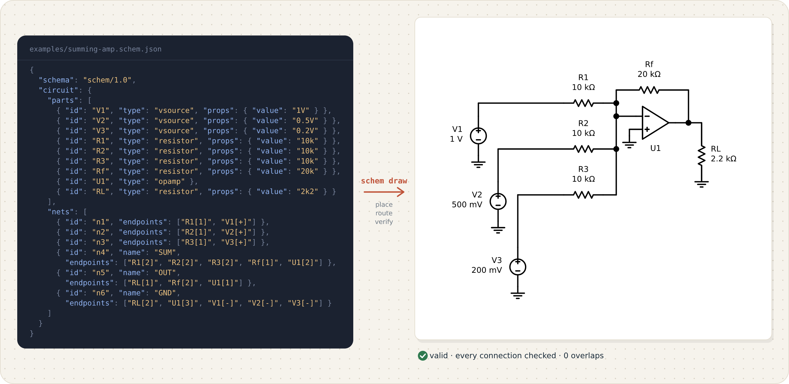
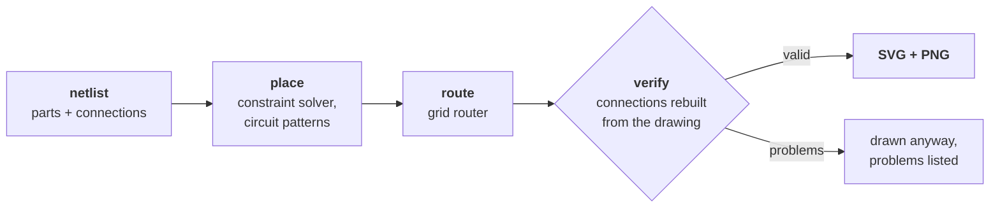

<div align="center">

# schem

**Describe the circuit. Get the schematic.**

A netlist goes in. A clean schematic comes out: laid out automatically, and checked against the netlist before you see it.<br>
Built for AI agents, pleasant for people.

[](https://github.com/2Ntlaks/schem/actions/workflows/ci.yml)
[](LICENSE)
[](https://nodejs.org/)
[](#where-it-stands)

<br>



<sub>Nothing above is mocked up: the file is <a href="examples/summing-amp.schem.json"><code>examples/summing-amp.schem.json</code></a>, and the drawing and its status line are made by the engine (<code>npm run readme:art</code>).</sub>

</div>

<br>

## Why

> AI agents are good at saying what a circuit is. They are bad at drawing it.

An agent can tell you that an ESP32 drives a relay through a transistor with a flyback diode. Ask it to *draw* that, and it has to pick every coordinate itself, and when the picture comes out wrong it has nothing to go on but the picture. schem takes the drawing off its hands:

- **You write a netlist.** Parts and the pins they connect. No coordinates, no wires, no layout.
- **schem draws it the way an engineer would.** Power at the top, ground at the bottom, signals flowing left to right, familiar circuits in their textbook arrangement.
- **Then it checks its own work.** The connections are rebuilt from the finished drawing and compared with your netlist, and parts and labels are checked for overlaps. If the picture does not say exactly what the netlist says, you are told.
- **Edits stay put.** Change a value or add a part with `schem edit`, and the rest of the drawing stays where it was (untouched parts may shift a little, within a measured limit; 133 of 137 random test edits stay inside it, and `--strict` refuses the rest). A figure in your report does not reshuffle itself between versions.

## Quick start

You need [Node.js](https://nodejs.org/) 22 or newer.

```sh
git clone https://github.com/2Ntlaks/schem.git
cd schem
npm install
npm run schem -- draw examples/esp32-relay.schem.json
```

```
esp32-relay: valid. Wrote out/esp32-relay.svg and out/esp32-relay.png (190 ms)
```

Five circuits to try are in [`examples/`](examples/). Add `-o <folder>` to write somewhere else. The exit code is `0` for a valid drawing, `1` when the drawing has problems (the files are still written and the problems listed), and `2` when the file could not be drawn, with a message saying what is wrong and where.

To change a circuit without reshuffling its drawing, list the changes in a small JSON file and run `npm run schem -- edit <file> --ops <changes.json>`. [`docs/editing.md`](docs/editing.md) shows how.

## How it works



Placement solves a set of layout rules (signal flow, rails, alignment, spacing) and recognises common circuits, such as an op-amp stage or an I2C bus with pull-ups, to give them their usual shape. Wires are routed on a grid with costs for bends and crossings. The verifier works only from the finished drawing, so a layout bug cannot hide a wrong connection. Output is deterministic: the same file gives the same SVG, byte for byte, on Windows and Linux, which CI checks on every push.

The full design is in [`SPEC.md`](SPEC.md).

## Gallery

Drawn by schem from the files in [`examples/`](examples/), with no hand adjustment.

<table>
  <tr>
    <td width="50%" valign="top">
      
      <br><sub><b>ESP32 relay driver</b>: a dev board, transistor switch, relay and flyback diode. <a href="examples/esp32-relay.schem.json">file</a></sub>
    </td>
    <td width="50%" valign="top">
      
      <br><sub><b>Two I2C sensors</b>: a shared bus with its pull-ups. <a href="examples/i2c-sensors.schem.json">file</a></sub>
    </td>
  </tr>
  <tr>
    <td colspan="2">
      
      <br><sub><b>H-bridge motor driver</b>: four MOSFETs around the motor, gate networks, drive header. <a href="examples/h-bridge.schem.json">file</a></sub>
    </td>
  </tr>
</table>

## How it compares

The same seven circuits, drawn by schem and four open-source tools. tscircuit, SKiDL and netlistsvg lay out automatically, like schem; schemdraw drawings are written by hand in code.


<details>
<summary><b>How the comparison was made fair</b></summary>
<br>

- Every tool drew from the same netlist, and every drawing's connections were checked against it. A drawing that failed the check could not be chosen.
- Each tool had one first attempt plus at most three revisions per circuit, using only that tool's own options. Every attempt, what changed and why, is logged in [`baselines/LOG.md`](baselines/LOG.md), along with the known defects in the chosen drawings.
- schem's drawings are used exactly as the engine makes them, rendered with the same settings as the others.
- SKiDL's case 7 is a tool failure: its fallback placement stacked eight parts behind one chip. So is tscircuit's case 4: one transistor's symbol is not drawn, and tscircuit prints an error in its place.
- tscircuit has no drawing for cases 5 and 7: none of its attempts passed the connection check (in case 7, a ground wire runs through a 5 V pin). Two things count as connected when they are closer than the width of a drawn wire, because that is how they look.
- Case 8, a differential pair, was left out of an earlier version of this comparison because schem drew it poorly. It now has a template and is back in; the old attempts stay in the log.
- This is our comparison, not a blind one. A blind rating by outside judges is planned.

Open [`docs/showcase/index.html`](docs/showcase/index.html) locally for the full-size page, or rebuild it with `npm run showcase`.

</details>

## Write your own

A circuit file lists parts, and nets that name the pins they connect:

```json
{
  "schema": "schem/1.0",
  "circuit": {
    "parts": [
      { "id": "B1", "type": "battery", "props": { "value": "9V" } },
      { "id": "R1", "type": "resistor", "props": { "value": "470" } },
      { "id": "D1", "type": "led", "props": { "color": "red" } }
    ],
    "nets": [
      { "id": "n1", "name": "PWR", "endpoints": ["B1[+]", "R1[1]"] },
      { "id": "n2", "endpoints": ["R1[2]", "D1[A]"] },
      { "id": "n3", "name": "GND", "endpoints": ["D1[K]", "B1[-]"] }
    ]
  }
}
```

[`docs/netlist-format.md`](docs/netlist-format.md) explains every field, and [`docs/parts.md`](docs/parts.md) lists every part type with its pin names. Nets named like `GND` or `5V` are drawn as ground and power symbols.

## Where it stands

schem is an early prototype. It is useful today for small and medium circuits, and honest about the rest.

<table>
  <tr>
    <th width="50%" align="left">Works today</th>
    <th width="50%" align="left">Not there yet</th>
  </tr>
  <tr>
    <td valign="top">

- 24 symbols: passives, diodes, LEDs, BJTs, MOSFETs, op-amps, relays, switches, sources and more
- Chips as labelled boxes, connectors, and 4 boards with their real pinouts (Arduino Uno, ESP32-DevKitC, a Pololu regulator, an I2C LCD)
- All 8 development circuits draw valid; a generated 30-part circuit draws in under 3 seconds
- Edits from the command line that keep the drawing and report anything that moved
- Byte-identical output on Windows and Linux
- Clear errors for broken input

</td>
    <td valign="top">

- Dense boards with several chips spread out too far
- Circuits with no template yet, such as Sallen-Key filters and oscillators, are drawn by the general rules and can come out messy
- The symbol and board library is small
- Not on npm, so no `npx schem` yet
- No blind rating by outside judges yet

</td>
  </tr>
</table>

## Contributing

There is a lot to do, and much of it needs no knowledge of the layout engine.

- **Send a circuit that draws badly.** Open an issue with the file and the PNG. Real circuits that break the layout are the most useful thing this project can get.
- **Draw a symbol.** The library is small; [`CONTRIBUTING.md`](CONTRIBUTING.md#adding-a-symbol) walks through adding one, and the tests check it in all eight orientations.
- **Add your board.** A dev board or breakout is one JSON file listing its real pins, no code needed. See [adding a board](CONTRIBUTING.md#adding-a-board).
- **Add an example**, or fix anything in the docs that confused you.

Coding agents are welcome too: [`AGENTS.md`](AGENTS.md) holds their rules. Start with [`CONTRIBUTING.md`](CONTRIBUTING.md).

## License

[MIT](LICENSE). The symbols are drawn for this project, not copied from other libraries.
