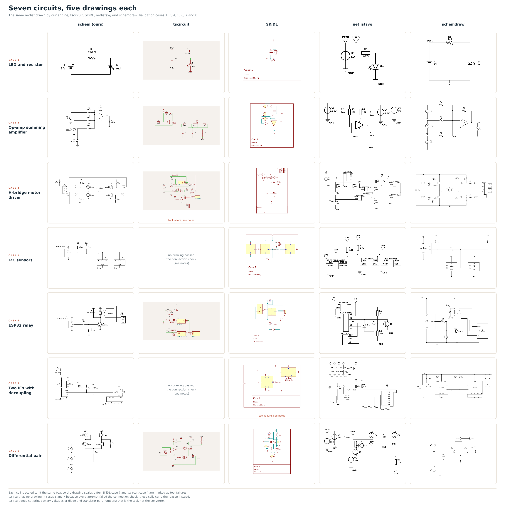

# schem

Turn a circuit description into a clean schematic drawing, with no dragging and dropping.

You (or an AI agent) write which parts exist and which pins connect, as JSON. schem places the parts, routes the wires, checks that the drawing shows exactly those connections, and writes SVG and PNG.



*The same six circuits, drawn by schem and by three open-source tools. schem, SKiDL and netlistsvg lay the drawing out automatically; schemdraw drawings are written by hand in code. Each baseline got a fixed budget of attempts, all logged in [`baselines/LOG.md`](baselines/LOG.md) with their known defects. SKiDL's case 7 is a tool failure: its fallback stacked eight parts behind one chip. Open [`docs/showcase/index.html`](docs/showcase/index.html) locally for the full-size page.*

## Why

AI agents are good at saying what a circuit is ("an ESP32 drives a relay through a transistor") and bad at drawing it. Code-based drawing tools make the agent pick every coordinate and direction, and when the picture is wrong, the agent has nothing to go on but the picture.

schem splits the job:

- **The agent writes a netlist**: parts and connections, no coordinates.
- **The engine draws it**: placement by a constraint solver with patterns for common circuits, wires by a grid router, conventional layout (power at the top, ground at the bottom, signals left to right).
- **A verifier checks the result**: it rebuilds the connections from the finished drawing and compares them with the netlist, and it checks for overlapping parts and labels. A drawing that does not show exactly the netlist is reported as not valid.
- **Edits keep the drawing stable**: after changing one value or adding one part, the rest of the drawing stays in place (untouched parts may shift a little, within a measured limit), so a figure in a document does not jump around between versions.

The visual target is the clean style of [circuit-diagram.org](https://www.circuit-diagram.org/): thin strokes, standard symbols, aligned parts, tidy labels.

## Try it

You need [Node.js](https://nodejs.org/) 22 or newer.

```
git clone https://github.com/2Ntlaks/schem.git
cd schem
npm install
npm run schem -- draw examples/led.schem.json
```

This writes `out/led.svg` and `out/led.png` and prints:

```
led: valid. Wrote out/led.svg and out/led.png (120 ms)
```

There are five examples in [`examples/`](examples/), from an LED up to an ESP32 driving a relay. `-o <folder>` writes somewhere else. The command exits with `0` for a valid drawing, `1` for a drawing with problems (it still writes the files, and lists the problems), and `2` when the file could not be drawn.

## Write your own circuit

A circuit file lists parts and nets. A net names the pins it connects:

```json
{
  "schema": "schem/1.0",
  "circuit": {
    "parts": [
      { "id": "B1", "type": "battery", "props": { "value": "9V" } },
      { "id": "R1", "type": "resistor", "props": { "value": "470" } },
      { "id": "D1", "type": "led", "props": { "color": "red" } }
    ],
    "nets": [
      { "id": "n1", "name": "PWR", "endpoints": ["B1[+]", "R1[1]"] },
      { "id": "n2", "endpoints": ["R1[2]", "D1[A]"] },
      { "id": "n3", "name": "GND", "endpoints": ["D1[K]", "B1[-]"] }
    ]
  }
}
```

- [`docs/netlist-format.md`](docs/netlist-format.md) explains every field.
- [`docs/parts.md`](docs/parts.md) lists the part types and their pin names.

If the file has a mistake (a missing comma, an unknown part type, a pin that does not exist), the command says what and where.

## Status: early prototype

This is a working prototype, not a finished tool. What works today:

- 22 built-in symbols (resistors, capacitors, diodes, LEDs, transistors, op-amps, relays, sources and more), chips drawn as labelled boxes, connectors, and 4 board modules (Arduino Uno, ESP32-DevKitC, a Pololu regulator, an I2C LCD) with their real pin names.
- All 8 development circuits draw valid. A generated 30-part circuit draws in under 3 seconds.
- Deterministic output: the same file always gives the same SVG, byte for byte, on Windows and Linux.

What is not there yet:

- **Dense and symmetric circuits draw poorly.** Boards with several chips spread out too much, and circuits that want mirror symmetry (a differential pair) come out messy, which is why case 8 is missing from the comparison above.
- **The library is small.** Many common parts and boards are missing.
- **Edits are an engine feature only.** The edit operations and the stability checks exist in the code (`src/edit/`), but the command line only draws whole files for now.
- **Not on npm yet**, so `npx schem` does not work; use the clone above.
- **Not yet judged blind.** The comparison above is our own, made with a logged and fixed budget. A blind rating by outside judges is planned.

The design, including what is planned, is in [`SPEC.md`](SPEC.md).

## Contributing

Help is welcome, and much of it needs no knowledge of the layout engine: new symbols, example circuits, and bug reports with a circuit file that draws badly. See [`CONTRIBUTING.md`](CONTRIBUTING.md).

## License

[MIT](LICENSE).
