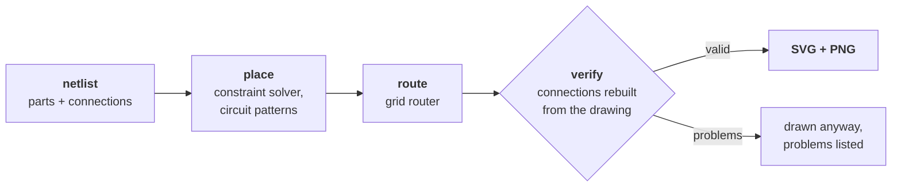
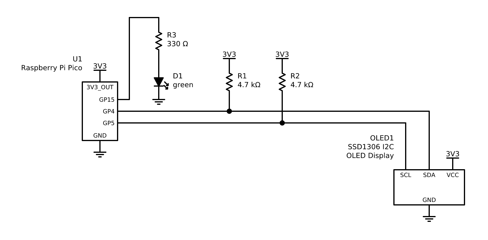
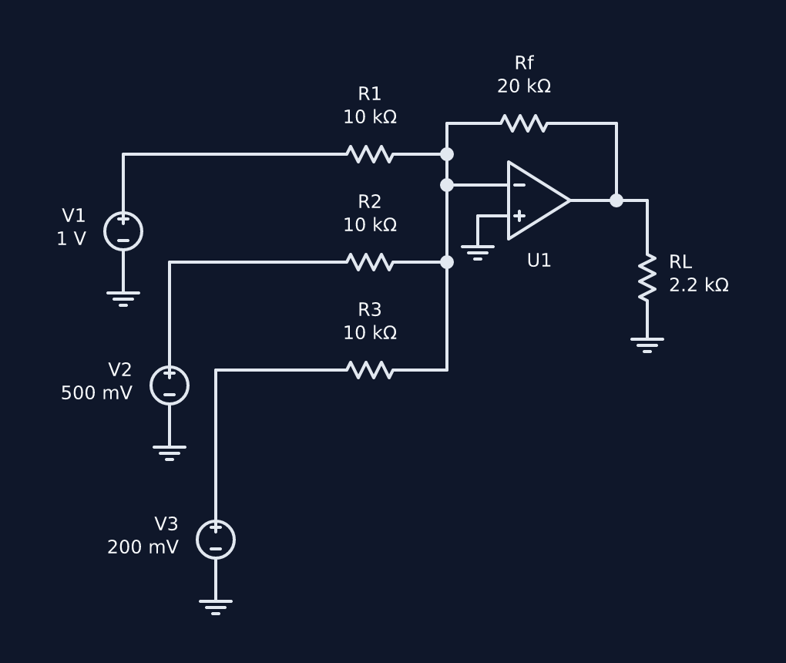
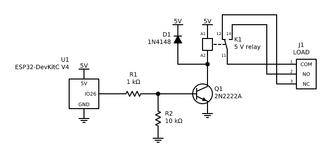
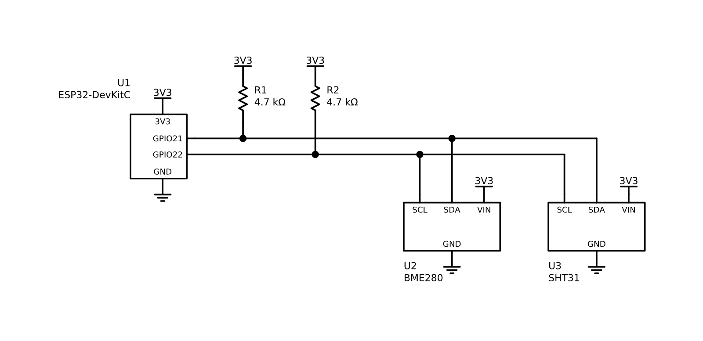
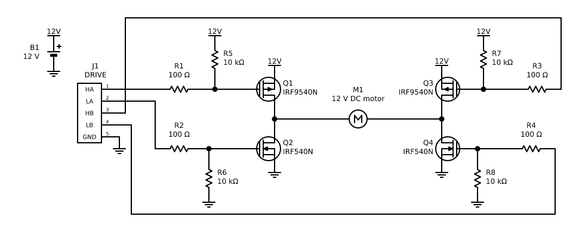
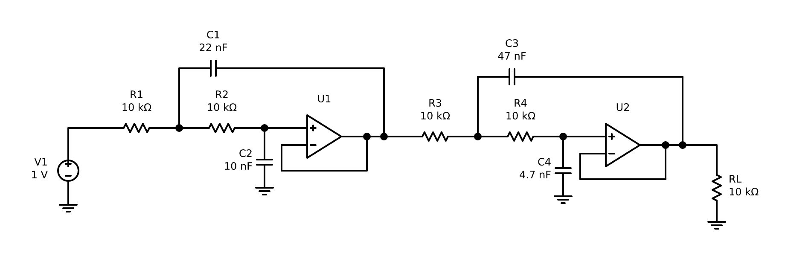
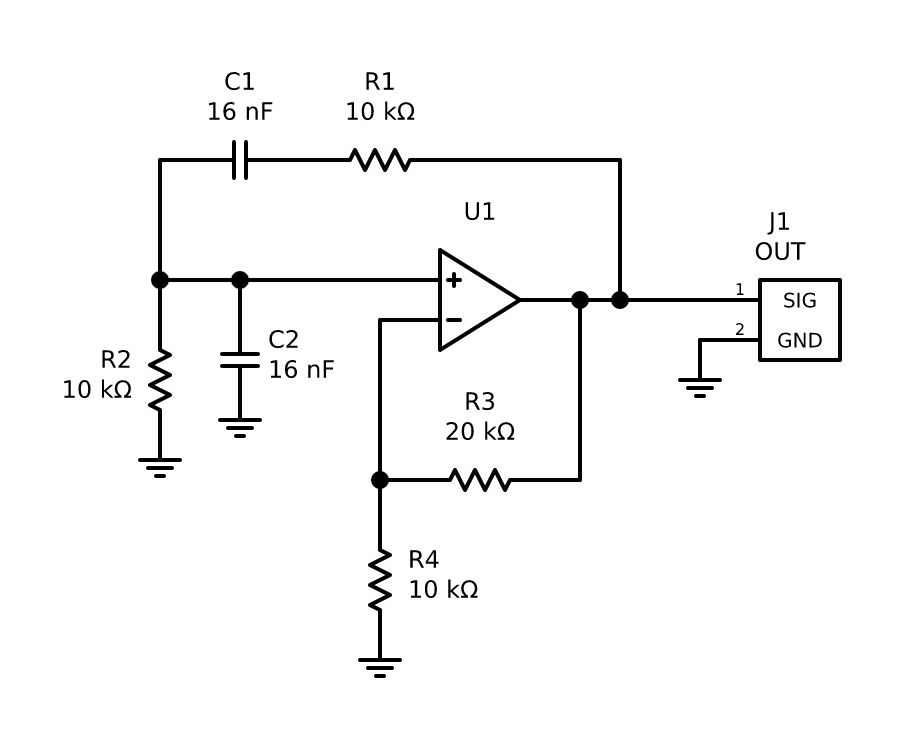
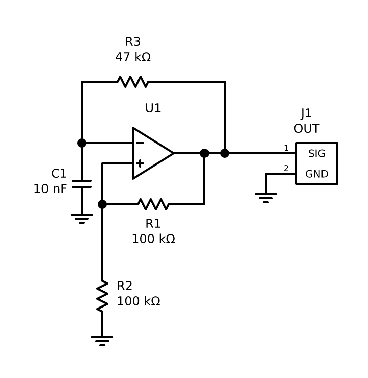

<div align="center">

# schem

**Describe the circuit. Get the schematic.**

A netlist goes in. A clean schematic comes out: laid out automatically, and checked against the netlist before you see it.<br>
Built for AI agents, pleasant for people.

[](https://github.com/2Ntlaks/schem/actions/workflows/ci.yml)
[](LICENSE)
[](https://nodejs.org/)
[](#where-it-stands)

<br>


<sub>Nothing above is mocked up: the file is <a href="examples/summing-amp.schem.json"><code>examples/summing-amp.schem.json</code></a>, and the drawing and its status line are made by the engine (<code>npm run readme:art</code>).</sub>

</div>

<br>

## Why

> AI agents are good at saying what a circuit is. They are bad at drawing it.

An agent can tell you that an ESP32 drives a relay through a transistor with a flyback diode. Ask it to *draw* that, and it has to pick every coordinate itself, and when the picture comes out wrong it has nothing to go on but the picture. schem takes the drawing off its hands:

- **You write a netlist.** Parts and the pins they connect, in the concise `.schem` text format or JSON. No coordinates, no wires, no layout.
- **schem draws it the way an engineer would.** Power at the top, ground at the bottom, signals flowing left to right, familiar circuits in their textbook arrangement.
- **Then it checks its own work.** The connections are rebuilt from the finished drawing and compared with your netlist, and parts and labels are checked for overlaps. If the picture does not say exactly what the netlist says, you are told.
- **Edits stay put.** Change a value or add a part with `schem edit`, and the rest of the drawing stays where it was (untouched parts may shift a little, within a measured limit; 134 of 137 random test edits stay inside it, and `--strict` refuses the rest). A figure in your report does not reshuffle itself between versions.

## Quick start

You need [Node.js](https://nodejs.org/) 22 or newer.

```sh
git clone https://github.com/2Ntlaks/schem.git
cd schem
npm install
```

Start from a `.schem` text schematic (templates: `led`, `divider`, `opamp`, `regulator`, `i2c`, `bjt-amp`), draw it, or watch it redraw as you edit:

```sh
npm run schem -- init circuit.schem --template led
npm run schem -- draw circuit.schem
npm run schem -- watch circuit.schem
```

Or try the shipped `.schem` and JSON examples, import a SPICE netlist, or print verified alt-text for a blog post or paper:

```sh
npm run schem -- draw examples/pico-i2c-oled.schem
npm run schem -- draw examples/esp32-relay.schem.json
npm run schem -- draw examples/summing-amp.schem.json --theme dark
npm run schem -- import circuit.cir -o circuit.schem
npm run schem -- describe examples/pico-i2c-oled.schem --alt-text
```

```text
esp32-relay: valid. Wrote out/esp32-relay.svg and out/esp32-relay.png (190 ms)
```

Twelve circuits to try are in [`examples/`](examples/) (8 JSON and 4 `.schem` text files). Add `-o <folder>` to write somewhere else. Render in any of five built-in themes (`clean`, `dark`, `blueprint`, `textbook`, `mono-print`) or with `--transparent` backgrounds ([themes guide](docs/themes.md)). Convert existing SPICE `.cir` files with `import` ([SPICE import guide](docs/spice-import.md)), or update a circuit without reshuffling its drawing with `edit <file> --ops <changes.json>` ([editing guide](docs/editing.md)).

Exit codes: `0` valid, `1` invalid or input error, `2` usage error (and unreadable legacy JSON input), `3` internal error, `4` revision or layout conflict.

## Install

schem is **not on npm yet**; it will be published as `schem-cli`. To get a `schem` command on your PATH today, build it from a clone and link it:

```sh
npm ci
npm run build
npm install -g .
schem draw examples/led.schem
```

The same binary runs the 12-tool MCP (Model Context Protocol) server for AI agents: `schem mcp --root <folder>`, and the repo ships a short agent skill in [`skills/schem/SKILL.md`](skills/schem/SKILL.md). [`docs/install.md`](docs/install.md) has the setup for Claude Code, Claude Desktop, Cursor, VS Code and Codex CLI, plus the one-line `npx` form for once the package is published.

## CLI and MCP command summary

Run commands as `schem <command>` after global install, or `npm run schem -- <command>` from a clone (and `npm run mcp -- --root <folder>` for the MCP server from source). Every file command accepts both `.schem` text DSL and `.schem.json`, plus `--json` for machine-readable output. See [`docs/dsl.md`](docs/dsl.md) for the full CLI reference and [`docs/install.md`](docs/install.md) for MCP setup.

| Command | What it does |
|---|---|
| `init [name] [--template <name>]` | Create a starter `.schem` or `.json` file (`led`, `divider`, `opamp`, `regulator`, `i2c`, `bjt-amp`). |
| `draw <file> [-o <dir>] [--theme <name>] [--transparent]` | Lay out, check, and write `<name>.svg` and `<name>.png` (defaults to `out/`). |
| `watch <file> [-o <dir>] [--theme <name>] [--transparent]` | Draw once, then redraw SVG and PNG automatically whenever `<file>` changes. |
| `render <file> -o <out.svg\|png> [--scale N \| --dpi N]` | Export one verified SVG or PNG; supports `--theme`, `--transparent`, `--draft`, and `--overwrite`. |
| `check <file> [--detail brief\|normal\|full] [--cursor N]` | Report drawing status, revision and layout tokens, metrics, and paged findings with checked fixes. |
| `preview <file> -o <out.png> [--max N] [--focus \| --finding]` | Export a size-capped PNG overview or a cropped view around specific parts or a finding. |
| `edit <file> --ops <ops.json> [--strict] [--dry-run]` | Apply edit operations transactionally, keep untouched parts in place, and save a snapshot in `.schem-history/`. |
| `undo <file>` | Restore the previous saved snapshot from `.schem-history/`. |
| `query <file> part\|net <id>` | Read exact grid coordinates, pin positions, and connections for a part or net. |
| `describe <file> [--table] [--alt-text]` | Print a plain-text sheet summary, verified alt-text, and optional net table. |
| `components [query] [--limit 20]` | Search the 31 built-in symbols and 10 board modules. |
| `component <type>` | Inspect pin numbers, names, aliases, roles, groups, bus interfaces, and docs for one part type. |
| `fmt <file> [--to dsl\|json]` | Format a file in place or convert between `.schem` text DSL and `.schem.json`. |
| `import <file.cir> [-o <out.schem>] [--overwrite]` | Convert a SPICE netlist into a laid-out `.schem` or `.schem.json` file. |
| `mcp [--root <folder>]...` | Run the 12-tool MCP server over stdin and stdout, restricted to the given root folders. |

**MCP tools (12):** `schem_create`, `schem_edit`, `schem_check`, `schem_preview`, `schem_query`, `schem_render`, `schem_undo`, `schem_describe`, `schem_fmt`, `schem_components`, `schem_component`, and `schem_import`. Details and client configs live in [`docs/install.md`](docs/install.md).

## How it works



Placement solves a set of layout rules (signal flow, rails, alignment, spacing) and recognises common circuits, such as an op-amp filter, an H-bridge or an I2C bus with pull-ups, to give them their usual shape ([the full list](docs/templates.md)). Wires are routed on a grid with costs for bends and crossings. The verifier works only from the finished drawing, so a layout bug cannot hide a wrong connection. Output is deterministic: the same file gives the same SVG, byte for byte, on Windows and Linux, which CI checks on every push.

The full design is in [`SPEC.md`](SPEC.md).

## Gallery

Drawn by schem from the files in [`examples/`](examples/), with no hand adjustment (`npm run readme:gallery` rebuilds the `gallery-*.png` images).

<table>
  <tr>
    <td width="50%" valign="top">
      
      <br><sub><b>Raspberry Pi Pico + SSD1306 OLED</b>: written in 16 lines of <code>.schem</code> text DSL using real board modules. <a href="examples/pico-i2c-oled.schem">file</a></sub>
    </td>
    <td width="50%" valign="top">
      
      <br><sub><b>Summing amplifier (dark theme)</b>: rendered with <code>--theme dark</code> for dark docs and slides. <a href="examples/summing-amp.schem.json">file</a></sub>
    </td>
  </tr>
  <tr>
    <td width="50%" valign="top">
      
      <br><sub><b>ESP32 relay driver</b>: a dev board, transistor switch, relay and flyback diode. <a href="examples/esp32-relay.schem.json">file</a></sub>
    </td>
    <td width="50%" valign="top">
      
      <br><sub><b>Two I2C sensors</b>: a shared bus with its pull-ups. <a href="examples/i2c-sensors.schem.json">file</a></sub>
    </td>
  </tr>
  <tr>
    <td colspan="2">
      
      <br><sub><b>H-bridge motor driver</b>: four MOSFETs around the motor, gate networks, drive header. <a href="examples/h-bridge.schem.json">file</a></sub>
    </td>
  </tr>
  <tr>
    <td colspan="2">
      
      <br><sub><b>Fourth-order low-pass filter</b>: two Sallen-Key stages, each found and drawn in its textbook shape. <a href="examples/sallen-key-filter.schem.json">file</a></sub>
    </td>
  </tr>
  <tr>
    <td width="50%" valign="top">
      
      <br><sub><b>Wien bridge oscillator</b>: the frequency network above and left, the gain resistors below. <a href="examples/wien-bridge.schem.json">file</a></sub>
    </td>
    <td width="50%" valign="top">
      
      <br><sub><b>Relaxation oscillator</b>: timing resistor and capacitor on top, the threshold divider below. <a href="examples/relaxation-oscillator.schem.json">file</a></sub>
    </td>
  </tr>
</table>

## How it compares

The same seven circuits, drawn by schem and four open-source tools. tscircuit, SKiDL and netlistsvg lay out automatically, like schem; schemdraw drawings are written by hand in code.


<details>
<summary><b>How the comparison was made fair</b></summary>
<br>

- Every tool drew from the same netlist, and every drawing's connections were checked against it. A drawing that failed the check could not be chosen.
- Each tool had one first attempt plus at most three revisions per circuit, using only that tool's own options. Every attempt, what changed and why, is logged in [`baselines/LOG.md`](baselines/LOG.md), along with the known defects in the chosen drawings.
- schem's drawings are used exactly as the engine makes them, rendered with the same settings as the others.
- SKiDL's case 7 is a tool failure: its fallback placement stacked eight parts behind one chip. So is tscircuit's case 4: one transistor's symbol is not drawn, and tscircuit prints an error in its place.
- tscircuit has no drawing for cases 5 and 7: none of its attempts passed the connection check (in case 7, a ground wire runs through a 5 V pin). Two things count as connected when they are closer than the width of a drawn wire, because that is how they look.
- Case 8, a differential pair, was left out of an earlier version of this comparison because schem drew it poorly. It now has a template and is back in; the old attempts stay in the log.
- This is our comparison, not a blind one. A blind rating by outside judges is planned.

Open [`docs/showcase/index.html`](docs/showcase/index.html) locally for the full-size page, or rebuild it with `npm run showcase`.

</details>

## Write your own

The shortest way to write a circuit is the `.schem` text format ([`examples/led.schem`](examples/led.schem)):

```text
circuit "LED with a current-limiting resistor"
style theme=clean

part B1 battery 9V
part R1 resistor 470
part D1 led color=red

net PWR = B1.+ R1.1
connect R1.2 D1.anode
net GND = D1.cathode B1.-
```

<details>
<summary><b>Equivalent JSON netlist (<code>examples/led.schem.json</code>)</b></summary>
<br>

```json
{
  "schema": "schem/1.0",
  "meta": {
    "title": "LED with a current-limiting resistor"
  },
  "circuit": {
    "parts": [
      { "id": "B1", "type": "battery", "props": { "value": "9V" } },
      { "id": "R1", "type": "resistor", "props": { "value": "470" } },
      { "id": "D1", "type": "led", "props": { "color": "red" } }
    ],
    "nets": [
      { "id": "n1", "name": "PWR", "endpoints": ["B1[+]", "R1[1]"] },
      { "id": "n2", "endpoints": ["D1[A]", "R1[2]"] },
      { "id": "n3", "name": "GND", "endpoints": ["B1[-]", "D1[K]"] }
    ]
  }
}
```

</details>

[`docs/dsl.md`](docs/dsl.md) explains the `.schem` text format, [`docs/netlist-format.md`](docs/netlist-format.md) documents every JSON field, and [`docs/parts.md`](docs/parts.md) lists all 31 built-in symbols and 10 board modules with their pin names. Nets named like `GND` or `5V` are drawn as ground and power symbols.

## Where it stands

schem is an early prototype. It is useful today for small and medium circuits, and honest about the rest.

<table>
  <tr>
    <th width="50%" align="left">Works today</th>
    <th width="50%" align="left">Not there yet</th>
  </tr>
  <tr>
    <td valign="top">

- 31 built-in symbols: passives, diodes (Zener, Schottky, photodiode, LED), BJTs, MOSFETs, op-amps, relays, SPST/SPDT/pushbutton switches, sources (voltage, current, battery, AC) and more
- Chips as labelled boxes, connectors, and 10 boards with their real pinouts (Arduino Uno and Nano, Raspberry Pi Pico, ESP32-DevKitC, ESP32-S3-DevKitC-1, Pololu 5V regulator, LM7805, Adafruit BME280, SSD1306 OLED, Waveshare I2C LCD)
- `.schem` text DSL and JSON netlists, SPICE `.cir` import (`schem import`), 5 rendering themes (`clean`, `dark`, `blueprint`, `textbook`, `mono-print`) plus transparent export ([themes](docs/themes.md), [SPICE import](docs/spice-import.md))
- Common circuits drawn in their textbook shape: op-amp amplifiers, Sallen-Key and other active filters, two oscillators, H-bridges, I2C buses and more ([the list](docs/templates.md))
- Circuits with no template are laid out from what their parts are: inputs on the left, loads above a transistor and emitter parts below it, a supply-to-ground string in one column. All 18 everyday circuits in the benchmark draw valid with total score 886.9 ([how it works](docs/general-layout.md))
- All 8 development circuits draw valid; a generated 30-part circuit completes layout and checked fixes in about 1.1 s (under the 3 s limit)
- 12-tool MCP server, shipped agent skill (`skills/schem/SKILL.md`), accessible `altText` and net tables, and CLI templates and file watching (`schem init --template`, `schem watch`)
- Edits from the command line that keep the drawing and report anything that moved (134 of 137 random test edits stay within the limit)
- Byte-identical output on Windows and Linux
- Clear errors for broken input

</td>
    <td valign="top">

- Dense boards with several chips spread out too far
- One benchmark circuit (`differentiator`) still has a squeezed wire run, and the `rc-rl-filter` template is held back ([open jobs](docs/general-layout.md#open-jobs))
- Not on npm yet (it will be published as `schem-cli`)
- No blind rating by outside judges yet

</td>
  </tr>
</table>

## Repository layout

| Folder | What lives there |
|---|---|
| [`src/`](src/) | TypeScript source: core model and `.schem` DSL compiler, layout engine, grid router, verifier, SVG/PNG renderer, 31 symbols, 10 board modules, CLI, and 12-tool MCP server. |
| [`docs/`](docs/) | User guides, installation instructions, part reference, themes, templates, general-layout benchmark docs, README assets, and showcase comparison. |
| [`examples/`](examples/) | Twelve ready-to-draw example circuits (8 JSON netlists and 4 `.schem` text schematics). |
| [`skills/schem/`](skills/schem/) | Shipped AI agent skill (`SKILL.md`) describing the MCP and CLI workflow. |
| [`bench/`](bench/) | Eighteen everyday benchmark circuits and `baseline.json` used by `npm run bench` to track general-layout quality. |
| [`cases/`](cases/) | Three starter development circuits used during early engine prototyping. |
| [`scripts/`](scripts/) | Build, benchmark, gallery, showcase, doc generation, and verification helper scripts. |
| [`tests/`](tests/) | Automated Vitest suite covering symbols, modules, DSL, SPICE import, layout, routing, verifier, CLI, MCP, themes, and snapshots. |
| [`phase0/`](phase0/) | Frozen evaluation cases protected by a SHA-256 manifest (includes the 8 validation cases run by `npm run phase0`). |
| [`baselines/`](baselines/) | Comparison outputs and attempt log (`baselines/LOG.md`) against tscircuit, SKiDL, netlistsvg, and schemdraw. |
| [`archive/`](archive/) | Earlier spec revisions, reviews, and the original plan page kept for project history. |

## Contributing

There is a lot to do, and much of it needs no knowledge of the layout engine.

- **Send a circuit that draws badly.** Open an issue with the [bad drawing form](.github/ISSUE_TEMPLATE/bad-drawing.md), including the file and the PNG. Real circuits that break the layout are the most useful thing this project can get.
- **Draw a symbol.** The library is small; [`CONTRIBUTING.md`](CONTRIBUTING.md#adding-a-symbol) walks through adding one, and the tests check it in all eight orientations.
- **Add your board.** A dev board or breakout is one JSON file listing its real pins, no code needed. See [adding a board](CONTRIBUTING.md#adding-a-board) or use the [new symbol or board form](.github/ISSUE_TEMPLATE/new-symbol-or-board.md).
- **Add an example** (`.schem` or `.schem.json`), or fix anything in the docs that confused you.
- **Improve the layout.** [`docs/general-layout.md`](docs/general-layout.md) lists the open jobs, each tied to a benchmark circuit, and `npm run bench` scores your change.

Coding agents are welcome too: [`AGENTS.md`](AGENTS.md) holds their rules. Start with [`CONTRIBUTING.md`](CONTRIBUTING.md).

## License

[MIT](LICENSE). The symbols are drawn for this project, not copied from other libraries.
