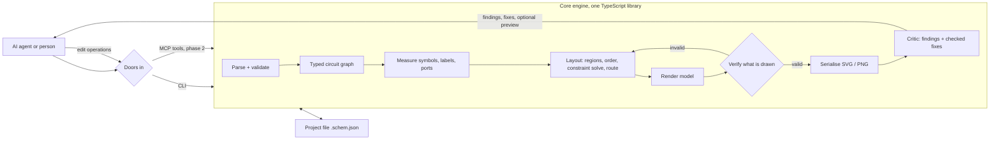
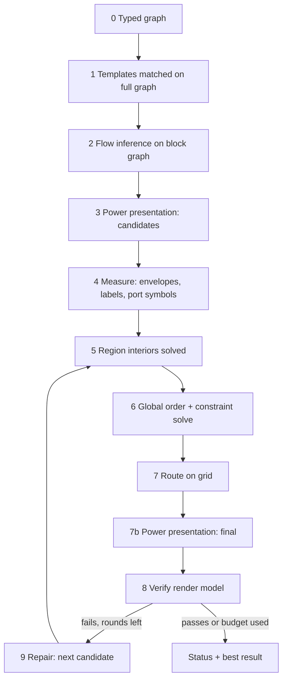

# Agent-first schematic engine: specification

| | |
|---|---|
| Status | **rev C.2**: Phase 0a built; its deviations and the open "fix before 0b" items folded in |
| Date | 2026-10-23 |
| Working name | `schem` (placeholder for the CLI and package names, final name to be decided) |
| Author | Project owner, drafted with Claude Code |
| Reviews | rev A: `archive/SPEC-REVIEW-revA.md`, rev B: `archive/SPEC-REVIEW-revB.md`, rev C: `archive/SPEC-REVIEW-revC.md` |
| Previous | `archive/SPEC-revA.md`, `archive/SPEC-revB.md`, `archive/SPEC-revC1.md` |

Section 18 maps every rev B finding (N01-N22, F31 and the over-corrections) to what changed, then lists the rev C.1 amendments and the rev C.2 changes. The rev A finding map is in `archive/SPEC-revB.md` section 18. Section numbers are kept from earlier revisions.

---

## 1. Summary

A tool that turns a description of a circuit (which parts exist and which pins connect) into a clean, publication-quality schematic drawing, with no human dragging and dropping. It is built first for AI coding agents (Claude Code, Codex, Cursor and similar), and second for people.

The agent never deals with coordinates. It writes a **netlist** (parts and connections), the engine **places parts, routes wires and renders** the drawing, an independent **verifier** proves the drawing shows exactly the connections of the netlist, and a **critic** returns findings with checked fixes so the agent can improve the drawing in small steps. A web editor (later phase) lets a person adjust the result by hand.

The visual target is the quality of [circuit-diagram.org](https://www.circuit-diagram.org/): thin even strokes, clean symbols, aligned parts, tidy labels, generous spacing.

## 2. Problem

- **Interactive editors** (circuit-diagram.org, Fritzing, KiCad, EasyEDA) produce good drawings but need a person to place every part and wire. That is slow when the hardware is already built and the person only needs a figure for a blog post, report or thesis.
- **Code-based drawing tools** (schemdraw in Python, CircuiTikZ in LaTeX) can be driven by an agent, but the agent has to choose every direction and position itself. It can render and look, but every fix means re-planning coordinates, with no structured feedback on what is wrong.
- **Automatic schematic generators exist.** SKiDL can generate SVG and KiCad schematics with automatic placement and routing; netlistsvg uses the ELK graph layout library and has an analog skin. **We have not yet measured how good their drawings are** on the circuits we care about. Phase 0 runs the same circuits through them as baselines.

The claim of this project is a hypothesis to test, not an assumption:

> For hobby and common analog circuits, an engine with drafting conventions, a connectivity verifier and an agent edit loop produces drawings people rate as publishable more often, with fewer edit rounds, than the existing automatic tools.

If Phase 0 shows a baseline already meets that bar, the right move is to build on it instead.

## 3. Goals, non-goals and decisions

### Goals

1. An agent can produce a publishable schematic of a small-to-medium circuit (up to about 30 parts in v1) from a netlist alone.
2. **The drawing is electrically exact.** Every drawing is checked by rebuilding its connections from what is drawn and comparing them with the netlist. A drawing that fails is never reported as valid.
3. The output looks hand-drafted by a careful engineer: conventional orientation, aligned parts, minimal crossings, no overlaps.
4. The agent can see the result and read it as structured findings, and fix it with small edit operations whose effect is predictable.
5. Results are **deterministic** (section 9.6).
6. Small edits cause small visual changes (section 9.5).
7. One project file holds the circuit, all intent and every symbol definition it uses; it is plain JSON, diff-friendly and safe to commit.
8. Outputs drop straight into blogs, Word documents, LaTeX and slides.

### Non-goals (for now)

- PCB layout, footprints, manufacturing bills of materials.
- Circuit simulation.
- Full electrical rule checking (only section 9.3).
- Multi-sheet or hierarchical schematics, buses, multi-unit parts, pin swapping, net classes. v1 rejects them with a feature error code (section 6.8). Their file shapes are designed when they are built.
- Non-orthogonal drawing (45-degree parts and wires).
- Very large designs. Above about 100 parts we warn and do our best.
- Copying circuit-diagram.org's code or symbols (section 14).

### Owner decisions

| ID | Question | Decision |
|---|---|---|
| D1 | Logical or physical drawing? | **Logical schematic that keeps real pin identity.** Board and chip pins keep their real numbers and names, so the drawing matches hardware that is already wired. Not a wiring or breadboard diagram. |
| D2 | Which hard circuits must v1 draw well automatically? | **Hobby + common analog:** H-bridge, op-amp feedback circuits (inverting, non-inverting, summing), I2C buses with pull-ups, ICs with decoupling capacitors, bridge rectifier, transistor and MOSFET switches, plus the simple patterns. Differential pairs, current mirrors, Sallen-Key filters and multi-loop oscillators may come out `valid_low_confidence`. |
| D3 | May the engine replace wires with labels? | **Power and ground only.** Signal nets are wires unless the agent or user asks for a label. |
| D4 | What happens when an edit cannot be satisfied? | **Undo and explain.** The edit is rejected, the file stays unchanged, and the response lists the constraints that conflict. |
| D5 | Does "same input" include edit history? | **Two modes.** *Canonical* layout depends only on the circuit, intent, assets and engine version. *Incremental* layout (after an edit) also depends on the previous drawing stored in the file. `relayout canonical` returns to the canonical drawing. (Author's decision; owner may override.) |

## 4. Users and main scenarios

| User | Scenario |
|---|---|
| AI agent in a coding session | "Draw the schematic for the ESP32 + DHT22 + relay project in this repo" → reads firmware pin definitions, writes a netlist, renders, reads findings, applies checked fixes, saves `docs/schematic.svg`. |
| Maker or student | Writes a short netlist, runs one command, gets an image for a report. |
| Technical writer | Asks an agent for a figure at 300 DPI for a Word document. |
| Person polishing a result (phase 3) | Opens the agent's file in the web editor, drags a part, wires follow, saves the same file. |

## 5. Architecture overview



### Packages (monorepo)

| Package | Responsibility |
|---|---|
| `core` | Data model, JSON schema, DSL parser, the single validator (used for loads and edits), quantities, circuit equality, edit operations, file I/O. |
| `geom` | Shared, audited basics: integer points, segments, boxes, symbol transforms. Used by both `layout` and `verify`. |
| `symbols` | Built-in symbol and module definitions, loader, measurement. |
| `text` | Bundled font, shaping, measurement and outlining. |
| `layout` | Inference, regions, ordering, constraint solving, routing, labels, incremental mode. |
| `verify` | **Independent** connectivity and validity checker. Reads only the render model. Shares `geom` but no routing or connectivity logic with `layout`. |
| `render` | Render model → SVG; SVG → PNG. |
| `critic` | Metrics, findings, checked fixes, text description, alt text. |
| `cli` | `schem` command-line tool. |
| `mcp` | MCP server (phase 2). |
| `editor` | Web editor (phase 3). |

**Stack:** TypeScript on Node.js 22+ (tested on 24), browser-capable except PNG conversion and file access. npm (one package in Phase 0; npm workspaces once the packages split), committed lockfile, exact dependency versions. In use since Phase 0a: `@resvg/resvg-js` (PNG), `opentype.js` with DejaVu Sans (measurement and outlined text), `vitest` (tests). Still candidates: `elkjs` (ordering only, if used), `zod` (schemas). The final font and shaper (`harfbuzzjs` or `fontkit`) are chosen in Phase 1 (rev C.2).

## 6. Data model

| Layer | Who writes it | Authoritative? |
|---|---|---|
| **Circuit**: parts, nets, no-connect marks | agent or person | yes |
| **Intent**: hints, locks, overrides, style | agent or person | yes |
| **Assets**: full copy of every symbol and module definition used | engine | yes |
| **Layout**: positions, routes, labels | engine | **no**, a cache. Deleting it loses no intent. |

### 6.1 Coordinates and transforms

- **Electrical geometry is integer grid.** Pin anchors, wire vertices, junctions and port anchors are integer grid points. Symbol artwork and measured bounds may be fractional.
- One grid unit (`G`) is 0.1 inch (2.54 mm) at physical scale 1, and 10 SVG user units.
- Each symbol has a local origin, an integer grid point. Pin anchors are integer in local coordinates; the loader rejects symbols that break this.
- A part's `x, y` is the sheet position of its local origin.
- Orientation = optional horizontal mirror about the local y axis (`x → -x`), then rotation about the origin by 0, 90, 180 or 270 degrees, clockwise on screen.
- Text is always upright; label sides are chosen after the transform.
- Origin top-left, y grows downward.

### 6.2 Parts, terminals and pin groups

**Part**

| Field | Notes |
|---|---|
| `id` | Reference designator, unique, the part's key. `^[A-Za-z][A-Za-z0-9_]*$`. `renamePart` rewrites every reference in circuit and intent in one validated transaction. Files with unknown semantic fields refuse renames (section 6.6). |
| `type` | Symbol or module id. |
| `props` | Raw values as written (section 6.7) plus type-specific fields. |
| `pins` | Only for `ic` and custom parts (section 7.3). |

**Terminal** (a physical pin, defined by the symbol or by `pins`)

| Field | Notes |
|---|---|
| `number` | Identity, unique within the part: `"1"`, `"38"`, `"A3"`. |
| `name` | Display name. May repeat (three pins named `GND`). |
| `aliases` | Unique within the part. |
| `role` | `power_in`, `power_out`, `ground`, `input`, `output`, `bidir`, `passive`, `nc`. |
| `group` | Optional. Terminals connected **inside** the part (a board's GND pins) share a group name. |
| `iface` | Optional interface roles, e.g. `["i2c.sda"]`, `["spi.mosi"]` (section 9.2 step 2). |
| `chain` | Optional `in` / `out` for two-pin parts. |

**Endpoints.** A net member is one of:
- a **terminal**, written `U1[38]` (canonical) or `U1.GPIO4` (by name or alias, when exactly one terminal matches);
- a **group**, written `U1{GND}` (canonical) or `U1.GND` when the name matches only terminals of one group. A group endpoint is a **logical** connection: it says "this net reaches the part's internally connected GND", without choosing a physical pin. It is drawn at a deterministic representative terminal (the lowest pin number in natural order), and the part's note says so ("GND: pins 14, 29, 38, connected inside").

An ambiguous name is an error listing the candidates by number.

**"In a net" means as written** (rev C.1). A terminal is in a net only if that terminal itself, or its group as a group endpoint, is written in the net. Equivalence classes (below) are used only for invariant 1, merging and the verifier's comparison. (Invariant 2 is checked as written, so a no-connect mark on a member of a connected group is allowed.) A group member that is not written and whose group is connected is simply hidden: no supply warning. The representative of a group is its **lowest-numbered member that is not marked no-connect**; a group whose members are all no-connect cannot be used as an endpoint (`E225`).

**Electrical equivalence.** For validation, every endpoint is expanded to its **equivalence class**: a terminal in a group belongs to the class of its group; any other terminal is its own class. All rules in 6.3 are checked on classes, so:
- `U1{GND}` in net n1 and `U1[14]` (a member of that group) in net n2 is an error: the part already joins them internally, so the two nets would be shorted.
- Two members of one group may both appear, but only in the same net.
- Physical terminals stay recorded as written. If the agent connected `U1[29]`, the drawing shows pin 29, not the representative (D1).

### 6.3 Nets

```json
{ "id": "n3", "name": "SDA", "kind": "signal", "endpoints": ["U1[21]", "U2[3]", "R1[2]"] }
```

- **Storage identity.** `id` is assigned once from `meta.nextNetId` and never changes. It is used only to refer to the net in edits and overrides. **Layout never uses it for ordering** (section 9.6). When the DSL is compiled, new nets get their ids in canonical-key order (section 9.6), not in line order, so reordering `net` lines gives the same ids and the same output (rev C.2). Layout output that names a net (`layout.routes[].net`, `data-net`) uses this id.
- **Names** are optional, unique, changeable (`renameNet`).
- **Kind:** `signal`, `power`, `ground`. Names such as `GND`, `VCC`, `VDD`, `3V3`, `5V`, `VIN`, `VBAT`, `+12V` default to `power`/`ground`; explicit `kind` wins.
- **Domain:** optional string. Ground nets with different domains are never merged and must be visibly distinguishable (section 9.2 step 3).
- **No-connect:** `circuit.nc` lists terminals with no external connection. Allowed on a member of a group even when the group is connected (the pin itself carries no wire). Not allowed on a group endpoint or on any terminal that is in a net.

**Invariants**, enforced by one validator on every load and every edit:
1. Each equivalence class appears in at most one net.
2. No-connect terminals are in no net.
3. Net names are unique.
4. Every net has at least one endpoint.

**Loading never merges.** A loaded file in which one class appears in two nets is invalid (`E220`, or `E222` when a group and its member are involved).

**Merging** happens only through `connect` (and DSL `connect` / `chain`) and `mergeNets`, when they join endpoints that are already in different nets. Rules, in this order:
1. Any power net with any ground net: **rejected.**
2. Two nets of different non-empty domains: **rejected.**
3. Two different named power nets: **rejected**, unless `mergeNets` with `keep` and `sameSupply: true` (for consolidating `5V` and `+5V` that are really one supply).
4. Two or more nets with different names otherwise: rejected unless `mergeNets` names the one to `keep`.
5. Survivor: the one named net; if none is named, the net with the lowest id in natural order (`n9` before `n10`). Its id is kept.

The first rule that fails decides the error code.
6. Kind: power or ground if any merged net has it, else signal. Domain: the non-empty one.

**Splitting:** `disconnect` removes an endpoint. A net left empty is deleted. Nets are never split automatically.

### 6.4 Intent: hints, locks and overrides

**Hints** are an ordered list, never re-sorted. Each has an `id`, a type and a priority (`strict`, `high`, `normal`).

| Hint type | DSL example | Constraint it becomes (section 9.2 step 6) |
|---|---|---|
| `relative` | `hint D1 right-of R1` | `D1.left ≥ R1.right + gap` (x only). `above`/`below` constrain y only. |
| `near` | `hint C3 near U1` | soft cost in ordering, no hard constraint |
| `align` | `hint row R1 R2` / `hint column C1 C2` | equal y / x of each part's **alignment point** (section 7.1), which is always integer |
| `orient` | `hint R2 vertical` | fixes allowed orientations |
| `flow` | `hint input J1` / `hint output SPK1` | rank first / last |
| `group` | `group "Power supply" U1 C1 C2` | members form one block |
| `decouples` | `hint C3 decouples U1.VCC` | assigns the capacitor to that pin's decoupling slot |
| `pinSides` | `hint U1 pins-left U1[3] U1[4] pins-right OUT` | fixes side and order of those pins |

**Precedence:** locks > strict hints > high hints > template constraints > normal hints. A normal hint that conflicts with a template is dropped and a finding says so ("use priority=high to override the template").

**Conflicts** are found by the constraint solver (section 9.2 step 6), separately for x and y, so `A right-of B` with `B above A` is not a conflict. When constraints at strict or lock level cannot all hold, the edit is rejected (D4) and the response lists **one conflicting set** of hints and locks: the cycle the solver found. It is not guaranteed to be the smallest such set.

**Locks:** `{ "part": "U1", "x": 20, "y": 10, "rot": 0, "flip": false }`. A locked part never moves.

**Overrides:**

| Override | Shape |
|---|---|
| Label side | `labelSide: { "R1": "below" }` |
| Net presentation | `netStyle: [ { "net": "n3", "endpoint": "U1[14]", "style": "wire" } ]` (endpoint optional = whole net). `port` on a power/ground net = supply symbols; `label` on a named signal net = net labels (D3). |
| IC pin sides | via `pinSides` hints |

### 6.5 Project file: `*.schem.json`

```json
{
  "schema": "schem/1.0",
  "meta": { "title": "LED indicator", "created": "2026-10-23", "nextNetId": 4, "nextHintId": 2 },
  "circuit": {
    "parts": [
      { "id": "B1", "type": "battery", "props": { "value": "9V" } },
      { "id": "R1", "type": "resistor", "props": { "value": "470" } },
      { "id": "D1", "type": "led", "props": { "color": "red" } }
    ],
    "nets": [
      { "id": "n1", "name": "PWR", "kind": "power", "endpoints": ["B1[+]", "R1[1]"] },
      { "id": "n2", "endpoints": ["R1[2]", "D1[A]"] },
      { "id": "n3", "name": "GND", "kind": "ground", "endpoints": ["B1[-]", "D1[K]"] }
    ],
    "nc": []
  },
  "intent": {
    "hints": [ { "id": "h1", "type": "relative", "part": "D1", "rel": "right-of", "of": "R1", "priority": "normal" } ],
    "locks": [],
    "overrides": {},
    "style": { "theme": "clean", "symbols": "ieee" }
  },
  "assets": {
    "library": "schem-symbols@0.1.0",
    "definitions": { "resistor": { "…": "full definition" }, "led": { "…": "…" }, "battery": { "…": "…" } }
  },
  "layout": {
    "mode": "canonical",
    "basis": "sha256:…",
    "parts": { "R1": { "x": 15, "y": 4, "rot": 0, "flip": false } },
    "routes": [ { "net": "n1", "points": [[6,4],[6,10],[12,10]] } ],
    "junctions": [[6,10]],
    "labels": { "R1.ref": { "x": 15, "y": 2, "anchor": "middle" } },
    "status": "valid",
    "fingerprints": []
  },
  "ext": {}
}
```

- **`assets.definitions`** holds the full definition of every symbol and module used, built-in or custom. The file renders the same even after the library changes or is missing. `schem update-assets` adopts newer built-in definitions in one transaction: pins are matched by number; if a used pin number disappears, the update is rejected with the list.
- **`layout.basis`** hashes the canonical circuit, intent, asset definitions, font bytes and shaping settings, templates, theme, options and engine version.
- **`layout.fingerprints`**: geometry-only hashes (positions, orientations, routes, labels) of the last 10 layouts, for repeat detection (section 10.3).
- Route branches have **no stable identity in v1**. Wire waypoint overrides are out of scope until branch matching across edits is designed.
- **Canonical serialisation:** UTF-8, LF, 2-space indent, fixed key order, endpoints sorted canonically, integers for grid geometry. `schem fmt` is idempotent.

### 6.6 Versioning

- `schema` is `schem/MAJOR.MINOR`. A reader refuses a newer major with a clear error. No migration code exists until a second major exists.
- Minor versions only add optional fields.
- **Unknown fields:** `ext` is inert metadata (never holds references) and is always preserved. A field outside `ext` that this version does not know marks the file as using a newer feature: the file can be rendered, but **edits are refused** with an error naming the field, because the writer cannot know how renames or merges must update it.

### 6.7 Values and quantities

Raw values are always kept as written. Parsing depends on the property:

| Property | Unit | Examples that parse |
|---|---|---|
| resistor `value` | Ω | `470`, `4.7k`, `4k7`, `2R2`, `1M`, `4.7 kΩ`, `470ohm` |
| capacitor `value` | F | `100n`, `100nF`, `4.7u`, `4.7µF`, `4u7`, `10p` |
| inductor `value` | H | `10u`, `10uH`, `1m` |
| battery / voltage source `value` | V | `9V`, `3.3`, `3V3` |
| current source, fuse `value` | A | `500mA`, `2A` |
| crystal `value` | Hz | `16MHz`, `32.768k` |

- SI prefixes `p n u µ μ m k M G`, case-sensitive (`m` milli, `M` mega); `meg`/`MEG` accepted as mega.
- Bare number = the property's base unit. A wrong unit (`10uF` on a resistor) is an error.
- Decimal point only; `4,7k` is an error suggesting `4.7k`.
- Non-quantity properties (`color`, `label`, `partNumber`) are strings, never parsed.
- An unparseable quantity is displayed as written, with a warning.

### 6.8 Not in v1

Multi-unit parts, pin swapping, buses, hierarchical sheets and label scopes, net classes and differential pairs, wire waypoints. A file or edit using any of them fails with a feature code (`E900` and up) naming the feature. Their formats are designed when they are built.

### 6.9 Circuit equality

One function, `circuitEquals(a, b)`, used by the agent evaluation, by `changesCircuit` checks on fixes, and by tests. Two circuits are equal when they have:
- the same parts (id, type and asset definition hash);
- equal properties: quantities compared as numbers in base units, strings exactly;
- the same nets as sets of endpoints, compared on physical terminals and groups as written (names and ids ignored, kind and domain compared);
- the same no-connect set.

Meta, intent, style and layout are excluded. For the agent evaluation, a variant `circuitEquivalent` also allows the agent to have chosen different reference designators (matching up to renaming, by graph isomorphism on the small circuits involved).

## 7. Symbol library

### 7.1 Symbol definition format

```json
{
  "id": "resistor",
  "version": 1,
  "name": "Resistor",
  "aliases": ["res", "r"],
  "refPrefix": "R",
  "source": "original",
  "pins": [
    { "number": "1", "name": "1", "at": [0, 0], "dir": "left",  "role": "passive", "chain": "in" },
    { "number": "2", "name": "2", "at": [6, 0], "dir": "right", "role": "passive", "chain": "out" }
  ],
  "align": [3, 0],
  "variants": {
    "ieee": { "graphics": [ { "path": "M0 0 H1.5 L1.75 -0.5 L2.25 0.5 ... H6" } ] },
    "iec":  { "graphics": [ { "path": "M0 0 H1.5 M4.5 0 H6" }, { "rect": [1.5, -0.5, 3, 1] } ] }
  },
  "labels": { "ref": { "prefer": ["above", "below", "right", "left"] }, "value": { "follow": "ref" } },
  "props": { "value": { "quantity": "ohm" } }
}
```

- **Pin anchors sit at the outer end of their lead**, on the symbol's outline. `dir` is the direction a wire leaves the pin.
- `align` is the integer **alignment point** used by row and column hints (for two-pin parts, a point on the pin axis).
- Graphics use a closed list of primitives: `path` (M, L, H, V, A, Z), `line`, `rect`, `circle`, `arc`, `polygon`. No raw SVG, no text except through `labels`.
- Two derived shapes, both computed by the loader for every orientation:
  - **Visual envelope:** the exact bounds of all artwork including arrows, widened by half the theme stroke width. Used for overlap checks between parts and labels (validity rule 3).
  - **Routing keep-out:** the axis-aligned box of the artwork, rounded outward to the grid. Used by the router (section 9.2 step 7). Pin anchors lie on its boundary.
- **Loader check** (rev C.1): for every orientation, every pin anchor lies on the keep-out boundary and its **approach point** (anchor + one step in `dir`) lies strictly outside the keep-out. A symbol that fails is rejected.
- Stroke width, colours and fonts come from the theme.
- `source: "original"` records that the symbol was drawn for this project.

### 7.2 Library

**Phase 1 (sized to D2):** resistor, potentiometer, capacitor, polarised capacitor, inductor, crystal, fuse; diode, Zener, Schottky, LED; NPN, PNP, N-MOSFET, P-MOSFET; op-amp (3-pin and 5-pin), comparator; battery, DC voltage source, AC source, current source; ground, chassis ground, supply (arrow, bar); SPST, push button, relay (one symbol), motor, lamp, buzzer; net label, header connector, no-connect mark; generic `ic` box.

**Style:** one symbol style in Phase 1 (IEEE/US by default, owner to confirm in section 16). IEC variants in Phase 2. Logic gates, transformer, SPDT, meters, speakers and more in Phase 2 by demand.

### 7.3 Generic ICs and modules

```
part U1 ic "ESP32-DevKitC" pins: 1:3V3/power_in 2:EN/input 14:GND/ground@gnd 29:GND/ground@gnd \
                                 21:GPIO21/bidir 22:GPIO22/bidir
part U2 ic "Sensor" pins: VIN GND SDA SCL
```

- **Pin declaration:** `[NUMBER:]NAME[/ROLE][@GROUP]`. Without a number, pins are numbered 1, 2, 3 … in the order written. Without a role: `ground` for names matching `GND|VSS|AGND|DGND`, `power_in` for `VCC|VDD|VIN|3V3|5V|V+|VBAT`, otherwise `bidir`. Without a group: none.
- **Logical inventory vs visible pins.** All pins exist in the model. Pins that are in a net, marked no-connect, or explicitly shown are drawn; other pins are hidden by default (`style.showUnusedPins: false`). The part note gives the hidden count.
- **Unconnected supplies are reported.** A `power_in` or `ground` pin in no net is always a warning, whether drawn or hidden.
- **Box shape is fixed before placement**, from an ordered candidate list of pin-side assignments (power top, ground bottom, upstream pins left, downstream right, then variants). Repair may try the next candidate. Side pins are 2 G apart; top and bottom pins are spaced by their name widths (at least 2 G) so the names never run together (rev C.2).
- **Modules** (`module:esp32-devkitc-v4`, `module:arduino-uno-r3`, `module:raspberry-pi-pico`, sensor breakouts) carry real pin numbers, names, aliases, groups, roles, interface roles, a `controller` flag for microcontroller boards, and the documentation URL and revision they come from. Aliases follow the board's own documentation exactly (on the ESP32-DevKitC V4, header label `D2` is GPIO9). Board revisions are separate module ids. **Phase 1 ships only the modules the corpus uses.**

## 8. Text DSL

Compiles to the `circuit`, `intent` and `meta.title` parts of the JSON.

```text
circuit "LED indicator"
style theme=clean

part B1 battery 9V
part R1 resistor 470
part D1 led color=red

net PWR = B1.+ R1.1
connect R1.2 D1.anode
net GND = D1.cathode B1.-

hint D1 right-of R1
```

### 8.1 Lexical rules

- UTF-8, optional BOM ignored; LF or CRLF; final newline optional; blank lines anywhere.
- One statement per line; a trailing `\` continues the line.
- **Strings** `"…"` (escapes `\"`, `\\`) are recognised first; `#` inside a string is a literal character.
- **Comment:** outside strings, `#` at line start or after whitespace, to end of line.
- **Keywords** (lowercase, case-sensitive): `circuit style part net connect chain nc hint group lock override strict`.
- **ID** (part id): `[A-Za-z][A-Za-z0-9_]*`.
- **TYPE:** `[a-z][a-z0-9_-]*` optionally followed by `:` and `[a-z0-9_-]+` (`module:esp32-devkitc-v4`).
- **NETNAME:** `[A-Za-z0-9_+\-.]+`, only after `net`.
- **PINNAME, PINNUMBER, GROUP, ROLE:** `[A-Za-z0-9_+\-]+`.
- **VALUE:** the first bare token after TYPE that is not an option; quote it if it has spaces.
- **Option:** `key=value`, no spaces around `=`.

### 8.2 Grammar

```
file       = { line } ;
line       = [ statement ] [ comment ] EOL ;
statement  = circuit | style | part | net | connect | chain | nc | hint | group | lock | override ;
circuit    = "circuit" STRING ;
style      = "style" option { option } ;
part       = "part" ID TYPE [ VALUE | STRING ] { option } [ "pins:" pindecl { pindecl } ] ;
pindecl    = [ PINNUMBER ":" ] PINNAME [ "/" ROLE ] [ "@" GROUP ] ;
net        = "net" NETNAME { option } "=" endpoint { endpoint } ;      (* options: kind=, domain= *)
connect    = "connect" endpoint endpoint { endpoint } ;
chain      = "chain" link "->" link { "->" link } ;
link       = endpoint | ID ;
nc         = "nc" terminal { terminal } ;
hint       = "hint" [ "strict" ] hintbody [ "priority=" ( "high" | "normal" ) ] ;
hintbody   = ID rel ID
           | "near" ID ID
           | ( "row" | "column" ) ID ID { ID }
           | ID ( "vertical" | "horizontal" )
           | ( "input" | "output" ) ID
           | ID "decouples" endpoint
           | ID side pinsel { pinsel } { side pinsel { pinsel } } ;
side       = "pins-left" | "pins-right" | "pins-top" | "pins-bottom" ;
pinsel     = PINNAME | ID "[" PINNUMBER "]" ;
rel        = "right-of" | "left-of" | "above" | "below" ;
group      = "group" STRING ID { ID } ;
lock       = "lock" ID "at" INT "," INT [ "rotate" ( "0" | "90" | "180" | "270" ) ] [ "flip" ] ;
override   = "override" ID "label-side=" side1
           | "override" "net" NETNAME [ "at" terminal ] "style=" ( "port" | "wire" | "label" ) ;
side1      = "above" | "below" | "left" | "right" ;
endpoint   = terminal | ID "." PINNAME | ID "{" GROUP "}" ;
terminal   = ID "[" PINNUMBER "]" ;
```

`ID "." PINNAME` resolves to a terminal or a group (section 6.2).

### 8.3 Semantics

- `net NAME = …` creates a named net or extends it.
- `connect a b …` joins endpoints by the merge rules of section 6.3. Merges that need `keep` or `sameSupply` are only available in JSON (`mergeNets`).
- An endpoint in two different named nets is an error naming both lines.
- `chain` joins links left to right. A bare part id is allowed only for symbols with `chain: in/out` pins (resistor 1 → 2, diode and LED anode → cathode, polarised capacitor + → -, battery - → +). A bare part at a chain's end leaves its outer pin unconnected (warning).
- Two strict hints that contradict: error at the later one.
- **Conversion:** DSL → JSON always works. JSON → DSL works for exactly this subset: circuit, `meta.title`, hints, locks, `labelSide` and `netStyle` overrides, style. Any other non-empty field (custom definitions in `assets` that differ from built-ins, `ext`, other meta) makes the conversion fail with a list of the fields. Comments and formatting are not preserved.

### 8.4 Errors

```
E104 9:14-9:18  unknown pin "R1.3". R1 (resistor) has pins 1, 2.
E106 12:9-12:16 "U1.GND" matches pins 14, 29, 38 that are not grouped. Use U1[14], U1[29] or U1[38].
E201 4:6-4:14   unknown part type "resister". Did you mean "resistor"?
E220 7:1-7:30   D1.anode is already in net PWR (line 5). A pin can be in one net only.
E222 8:1-8:22   U1[14] is connected inside U1 to group GND, which is in net n1. Putting it in net SIG would short them.
E310 3:16-3:20  "4,7k" is not a number. Did you mean "4.7k"?
W410            net n7 has one endpoint (U1.GPIO5). Connect it or mark it: nc U1[5]
```

The test suite holds valid and invalid example files with exact expected codes and spans.

## 9. Layout engine

### 9.1 What "looks good" means

Results are ranked **lexicographically** by these groups.

**Group 1: validity** (all must hold, or the status is not `valid`)
1. **Topology equivalence** (section 9.7).
2. **No unintended contact** (section 9.7).
3. No overlap between visual envelopes of parts, labels and port symbols.
4. **Forbidden geometry** (rev C.1, one definition in `geom`, used by the router and re-checked by the verifier): the closed boxes (inside **or on the boundary**) of every part keep-out, every port-symbol keep-out and every label envelope rounded outward to the grid. No unit wire edge may have its midpoint in a forbidden box. A wire reaches a pin anchor only by its last edge from the approach point, whose midpoint is outside by the loader check.
5. No collinear overlap of wires of different nets.
6. All electrical geometry on grid; all locks honoured exactly.

**Group 2: conventions** (counted)
7. Supply at the top, ground at the bottom; ground symbols point down, supply symbols up.
8. Signal flow left to right where known.
9. T junctions with a dot; no four-way junctions.
10. Two-pin parts between a supply and ground drawn vertical.
11. Series parts on one signal path in a straight line where possible.
12. Repeated structures in equal-spaced rows or columns.
13. Decoupling capacitors next to the pin they serve.

**Group 3: readability**
14. Signal nets as wires unless asked (D3).
15. Labels next to their part, on the preferred side.
16. A net drawn as a trunk with short taps rather than parallel wires.

**Group 4: aesthetics** (weights tuned on the validation set only)
17. Crossings (each point where two different nets cross counts once).
18. Bends.
19. Total wire length.
20. Sheet area and distance from the target aspect ratio (4:3 landscape).

### 9.2 Pipeline



**Step 0: Typed graph.** Bipartite graph of parts and nets; each edge is one endpoint, carrying role, side and interface roles. Nets stay whole.

**Step 1: Templates.** Matched on the full graph (section 9.4). Matching does not depend on ranks. A part belongs to at most one region. Overlaps are resolved by template priority, then larger region, then the lowest canonical key of the region's parts. Losing matches are kept as repair alternatives. Templates may declare child slots (decoupling capacitors inside an IC region); otherwise regions do not nest. Each region becomes one **block**; each remaining part is its own block. A region's **boundary terminals** are the endpoints whose nets leave it.

**Step 2: Flow inference**, on the block graph, in this order:
1. **Nets ignored for flow:** ground nets, and power nets drawn as ports. A power net drawn as a wire (a power path, or a power net with two endpoints) carries flow, so in a wired battery loop the parts after the battery still rank after it (rev C.2).
2. **Sources:** blocks containing a source part, a part with `flow: input`, a connector hinted `input`, or a `controller` module. A pin role `output` or `power_out` does **not** make its block a source: an op-amp's OUT pin would otherwise make the op-amp a source and reverse the ranks of its own input resistors (rev C.2). A template may set the ranks of its blocks explicitly (Appendix A.2).
3. **Ranks:** breadth-first distance from the set of sources, visiting neighbours in canonical-key order. Blocks hinted `output` get the highest rank. Blocks not reached get ranks by a second pass starting from their lowest canonical key, placed after the reached blocks.
3a. **Taps** (rev C.2): a two-pin part with exactly one wired pin and one pin drawn as a port (a pull-up or pull-down) is placed half a column upstream of its rank, so it sits between the driver and the receivers of its wired net.
4. **Feedback:** after ranking, an edge between blocks whose ranks are not increasing in the direction of signal flow is a feedback edge. Feedback inside a template region is handled by the template.
5. **Interfaces:** a net is an I2C SDA (or SCL) bus if at least one endpoint on it has `iface: i2c.sda` (or `i2c.scl`) and none has a conflicting interface. Directional interfaces (SPI MOSI from controller to peripheral, MISO the reverse, UART TX to RX) take their direction from the interface roles. **Shared `bidir` pins alone never imply a bus.**
6. **Confidence:** a block whose rank came from step 3's second pass, a guessed decoupling assignment, or a template matched without interface metadata (by net names only) is low confidence.

**Step 3: Power presentation, candidates.**
- **Power domains are inferred without deleting any edge:** a net is power-connected if it is `power`/`ground`, or if it is reached from such a net through a series **power-path element** (fuse, switch, regulator, diode or inductor whose other side is power-connected, or a high-side transistor's switched side).
- Power-path parts and the nets between them are drawn as **wires**, with supply symbols only at the outer ends, so the current path stays visible. A power-path net with no name gets a visible generated name only if it must become a port; otherwise it stays a wire.
- Every other connection to a `power`/`ground` net starts as a **port candidate**. Port symbols (with their size and orientation) are added to the measurement in step 4, so their space is reserved.
- Ports require a visible name: the default ground (`GND`, no domain) shows only the symbol; every other power or ground port shows its net name, and its domain if set. A net with no name cannot be drawn with ports. The render model still carries the implied text `GND` for the default ground port, so the verifier compares names the same way for every port; nothing extra is drawn (rev C.2).
- Signal nets: wires, unless overridden to `label` (requires a named net; drawn as net labels, never as supply symbols).

**Step 3b: Default orientations** (rev C.1), for parts not placed by a template, in this order:
1. ICs, modules and op-amps: rotation 0.
2. Sources (battery, voltage and current sources): vertical, `+` up.
3. Two-pin parts with one pin on a ground net: vertical, that pin down. With one pin on a power net drawn as a port: vertical, that pin up.
4. Other two-pin parts: horizontal, with the pin whose net reaches lower-rank blocks on the left (ties: chain `in` pin left).

**Step 4: Measure.** For each block candidate: visual envelopes, routing keep-outs, label sizes (bundled font, section 12.2) for each candidate label side, port symbols, IC box candidates. A label position is rejected if it covers a port symbol or any pin's **approach point** (a label there can make the pin unreachable); generated IC boxes also try label positions at their outside corners (rev C.2).

**Step 5: Region interiors.** Each template region is solved on its own, using the same difference-constraint solver as step 6 (template constraints, measured sizes, chosen label sides, child slots). Output: local integer geometry, boundary port positions, label anchors and the region's envelope (including reserved wire corridors).
- Label sides are tried in each label's preference order, a fixed number of times.
- A child lock (a locked part inside a region) fixes the region's position: the region is placed so that the locked part lands exactly on its lock. Two child locks that disagree with the region's internal solution make the template **abandoned** for that region: its parts become ordinary blocks, and a finding says so.
- **Proven vs not found:** a contradiction found by the solver is proven infeasible for that template and label choice. A routing failure only means "not found within budget".

**Step 6: Global order and constraint solve.**
- **Order.** Blocks get a column (rank) and a band (supply, signal, ground). The order within each column is chosen to reduce crossings. Phase 0 compares two ordering implementations (section 15): **A**, ELK `layered` on the block graph used for order only (pinned version, `randomSeed: 1`, each multi-endpoint net as a star through a dummy net node); **B**, a fixed number of barycentre sweeps (4, alternating forward and backward), where a neighbour's position is its index in its column plus the relative height (0 top, 1 bottom) of the pin it shares with the block (rev C.2: fewer crossings than the plain index). Star edge directions follow pin roles (driver → net node → receivers); for `passive` and `bidir` endpoints, from the lower-rank block to the net node to the higher-rank block; for equal ranks, by canonical key.
- **Constraint solve.** Positions are found by solving two separate systems of **difference constraints**, one for x and one for y, each of the form `a - b ≥ c` or `a - b = c` with integers:
  - column order: `left(next) - right(prev) ≥ gap`, where the channel gap between columns i and i+1 is **2 + the number of wired nets with endpoints on both sides of the channel + the number of wired nets whose endpoints all lie in column i or all in column i+1** (an upper bound on the vertical tracks the router needs there; rev C.1, internal nets added in rev C.2);
  - order within a column: `top(next) - bottom(prev) ≥ 2 + the number of wired nets passing through the column` (endpoints both left and right of it; rev C.2);
  - bands: supply band above signal above ground;
  - hints at their priorities (section 6.4), alignment on alignment points;
  - region envelopes as rigid blocks;
  - locks as equalities to fixed values.
  The system is solved by longest paths in the constraint graph (Bellman-Ford; `a - b ≥ c` is an edge from b to a with weight c; an origin variable `x0 = 0` has a zero-weight edge to every variable, and a lock `a = v` is `a - x0 ≥ v` and `x0 - a ≥ -v`). This gives the most compact integer solution, or finds a **positive cycle** of constraints that cannot all hold. **Structural constraints** (column order, order within a column, bands, rigid region envelopes) are never dropped. If a cycle contains only structural, lock, strict or high constraints, the result is `infeasible` and the cycle's constraints are the reported conflict set. Otherwise the lowest-priority constraint on the cycle is dropped (with a finding) and the solve is repeated, at most 50 times; then `budget_exhausted`.
- **Straight wires** (rev C.2, the 0a version): after the least solution, candidate equalities are tried one at a time, and each is kept only if the system stays feasible. For every pair of pins of one wired net on blocks in different columns: two sideways pins (`left`/`right`) get the same row; a sideways pin and an up/down pin get a **one-bend** equality (the sideways pin's row 2 G beyond the up/down pin, on the side it faces). Candidates are tried by column distance (one-bend pairs half a column later), then by canonical key. Phase 0b may replace this with an optimising pass (network simplex).
- Blocks are never moved independently of their ports; nothing is snapped after the solve, because the solve is already integer.

**Step 7: Route.** Own grid router.
- **Grid graph:** grid points within the sheet bounds plus 4 G, connected to their 4 neighbours.
- **Forbidden:** the forbidden geometry of section 9.1 rule 4 (part keep-outs, port keep-outs, label envelopes; grid points inside or on the boundary, except the pin anchors of the net being routed, reached from their approach points); other nets' pin anchors, junctions, wire corners and wire endpoints; running along another net's wire.
- **Terminal rule:** a wire reaches a pin anchor only along that pin's `dir`, from outside the keep-out. A wire never passes through a pin anchor.
- **Crossings:** a wire may cross another net's wire only perpendicularly and straight through (no turn on the crossing point), at a cost.
- **Search:** A* over states (grid point, arrival direction). Cost = length + bend penalty (direction change) + crossing penalty + proximity penalty near foreign pins. Heuristic = Manhattan distance. Ties are broken by (f, h, direction order E, S, W, N, x, y).
- **Trees:** each net starts at its most upstream endpoint (by rank, then canonical key) and adds the remaining endpoints **nearest to the existing tree first** (Manhattan distance; ties by canonical order; rev C.2, for shorter trees); each new branch may join the existing tree at any of its grid points except pin anchors and existing junctions, creating a T junction with a dot, never a four-way junction. (Joining at a pin anchor would make a branch enter the pin from the side, which the verifier rejects.)
- **Net order:** template-internal nets first, then by fewest endpoints, then by canonical key.
- **Pre-routed segments:** a template may hand the router fixed conductor segments of a net (bus trunks, reserved corridors, port stubs). They are part of that net's tree from the start and forbidden to every other net, like any wire (rev C.2).
- **Budgets:** a node-expansion cap per connection (default 20,000) and a fixed number of rip-up-and-reroute passes (default 3) for nets involved in the most crossings.

**Step 7b: Power presentation, final.** A port candidate becomes a wire when, after routing, the endpoint is within 3 G (Manhattan) of another endpoint of the same net with a free straight or one-bend path, and that wire would cross nothing. Fixed threshold, applied in canonical order. The other endpoint keeps its port, so the two must not share a ray (rev C.2): **either** both port symbols are replaced by one wire between the two pins plus one port at the wire's far end, **or** the new wire joins the other endpoint's port stub at a T (with a dot). The rerouted pair is re-checked against the forbidden geometry; if neither form fits, both stay ports.

**Step 8: Verify** the render model (section 9.7).

**Step 9: Repair.** (Phase 0a has only the last item: if routing fails, all spacing +2 G and lay out again, at most 3 times; rev C.2.) On failure, or severe Group 2 breaks, try the next candidate in a fixed list: next IC pin-side candidate, next orientation of a part next to the failure, the alternative template match, next label side, spacing +1 G around the failure. Budget: 8 rounds. **Budgets are counts, never wall-clock time.** A separate timeout (default 30 s) only aborts with `budget_exhausted`; it never selects a different result.

**Statuses**

| Status | Meaning | Export? |
|---|---|---|
| `valid` | Group 1 holds | yes |
| `valid_low_confidence` | Group 1 holds; some inference was a guess (findings explain) | yes |
| `infeasible` | Lock / strict / high constraints contradict; conflict set returned | no |
| `budget_exhausted` | No valid result within budgets | only with `--draft` (stamped "DRAFT - NOT VERIFIED") |
| `invalid_input` | Validation errors | no |

**Validity and confidence are separate.** Gates and exports depend on validity; confidence is reported alongside.

### 9.3 Basic electrical checks

Warnings: pin in no net and not marked no-connect (supply pins always reported); net with one endpoint; polarised part with both pins on one net; an IC's power pins on different domains; unparseable value.
Errors: section 6.3 invariants, duplicate reference, unknown type, unknown or ambiguous pin.

### 9.4 Pattern templates

A template is data: a **matcher** (slots with part types, pin roles, interface roles and pin-to-net predicates) and **constraints** (difference constraints in the local frame of the region, orientations, reserved corridors). Templates are versioned and part of `layout.basis`.

v1 templates (D2), in priority order:

| Template | Matcher (summary) | Constraints (summary) |
|---|---|---|
| Op-amp inverting / summing | op-amp; resistor between OUT and IN-; ≥1 resistor into IN- | worked example in Appendix A |
| Op-amp non-inverting | op-amp; resistor OUT → IN-; resistor IN- → ground | feedback resistor above the op-amp; ground resistor vertical below the IN- node |
| H-bridge | four switches (BJT or MOSFET) in two legs between one supply and ground; load between leg midpoints | two vertical legs, high side above low side; load horizontal between midpoints; drives outward |
| Bridge rectifier | four diodes forming a full bridge | orthogonal convention: two vertical diode legs side by side; AC inputs at leg midpoints on the left; + output top, - output bottom |
| I2C bus with pull-ups | two nets with `i2c.sda` / `i2c.scl` interface roles; resistor from each to one supply | worked example in Appendix A |
| Low-side switch | transistor with load to supply on collector/drain, emitter/source to ground, resistor into base/gate | load above transistor on one vertical; drive resistor horizontal on the left; flyback diode parallel to load |
| Decoupling (child slot) | capacitor between an IC power pin's net and ground; `decouples` hint wins; otherwise, if several ICs share the net, nearest in flow order (low confidence) | vertical, next to the pin, short wire to the pin |
| Voltage divider | two resistors in series between a supply and ground with a tap | one vertical column; tap to the right |
| RC / RL filter | series element on a signal path; shunt element to ground | series horizontal; shunt vertical |
| Pull-up / pull-down | resistor between a signal net and a supply or ground | vertical from the rail to the signal wire |
| LED + series resistor | resistor in series with an LED | in line, resistor first |

Low confidence in v1: differential pair, current mirror, Sallen-Key and other coupled feedback loops, common-emitter amplifier.

### 9.5 Layout stability (incremental mode)

**Which parts an operation affects:**

| Operation | Affected parts |
|---|---|
| `setProp` (value or label text) | the part |
| `place`, `setOrientation`, `lock`, `setLabelSide`, `setPinSides` | the part |
| `align`, hints | the parts named |
| `setNetStyle`, `connect`, `disconnect`, `mergeNets` | all parts on the nets involved |
| `addPart` | the new part and parts on the nets it joins |
| `removePart` | parts on the nets it was on |
| `setSpacing`, style, theme, `update-assets` | whole sheet (canonical solve with displacement cost) |

**Repair region:** the union of the affected parts' boxes before and after the edit, plus the boxes of their regions, expanded by 2 G. Everything outside is frozen: parts keep position and orientation; wire fragments outside the region are kept, and the points where they cross the region boundary become fixed terminals. Steps 5-9 run inside the region with an added cost for moving a part from its previous position (an extra term in the ordering cost and a soft equality constraint to the old position at lowest priority in the solve).

**Widening:** if no valid result, grow the region by 4 G, at most 3 times; then the whole sheet with locks honoured and displacement cost on; then reject the edit (D4).

**Change report:** for every part, displacement after removing any whole-sheet shift, rotation and flip changes; nets whose routes changed; how far the region widened. **"Untouched" parts** for stability measurement are parts not affected by the operation (table above).

### 9.6 Determinism

- **Identity vs ordering:** storage ids (net ids, hint ids) are never used to order anything. All ordering uses **canonical keys**: a part's id; a net's smallest endpoint in canonical order (part id by code point, then pin number in natural order). Reordering declarations therefore cannot change a canonical layout.
- Placement and routing use integers only. If ELK is used, its floating-point output is reduced to an order with a defined tie rule.
- Every sort is total; strings compare by Unicode code point (`localeCompare` banned by a lint rule); no iteration over unordered collections without sorting.
- Single-threaded, or parallel only with a fixed merge order.
- Budgets are counts.
- SVG serialiser: fixed element and attribute order, numbers with at most 2 decimals and no `-0`, LF, no timestamps or random ids.
- PNG: resvg with pinned font bytes, `loadSystemFonts: false`, no time metadata.
- Tested at three levels (section 13).

### 9.7 Verifier

The verifier reads the **render model** (the exact primitives the SVG serialiser writes: conductor segments, junction dots, pin anchors, port and label symbols with anchors and visible text). It never reads net tags from the router. A test checks that the SVG serialiser writes the render model faithfully.

**Expected inventory** comes from the circuit and assets, not from what is visible:
- every endpoint in a net must be represented: its terminal anchor (or the group's representative anchor) is drawn and attached;
- every no-connect terminal must be drawn with a no-connect mark and nothing attached;
- every hidden pin must be in no net as written and not no-connect (a group member that is not written may be hidden even when its group is connected); a drawn terminal in no net must have nothing attached (invalid otherwise, see the rev C.1 rows below).

**Normalisation:** all conductor segments are merged into maximal straight conductors (collinear overlapping or touching segments become one), regardless of how the router split them. Collinear overlap of conductors therefore always means connection, so a wrong overlap shows up as a short.

**Contact classification**, at every grid point where conductors, pins, dots or port anchors meet:

| Situation at the point | Result |
|---|---|
| 2 conductor directions (bend or straight), no pin | connected |
| 3 directions (T) with a dot | connected |
| 3 directions without a dot | **invalid** (ambiguous T) |
| 4 directions without a dot | crossing, not connected |
| 4 directions with a dot | **invalid** (four-way junction) |
| dot with fewer than 3 directions | **invalid** |
| conductor ends at a pin anchor, approaching along the pin's `dir` | connected |
| conductor ends at a pin anchor from another direction, or passes through it | **invalid** |
| conductor end touching nothing (no pin, conductor, or port anchor) | **invalid** (dangling) |
| port or label anchor on a conductor end or pin anchor | connected to the virtual net named by its **visible text** (plus domain mark) |
| port or label anchor anywhere else | **invalid** |

**Additional rows (rev C.1):**

| Situation | Result |
|---|---|
| two pin anchors at the same point | **invalid** (pin contact) |
| a non-orthogonal or off-grid conductor | **invalid** |
| a no-connect mark on a pin with anything attached | **invalid** |
| a drawn pin that is in no net (as written) with anything attached | **invalid** |

No-connect marks are not ports and never join anything.

**Comparison:** union-find over these connections gives groups of endpoints. Virtual nets join ports and labels with the same **(symbol class, visible text, domain mark)**. These groups must equal the circuit's nets exactly, after expanding groups to their equivalence classes. Any difference is reported with the endpoints involved.

**Names and kinds (rev C.1):** every port or label must match the net its piece belongs to: visible text = net name, domain mark = net domain, symbol class = net kind (ground symbol for `ground`, supply symbol for `power`, net label for `signal`). A port on an unnamed net is invalid. So a `5V` net drawn with "3V3" symbols fails.

**Single-endpoint nets** are drawn as an unconnected pin, with the electrical warning only.

## 10. Critic

### 10.1 Metrics

```json
{
  "status": "valid",
  "confidence": "high",
  "validity": { "topology": "ok", "contacts": 0, "overlaps": 0, "keepOut": 0, "wireOverlap": 0, "offGrid": 0, "locks": "ok" },
  "conventions": { "breaks": 1 },
  "readability": { "signalLabels": 0, "farLabels": 0 },
  "aesthetics": { "crossings": 2, "bends": 14, "wireLength": 186, "sheet": [48, 32] },
  "findings": { "error": 0, "warn": 1, "info": 3 },
  "progress": "changed"
}
```

`progress` is one of `changed`, `noProgress` (the geometry fingerprint is identical to the one before this edit) or `cycle` (it matches an earlier, not-immediately-previous fingerprint). Results are compared lexicographically; there is no single score.

### 10.2 Findings and checked fixes

```json
{
  "id": "L201-U1-SDA-SCL",
  "severity": "warn",
  "message": "Nets SDA and SCL cross twice between U1 and U2.",
  "fix": {
    "ops": [ { "op": "setPinSides", "part": "U1", "right": ["U1.GPIO22", "U1.GPIO21"] } ],
    "changesCircuit": false,
    "expect": { "aesthetics.crossings": -2 },
    "tradeoff": null
  }
}
```

- At most 5 candidate fixes are dry-run per check (applied in memory, laid out, verified, compared). Dry runs do not generate fixes of their own.
- A fix is offered only if the result is valid and **lexicographically better**; if it improves one group but worsens a higher one, it is offered only with `tradeoff` naming what gets worse.
- `changesCircuit` is computed with `circuitEquals` (section 6.9), never asserted.
- Fixes are tied to the layout they were checked on: applying one requires `expectedLayout` (section 11.1).
- When no candidate works: `"fix": null` and the message says so.
- Severities: `error` (validity), `warn` (conventions), `info` (aesthetics).

### 10.3 Agent stopping rule

Stop when status is `valid` and `findings.warn` is 0 (the total count, not the displayed page), or `progress` is `noProgress` twice in a row, or `progress` is `cycle`, or after 5 edit rounds.

### 10.4 Text description and alt text

- **Text description** for agents: sheet size, each part with grid position, orientation and neighbours, nets as wires or ports, crossings. From verified geometry.
- **Alt text and net table** for readers: from verified connectivity. Structural sentences; functional words only when a template matched, marked as inferred.
- SVG carries `<title>`, `<desc>` and `data-part` / `data-net` attributes.

## 11. Agent interfaces

### 11.1 Design rules

- **Files are the state.** Every command works on a project file path.
- **Small responses:** status, tokens, counts, top findings (default 5) with a cursor; detail levels `brief`, `normal`, `full`.
- **Images only on request**, with explicit size and focus.
- **Two tokens** in every response:
  - `revision` = hash of circuit + intent + assets.
  - `layoutToken` = hash of revision + layout geometry.
  Circuit operations may carry `expectedRevision`. Visual operations and checked fixes may carry `expectedLayout`. A mismatch refuses the edit with status `conflict`.
- **Retries are safe by design:** visual operations are setters, so repeating them changes nothing. Circuit operations that are not idempotent (`addPart`) fail on repeat with a clear error ("R5 already exists") or with `conflict` when `expectedRevision` is used.

### 11.2 File safety and limits

*These checks protect against mistakes and confused agents. They are an application guardrail, not a security sandbox; v1 assumes the user trusts the agent process it runs.*

- **Roots:** read and write only inside configured roots (default: the project directory).
- **Existing paths:** resolved to their real location (following symlinks and Windows junctions) and checked against the roots.
- **New files:** the existing parent folder is resolved and checked; the file is created with exclusive-create, so an existing file is never replaced by accident.
- **Replacing a file** (the project file, or an export with `overwrite: true`): write a temporary file in the same folder, re-check the folder, then rename over the target. If the target is itself a symlink or junction, refuse. On Windows, a rename blocked by another program (OneDrive, an editor, antivirus) is retried a fixed number of times with short waits, then fails clearly; the original is never left half-written.
- **One writer at a time:** a lock file (`<file>.lock`, exclusive-create, removed after commit, stale after 60 s) serialises the revision check and the save.
- **Untrusted content:** all text XML-escaped; symbols limited to the primitive list; no raw SVG, external references or scripts in output.
- **Limits** (configurable): project file 2 MB, 500 parts, 512 pins per part, 200 characters per label, 5,000 path commands per custom symbol, PNG at most 8,000 px per side and 40 megapixels, routing expansion cap.
- **MCP over stdio:** protocol on stdout only, logs on stderr.

### 11.3 Edit operations

Applied in order as one transaction: validated, applied in memory, laid out, verified. **Only a valid result is saved** (D4).

**Visual operations** are setters on intent, each with a fixed target, so the same call twice gives the same file:

| Operation | Target it sets (replaces any previous value) |
|---|---|
| `place` `{part, rel, of}` | the single placement hint of `part` |
| `setOrientation` `{part, rot, flip}` | the orientation constraint of `part` (absolute values) |
| `lock` / `unlock` `{part, at?}` | the lock of `part` |
| `align` `{axis, parts}` | the alignment hint for that exact set of parts and axis |
| `setPinSides` `{part, left?, right?, top?, bottom?}` | the pin-side hint of `part` |
| `setNetStyle` `{net, endpoint?, style}` | that net or endpoint's presentation |
| `setLabelSide` `{part, side}` | the label side of `part` |
| `setSpacing` `{factor}` | the sheet spacing factor (absolute) |
| `setHint` `{id?, hint}` | upsert: replaces the hint with that `id`, or adds a new one and returns its id |
| `removeHint` `{id}`, `clearOverride` `{path}` | removal |
| `relayout` `{mode}` | `incremental` or `canonical` |

**Circuit operations:** `addPart`, `removePart`, `renamePart {from, to}`, `setProp {part, key, value}`, `connect {endpoints, name?}`, `disconnect {endpoint}`, `renameNet {net, name}`, `mergeNets {nets, keep, sameSupply?}`, `setNoConnect {terminal, nc}`.

**Undo (convenience, not a guarantee).** Before each save, the previous file is copied to `.schem-history/<file>/<n>.schem.json` (last 20). `schem undo` restores the newest snapshot as a normal edit (new revision). The folder may be deleted at any time; nothing else depends on it.

### 11.4 CLI (v1 door for agents and people)

```
schem init [name]
schem render <file> -o out.svg|png       [--scale N | --dpi N] [--draft] [--overwrite]
schem check <file>                       status, metrics, findings; exit 1 if not valid
schem edit <file> --ops ops.json         [--expect-revision R] [--expect-layout L] [--dry-run]
schem preview <file> -o p.png            [--max 1024] [--focus R1,U2 | --finding ID]
schem query <file> part|net ID
schem undo <file>
schem fmt <file> [--to dsl|json]
schem describe <file> [--table]
schem components [query] [--limit 20]
schem update-assets <file>
schem watch <file> -o out.svg            ignores its own writes
```

`--json` for machine output. Exit codes: 0 valid, 1 not valid or input errors, 2 usage, 3 internal, 4 conflict.

### 11.5 MCP tools (phase 2)

| Tool | Input | Output |
|---|---|---|
| `schem_create` | `path`, `source`, `detail?` | status, tokens, metrics, top findings |
| `schem_edit` | `path`, `ops[]`, `expectedRevision?`, `expectedLayout?`, `dryRun?`, `detail?` | status, tokens, change report, findings added and resolved |
| `schem_check` | `path`, `detail?`, `cursor?` | status, tokens, metrics, findings page |
| `schem_preview` | `path`, `maxSize?`, `focus?` | PNG; if the whole sheet makes labels smaller than 9 px, an overview plus a note to request focused crops |
| `schem_query` | `path`, `part?` or `net?`, `cursor?` | positions, pins, connections |
| `schem_render` | `path`, `format`, `out`, `scale?` or `dpi?`, `overwrite?` | output path and size |
| `schem_components` / `schem_component` | `query?`, `limit?`, `cursor?` / `type` | symbol ids and pins / full pin data |
| `schem_undo` | `path` | restored revision |

### 11.6 Agent instructions

Shipped as a Claude Code skill and an `AGENTS.md`, under about 150 lines: list components, write the netlist, create, read status and findings, apply checked fixes, preview once at the end, render. Includes the stopping rule and the rule that the circuit must never be changed to improve a drawing.

## 12. Rendering and themes

### 12.1 Theme "clean" (Phase 1's only theme)

Black strokes on white, stroke width 0.2 G, round caps and joins; junction dots radius 0.35 G; one sans-serif typeface, regular, reference and value the same size; 3 G margin from the outer edge of strokes and labels; values with proper symbols and a non-breaking space (`4.7 kΩ`).

Phase 2 themes: `textbook`, `dark`, `blueprint`, `mono-print`. Themes are JSON and are **layout inputs** (part of `layout.basis`), because they change text and stroke sizes.

### 12.2 Text

- One open-licensed font file, pinned by hash, licence shipped.
- Shaped once (kerning on, ligatures off); the same glyph positions are used for measuring, outlining and drawing.
- Supported: Latin, Greek (Ω, µ), common technical symbols. A missing glyph is an error naming the character.
- Not in v1: right-to-left and complex scripts.

### 12.3 Output formats and units

- **Physical size:** 1 G = 0.1 inch at scale 1. The drawing's export bounds **include** the 3 G margins: a 48 × 32 G export is 4.8 × 3.2 inches (121.92 × 81.28 mm), and 1440 × 960 px at 300 DPI.
- **SVG:** self-contained, presentation attributes only, `width`/`height` in mm plus `viewBox`. **Text is outlined** (paths), with meaning kept in `<title>`, `<desc>` and `aria-label`. Guarantee: identical geometry in every application; rasterisation may differ slightly between applications. A `font` mode with selectable text needs an embedded `@font-face` rule, the one allowed piece of CSS, and comes in Phase 2.
- **PNG:** `--scale N` (pixels per grid unit, default 10) or `--dpi N` (physical size × DPI). Both given is an error. DPI written to metadata.
- **PDF** (Phase 2): vector, outlined text, no timestamps, deterministic object ids; backend chosen then.
- **Consumer check** (visual tolerance, not pixel equality): Chrome, Firefox, Edge, Word (Microsoft 365, Windows), Google Docs (PNG), LaTeX (`\includegraphics`, PNG), Inkscape. Strict pixel equality only for our own resvg rendering.

## 13. Testing and quality

1. **Corpus in three sets:**
   - *Development set*: anything; used freely while building.
   - *Validation set*: used to tune weights and templates and to choose between candidates.
   - *Test set*: touched **once**, at the end of a phase, rated blind. Includes the owner's hardware projects.
2. **Verifier counterexample suite** (built first, Phase 0a): every counterexample from the rev B review plus our own. A dotless T split or unsplit; a dotless X split into four segments; a group member placed in a second net; a hidden connected pin; a no-connect pin with a mark; a dangling stub; a port anchor off a wire; two ports with the same name in different domains; a wire entering a pin from the wrong side; resistor values differing only in value (`circuitEquals` must catch it). Each has an expected result.
3. **Verifier on every test**, every corpus circuit, every edit test.
3a. **Quality checks (rev C.2)** layered on the verifier, as drawn in `docs/verification-stack.html`: layer 2 (no overlaps, on grid, text inside the sheet), layer 3 (convention checks, section 9.1 group 2), layer 4 (readability metrics with limits, section 10.1), layer 5 (generated circuits, metamorphic and determinism tests, items 5-8 below) and layer 6 (a blind AI judge panel with a written rubric, calibrated against the owner's ratings). Layers 1-4 run on every drawing; layers 1-5 on every `npm test`.
4. **Golden files** for the development and validation sets, with a side-by-side HTML report for review.
5. **Metamorphic tests** (canonical mode, output must be identical): parts and nets reordered; endpoints by alias, name or number; DSL vs equivalent JSON; save and reload; a no-op edit; setting an orientation to its current value; repeating any visual operation.
6. **Edit-sequence tests:** add then remove a part (topology identical, drift bounded); conflicting locks → `infeasible` with a correct conflict set; strict hint contradiction rejected; `addPart` repeated → clear error; merge rules (all six cases).
7. **Generated circuits** from combinations of the v1 patterns, up to 30 parts: never crash, never return `valid` without passing the verifier.
8. **Determinism:** Windows x64 and Linux x64 in CI (macOS later). Layout JSON and SVG bytes equal; PNG pixels equal; PNG bytes compared and expected equal with the pinned resvg.
9. **Agent evaluation:** plain-language task, CLI only (Phase 1) or MCP (Phase 2). Pass requires `circuitEquivalent` to the reference, status `valid`, blind rating 4+. Measures rounds and tokens.
10. **Packaging test:** packed npm tarball on a clean Windows machine; project path with spaces, non-ASCII characters, under OneDrive; `watch` ignores its own writes.
11. **Performance:** full pipeline (layout, verify, critic including fix dry-runs), recorded with part, pin, net and label-character counts, cold and warm, p50 and p95, on the owner's laptop and the CI runner.

| Size | Target (warm, p95, full pipeline) |
|---|---|
| 10 parts | < 500 ms |
| 30 parts, up to 150 pins | < 3 s |
| 100 parts | < 15 s, best effort |

## 14. Licensing and prior art

*Engineering decisions, not legal advice. Before any commercial release, the owner should have this reviewed.*

- **circuit-diagram.org:** its application and component repositories are GPL-2.0. We copy no code, symbol files or artwork.
- **Our symbols** are drawn for this project. We follow drafting conventions but do not copy artwork from standards publications (IEC, IEEE) or other libraries.
- **Module pin data** is factual data from manufacturer documentation, recorded with its source.
- **Dependencies:**
  - elkjs (only if ordering candidate A wins): EPL-2.0. Compatible with MIT/Apache project code; when distributed, notices kept and source location given.
  - @resvg/resvg-js: MPL-2.0. We distribute it unmodified; recipients must be told where to get the covered source, so the notices file includes it explicitly.
  - Font: OFL or similar, licence shipped.
  - **`THIRD_PARTY_NOTICES`** is generated in CI and lists, for every distributed artifact: name, exact version, licence, and source URL for that version. CI fails if any entry lacks a source URL.
- **Generated drawings belong to the user.**
- **Our licence:** owner to decide (section 16). MIT or Apache-2.0 both work.
- **Prior art studied for ideas, not code:** schemdraw, CircuiTikZ, netlistsvg, SKiDL, KiCad's netlist format.

## 15. Phases and acceptance criteria

### Phase 0a: foundations (about 1 week)

**Build:** JSON input; the data model of section 6 (validator, equivalence classes, merge rules, `circuitEquals`); about 10 symbols with the loader check; `geom` including the forbidden-geometry rule; measurement; flow ranks (step 2); power presentation as ports placed at pins (step 3 without 7b), except that a power or ground net with exactly two endpoints is drawn as a wire; default orientations (step 3b); the difference-constraint solver with channel sizing and the straight-wire pass; ordering candidate **B** only; the grid router with terminal rules; render model and SVG; the verifier.

**Cases** (development set): 1, 3 and 5 from the table below.

**Gates:**
1. The verifier counterexample suite passes completely.
2. Cases 1, 3 and 5 lay out with status `valid` and pass the verifier.
3. The owner looks at the three drawings and says whether the basis is promising. (No rating gate yet.)

### Phase 0b: layout quality (about 2 weeks)

**Before work starts (rev C.2):** cases frozen (below), verification layers 2-6 built (section 13 item 3a), Appendix A run through the router and verifier as tests.

**Build:** templates (op-amp inverting/summing, I2C pull-ups, decoupling, H-bridge, bridge rectifier, low-side switch); incremental mode; the visual operations; a **minimal findings harness** (findings with checked fixes for crossings, convention breaks and label collisions; no text description or alt text yet).

**Cases, frozen before work starts** (netlists, allowed hints and edit scripts committed to `phase0/cases/`, validation cases in `validation/`, test cases in `test/`, edit scripts in `edits/`, with a SHA-256 manifest; written by an agent that does not read the layout code, and the test folder is not opened by the layout builder until the end gate):

| # | Case | Set |
|---|---|---|
| 1 | LED + resistor + battery | validation |
| 2 | Voltage divider feeding an op-amp buffer | validation |
| 3 | Inverting summing amplifier, 3 inputs | validation |
| 4 | H-bridge, 4 MOSFETs, motor, gate resistors | validation |
| 5 | ESP32 + 2 I2C sensors + pull-ups | validation |
| 6 | ESP32 + relay via NPN driver + flyback diode | validation |
| 7 | Two ICs, each with 2 decoupling capacitors (`decouples` hints given) | validation |
| 8 | Differential pair with current-mirror load (low confidence allowed) | validation |
| 9 | 555 astable with LED output | **test** |
| 10 | Bridge rectifier + smoothing capacitor + 7805 regulator | **test** |
| 11 | Owner's real hardware project, about 30 parts | **test** |
| 12 | Owner's second real project | **test** |

Cases 1, 3 and 5 were developed during Phase 0a, so gate 3 below (validation set) is biased in their favour; the test-set figures in gate 2 decide. If the owner has not supplied cases 11 and 12 when Phase 0b starts, they are replaced by: (11) Arduino Uno + I2C 16×2 LCD + DHT22 + buzzer + push button; (12) ESP32 + MOSFET LED-strip driver + buck converter module + status LED.

**Edit scripts** (cases 3, 5, 7, 11), each applied separately: change one value to a 3× longer text; add a part on an existing net; remove a part; change one IC's pin sides.

**Baselines** (pinned versions, same netlists, same effort): SKiDL's schematic generator; netlistsvg with its analog skin; schemdraw code written by Claude Code with preview images. Every agent-driven tool, ours included, gets **1 initial attempt plus at most 3 revisions**. The owner checks each baseline drawing's connections against the netlist; an incorrect drawing scores 1.

**Ordering comparison:** candidate A (ELK) is built and compared on the validation set **only if** candidate B misses gate 3 on that set. Both candidates share the solver and router, so differences come from ordering alone.

**Gates** (test set touched once, at the end):
1. Verifier passes on 12 of 12; status `valid` or `valid_low_confidence` (low confidence allowed on case 8 only).
2. Blind owner rating of 4+ ("would publish"), recorded twice: **without edits**, and **after at most one agent edit call** (≤3 visual operations, no absolute coordinates, chosen by the agent from findings). Pass: after-edit 4+ on at least 9 of 12, including at least 3 of the 4 test cases.
3. Same metric on the validation set alone: at least 7 of 8 (used to choose the ordering candidate).
4. Stability, on each edit script: locked parts move 0; untouched parts move on average ≤ 2 G and at most 6 G; no untouched part changes orientation; route changes limited to affected nets plus at most one other.
5. Rated better than or equal to the best baseline on at least 8 of 12.
6. Case 11 meets the 30-part performance target.

"Blind" means shuffled images with no indication of tool or candidate.

**Decision:** keep the winning ordering candidate and continue, or, if gates 1-4 fail, stop and rethink layout (for example a full constraint-based placer for small regions) before Phase 1.

### Phase 1: engine + CLI

All of sections 6-8, the Phase 1 library and modules needed by the corpus, all v1 templates, full critic (text description, alt text, net table), all edit operations, undo snapshots, CLI, outlined SVG and PNG, theme `clean`, one symbol style.

**Accept when:** every corpus circuit passes the verifier; on a fresh test set, at least 75% rated 4+ blind with no edits and 90% within 3 agent edit rounds via the CLI; determinism tests pass on Windows and Linux; packaging test passes.

### Phase 2: agent loop and polish

MCP server, agent instructions, focused previews, PDF, `font` text mode, more themes, IEC symbol variants, more symbols and modules, better handling of the low-confidence families.

**Accept when:** Claude Code and Codex reach status `valid` and 4+ blind on at least 90% of a fresh test set within 3 edit rounds, with `circuitEquivalent` final circuits.

### Phase 3: web editor

Browser app on the same core: open, drag (wires reroute live, drag sets a lock), edit values, hints and overrides, export, save the same format.

### Phase 4: from real hardware

More modules; drafting netlists from Arduino / ESP-IDF / MicroPython pin definitions; KiCad netlist import; experimental drafting from a breadboard photo by the agent's own vision, validated by the engine.

## 16. Open questions for the owner

1. Final project name.
2. Licence: MIT or Apache-2.0?
3. Phase 1 symbol style: IEEE/US (zigzag resistor, proposed) or IEC (box resistor)?
4. Web editor (phase 3): hosted site, local app, or both?
5. Which two of your hardware projects are test cases 11 and 12? (Not supplied by the 0b freeze on 2026-10-23, so the section 15 substitutes are used unless the owner supplies them before the freeze is committed.)
6. Is an HTTP API wanted, or are CLI + MCP enough?

## 17. Notes for the reviewer (rev C)

Rev C is meant to be the last full review before Phase 0a. Please keep this round short:

1. Check section 18: does each change resolve its finding?
2. Check the five former blockers in their new sections: N01 (6.2-6.3), N02 (7.1, 9.2 step 7), N03 (9.2 steps 5-6), N04 and N05 (9.7). Try to break them with a counterexample, as before.
3. Is anything still a **blocker for Phase 0a** specifically? Issues that only matter for Phase 0b or later can be marked as such and will be handled with tests during the build.

Mark each comment **blocker for 0a**, **fix before 0b**, or **later**, with a section number.

## 18. Changes from rev B

| Finding | Verdict | Where | What changed |
|---|---|---|---|
| N01 | Accepted | 6.2, 6.3, 8.4 | Endpoints are terminals or logical groups; validation on equivalence classes; group members can only share the group's net; no-connect allowed on a group member; physical terminals kept as written; representative terminal rule. |
| N02 | Accepted | 7.1, 9.1 rule 4, 9.2 step 7 | Pin anchors on the outline; separate visual envelope (overlap checks) and grid-rounded routing keep-out (router); own pin anchors exempt, approach only along `dir`; foreign anchors forbidden. Terminal tests in the 0a counterexample suite. |
| N03 | Accepted | 9.2 steps 5-6 | Regions solved by the same difference-constraint solver: inputs, outputs, label-side trials, child-lock rule, template abandonment, proven vs not-found infeasibility. Global placement is a difference-constraint solve, not push-right. |
| N04 | Accepted | 9.7 | Expected inventory from circuit and assets; hidden pins checked to be unconnected; separate connected / no-connect / unconnected states. |
| N05 | Accepted | 9.7, 9.2 step 3 | Conductors normalised before classification; T, X, dot, pin-approach and dangling rules; ports and labels join by visible text and domain mark; ports require a visible name; verifier reads the render model, not router tags. |
| N06 | Accepted | 6.3 | Six ordered merge rules covering N-way merges, survivor, kind and domain, explicit same-supply consolidation; one validator for load and edit. |
| N07 | Accepted | 6.4, 9.2 step 6 | Hints become x and y difference constraints separately; `near` is a soft cost; alignment on integer alignment points; full precedence including locks and templates; conflict set is "one cycle found", not the smallest. |
| N08 | Accepted | 6.3, 6.5, 9.6 | Storage ids never used for ordering; canonical keys for ordering; geometry-only fingerprints for repeat detection; route branch ids dropped from v1. |
| N09 | Accepted | 6.5, 6.6 | All used definitions embedded; transactional `update-assets` with pin matching; unknown non-`ext` fields block edits; migration framework deferred. |
| N10 | Accepted | 7.3, 8.1-8.3 | Pin declaration syntax with numbers, roles, groups and defaults; numeric pin selectors in hints; TYPE token; string-before-comment precedence; `override` statement; exact JSON → DSL subset, everything else refused. |
| N11 | Accepted | 9.2 steps 1-2, 6; Appendix A | Ordered inference (templates first, then ranks on the block graph, then feedback); star edge directions; interface roles from metadata, SPI direction corrected, no bus guessed from shared `bidir` pins; worked block graphs in Appendix A. |
| N12 | Accepted | 9.2 steps 3, 4, 7b | Power domains inferred without deleting edges; power-path wiring; port candidates reserved in measurement; port-to-wire decision after routing with a fixed 3 G threshold; `label` style for signal nets separate from supply symbols. |
| N13 | Accepted | 9.2 step 7, 9.5 | Router state, forbidden set, crossing rule, tree attachment, bounds, tie order, budgets; geometric repair region with frozen fragments; per-operation affected-parts table including removal and global changes. |
| N14 | Accepted | 11.1, 10.2, 9.5 | `layoutToken` and `expectedLayout` for visual operations and fixes; "untouched" defined by the affected-parts table. |
| N15 | Accepted | 11.3, 10.1-10.3 | Each visual operation upserts a fixed target; `setHint` upsert replaces `addHint`; fixes only if lexicographically better or with a stated trade-off; total counts; `noProgress` vs `cycle`; fix search bounded, no recursion. |
| N16 | Accepted (narrowed) | 11.1, 11.3, 11.2 | `opId` deduplication removed; retry safety comes from setters and revision tokens; undo is a documented best-effort convenience; same-file commits serialised by a lock file. |
| N17 | Accepted | 6.9, 13 item 9 | `circuitEquals` (types, asset hashes, numeric values, physical endpoints, no-connect) and `circuitEquivalent` (up to renaming) used for agent evaluation and `changesCircuit`. |
| N18 | Accepted | 15 Phase 0b | Inputs, hints and edit scripts frozen and committed; case 7 gets explicit hints; validity separate from confidence; no-edit and after-edit ratings recorded separately; max displacement and orientation checks; timing covers the full pipeline; substitutes for cases 11-12. |
| N19 | Accepted | 15, 13 item 1 | Staged 0a (shared foundations) then 0b; ELK candidate built only if needed and compared on ordering alone; development / validation / test sets; equal effort for baselines; baseline connections checked; minimal findings harness in the 0b build list. |
| N20 | Accepted | 12.3 | Outlined text only in Phase 1; font mode with an allowed `@font-face` rule in Phase 2; geometry guarantee and visual-tolerance consumer checks instead of identical appearance. |
| N21 | Accepted | 14 | Notices list artifact, version, licence and source URL; CI enforces it; MPL source availability stated. |
| N22 | Accepted | 11.2 | Creation via resolved parent and exclusive-create; replacement re-checks the folder, refuses symlink targets; described as a guardrail, not isolation. |
| F31 (made worse) | Accepted | 15 | Phase 0 split into 0a (foundations, 3 cases, no rating gate) and 0b (quality); ELK candidate conditional. |
| F19 text | Corrected | 15 | Rev B wrongly said all low-confidence families are Phase 0 cases; only the differential pair (case 8) is. |
| Over-corrections | Accepted | 6.4, 6.6, 6.8, 11.3, 12.3, 7.2-7.3, 5 | Smallest conflict set dropped; reserved future shapes and migration framework dropped; `opId` dedupe dropped, undo simplified; outlined text only; one symbol style and corpus-only modules in Phase 1; verifier may share audited `geom` basics. |

### Rev C.1 amendments (from `archive/SPEC-REVIEW-revC.md`)

| Review row | Status | Where |
|---|---|---|
| Blocker 1: "in a net" for group members; no-connect on the representative | Fixed | 6.2 |
| Blocker 2: verifier names, kinds, no-connect, attachment, coincident pins, orthogonality | Fixed | 9.7 |
| Blocker 3: one forbidden-geometry rule for router and verifier; loader check | Fixed | 7.1, 9.1 rule 4, 9.2 step 7 |
| Blocker 4: default orientations, channel sizing, 0a build list | Fixed | 9.2 steps 3b and 6, 15 |
| Structural constraints never dropped; origin variable; drop bound | Fixed | 9.2 step 6 |
| Least solution puts blocks at the top (straight wires) | Fixed for 0a (greedy equalities); optimising pass may come in 0b | 9.2 step 6 |
| Single-endpoint nets can never be valid | Fixed | 9.7 |
| Appendix A.1 pin anchors on the summing node; A.2 ranks and crossing count; 7b overlapping ports; net ids in layout output | Fixed in rev C.2 | Appendix A, 9.2 steps 2 and 7b, 6.3 |
| Case-insensitive groups and net names; class-level `circuitEquivalent`; INT token, `->` spacing, stale lock takeover | **Open, later** | 6.2-6.3, 6.9, 8, 11.2 |

### Rev C.2 changes (Phase 0a built; from `docs/PHASE0A-NOTES.md` and the open C.1 rows)

| Change | Why | Where |
|---|---|---|
| Output pins no longer make a block a source; `flow: input` does | an op-amp's OUT pin reversed the summing-amplifier ranks | 9.2 step 2 |
| Flow ignores ground nets and port-drawn power nets; wired power nets carry flow | a wired battery loop needs its supply net to rank the resistor after the battery | 9.2 step 2 |
| Taps half a column upstream | puts pull-ups between the controller and the peripherals | 9.2 step 2 |
| Barycentre uses the shared pin's height on the neighbour | fewer crossings in case 5 | 9.2 step 6 |
| Channel and column gaps count internal and through nets | the router ran out of tracks | 9.2 step 6 |
| Straight-wire pass covers all pin pairs and one-bend pairs | case 1 and the sources in case 3 | 9.2 step 6 |
| Router adds the nearest endpoint first; pre-routed template segments | shorter trees; bus trunks for A.2 | 9.2 step 7 |
| 7b: one wire plus one port, or a T on the other stub | the 7b wire overlapped the other port | 9.2 step 7b |
| 0a repair: spacing +2 G, at most 3 times | needed while label placement is simple | 9.2 step 9 |
| Labels clear of approach points; corner positions for chips | a label in front of a pin made case 5 unroutable | 9.2 step 4 |
| Default ground carries text `GND` in the render model | the verifier compares names uniformly | 9.2 step 3 |
| DSL net ids in canonical order | metamorphic reorder test | 6.3 |
| npm, opentype.js, DejaVu Sans in Phase 0 | pnpm not installed; final font in Phase 1 | 5 |
| Appendix A.1 and A.2 corrected and run as tests | review rows A.1 and A.2 | Appendix A, `tests/appendix-a.test.ts` |
| Generated IC boxes space top and bottom pins by name width; a supply or ground symbol on a side pin gets a stub long enough to clear the box | names ran together ("SCLSDAVIN"); a side-pin supply symbol overlapped its own chip (both found by layer 2 on A.2) | 7.3, 9.2 step 3 |
| Sheet bounds start from the drawing, not the origin | every 0a drawing had a 3 G band of extra margin at the top and left (found by layer 4) | 12.1 |
| Verification layers 2-6 named; 0b preconditions; validation-set bias noted | owner's verification plan | 13 item 3a, 15 |

## Appendix A: worked block graphs

*Rev C.2: A.1 and A.2 are corrected (rev C review rows A.1 and A.2) and checked by `tests/appendix-a.test.ts`, with the placements in `tests/support/appendix-a.ts`. That test places the parts exactly as these constraints say, routes with the 0a router (A.2's trunks pre-routed) and must pass verification layers 1-4 with the stated junction and crossing counts. Two constraints were tightened when the test first ran: input rows 5 G apart, not 4 (a resistor's two-line label sits above it), and peripherals 5 G below the SCL trunk, not 4 (their labels sit above the box).*

### A.1 Inverting summing amplifier (Phase 0 case 3)

**Circuit:** sources V1, V2, V3 (each `-` to GND); input resistors R1, R2, R3 from each source's `+` to net SUM; op-amp U1 (IN- = SUM, IN+ = GND, OUT = OUT); feedback resistor Rf between SUM and OUT; load RL from OUT to GND.

**Step 1:** the summing template matches {U1, Rf, R1, R2, R3} → region RG1. Boundary terminals: R1[1], R2[1], R3[1] (left), U1 OUT (right). GND connections are port candidates.

**Step 2:** sources V1, V2, V3 → rank 0; RG1 → rank 1; RL → rank 2. No feedback edges at block level (Rf is inside RG1).

**Block graph handed to ordering** (power nets excluded):

```
blocks:  V1 r0 | V2 r0 | V3 r0 | RG1 r1 | RL r2
nets:    nA, nB, nC, OUT
edges:   V1[+] -> nA -> RG1.in1      V2[+] -> nB -> RG1.in2
         V3[+] -> nC -> RG1.in3      RG1.out -> OUT -> RL[1]
```

**Region interior** (x and y difference constraints, grid units). `INm`, `INp` and `OUT` are U1's pin anchors; with the built-in op-amp, `INp = INm + (0, 2)` and `OUT = INm + (6, 1)`.
- `U1` rotation 0. **Node column** `S = INm.x - 3`. The summing node is one vertical conductor at `x = S`, and nothing else uses that column. (`INm.x - 3`, not `- 1`: the IN+ ground symbol is centred at `INm.x - 1` and is 2 G wide, so its keep-out reaches `INm.x - 2`.)
- **Inputs:** R1, R2, R3 horizontal, `R_i.pin2.x ≤ S - 1`, each joined to the node column by a T. Rows: `R1.y = INm.y - 2`, `R2.y - R1.y ≥ 5`, `R3.y - R2.y ≥ 5` (each resistor's two-line label sits above it), and no input row equals `INm.y`. The node column therefore never carries a pin anchor, and every junction on it has three directions.
- **IN- branch:** a horizontal wire from the node column at row `INm.y` straight into IN- (its own T on the column).
- **Feedback:** Rf horizontal above the op-amp, `Rf.y ≤ INm.y - 5` (op-amp top `INm.y - 1.5`, then a 1 G corridor plus Rf's label), `Rf.pin1.x ≥ S + 2`. Rf[1] runs left to the node column and turns down: the top of the column is a corner, not a junction.
- **Output:** tap column `T = OUT.x + 2`, `Rf.pin2.x ≤ T - 1`. Rf[2] runs right to `T` and down to the OUT row, a T on the line from OUT to the load.
- **IN+:** the 0a port stub (left 1 G, then down) to a ground symbol at `(INm.x - 1, INp.y + 1)`.
- **Expected drawing:** 4 junction dots (R1, IN-, R2 on the node column; the output tap), every pair of dots at least 2 G apart, no crossings.

### A.2 I2C bus with pull-ups (Phase 0 case 5)

**Circuit:** U1 `module:esp32-devkitc-v4` (`controller`); U2 BME280 breakout and U3 second I2C sensor breakout (their SDA/SCL pins carry `i2c.sda` / `i2c.scl`); R1, R2 4.7 kΩ pull-ups to 3V3. Nets: SDA = U1.GPIO21, U2.SDA, U3.SDA, R1[2]; SCL = U1.GPIO22, U2.SCL, U3.SCL, R2[2]; 3V3 and GND to all supply pins.

**Step 1:** the I2C template matches nets SDA and SCL (interface roles on U2 and U3) with pull-ups R1, R2 → region RG_i2c = {R1, R2}. U1, U2, U3 stay ordinary blocks, but the template adds constraints that link them (below).

**Step 2:** the template **sets the ranks explicitly** (rev C.2): U1 → 0, RG_i2c → 1, U2 and U3 → 2. Breadth-first search alone would give U2 and U3 rank 1, because they share SDA with U1 directly.

**Block graph handed to ordering:**

```
blocks:  U1 r0 | RG_i2c r1 | U2 r2 | U3 r2
nets:    SDA, SCL                   (3V3, GND are port candidates)
edges:   U1.GPIO21 -> SDA -> RG_i2c.sda, U2.SDA, U3.SDA
         U1.GPIO22 -> SCL -> RG_i2c.scl, U2.SCL, U3.SCL
```

(`bidir` endpoints: direction from lower rank to higher rank.)

**Constraints added by the template** (the conventional bus drawing):
- **Controller:** U1 GPIO21 and GPIO22 on its right side, SDA above SCL.
- **Trunks:** SDA at `y = U1.GPIO21.y`, SCL at `y = U1.GPIO22.y` (2 G below), horizontal from each controller pin's approach point to the last peripheral's tap on that net. They are handed to the router as pre-routed segments (9.2 step 7); without them the router draws parallel side lines instead of a bus.
- **Peripherals in one row below the trunks:** `U2.y = U3.y`, `U3.left - U2.right ≥ 4`, SDA and SCL on their **top** side with **SCL left of SDA** (so the last peripheral's SDA tap needs no crossing), the supply pin on the **right** side (a supply symbol on the top side would block the SDA pin's approach), ground at the bottom. `U2.top ≥ SCL.y + 5`, so the peripheral's label above the box clears the SCL trunk.
- **Taps:** vertical from each trunk down to the pin. Each SDA tap except the last peripheral's crosses the SCL trunk once, straight through.
- **Pull-ups:** R1 and R2 vertical, side by side between U1 and U2, bodies above the SDA trunk, each `pin1` at a 3V3 port above, R1 left of R2, `R2.x - R1.x ≥` R1's label width + 2. R1[2] drops to the SDA trunk (a T). R2[2] drops to the SCL trunk, crossing the SDA trunk once.
- **Expected drawing (a template output, not a finding):** crossings = the number of peripherals (2 for case 5): one for R2's drop and one for each SDA tap except the last. Junction dots = 2 × (number of peripherals): on each trunk, the pull-up tap and every peripheral tap except the last (the trunk ends in a corner there).
