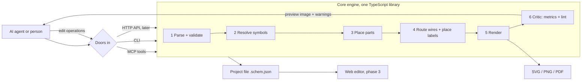

# Agent-first schematic engine: specification

| | |
|---|---|
| Status | Draft for review, rev A |
| Date | 2026-10-22 |
| Working name | `schem` (placeholder for the CLI and package names, final name to be decided) |
| Author | Project owner, drafted with Claude Code |
| Reviewer | GPT Astra (see section 17, "Notes for the reviewer") |

---

## 1. Summary

A tool that turns a description of a circuit (which parts exist and which pins connect) into a clean, publication-quality schematic drawing, with no human dragging and dropping. It is built first for AI coding agents (Claude Code, Codex, Cursor and similar), and second for people.

The agent never deals with coordinates. It writes a **netlist** (parts and connections), the engine **places parts, routes wires and renders** the drawing, and a **critic** returns a preview image plus a list of problems so the agent can send small fixes. A web editor (later phase) lets a person adjust the result by hand.

The visual target is the quality of [circuit-diagram.org](https://www.circuit-diagram.org/): thin even strokes, clean symbols, aligned parts, tidy labels, generous spacing.

## 2. Problem

- **Interactive editors** (circuit-diagram.org, Fritzing, KiCad, EasyEDA) produce good drawings but need a person to place every part and wire. That is slow when the hardware is already built and the person only needs a figure for a blog post, report or thesis.
- **Code-based drawing tools** (schemdraw in Python, CircuiTikZ in LaTeX) can be driven by an agent, but the agent has to choose every direction and position itself, without seeing the result. The drawings come out cramped, tangled or misaligned, and the agent cannot tell.
- **Automatic layout tools** exist (netlistsvg, which uses the ELK graph layout library) but are built for digital logic diagrams and do not follow analog drawing conventions.
- **Netlist tools** (SKiDL) describe connections but draw nothing.

Agents are good at knowing *what connects to what*. They are bad at deciding *where each part goes on a page*. Nothing on the market splits the work that way and gives the agent eyes on the result.

## 3. Goals and non-goals

### Goals

1. An agent can produce a publishable schematic of a small-to-medium circuit (up to about 30 parts in the first version) from a netlist alone.
2. The output looks hand-drafted by a careful engineer: conventional orientation, aligned parts, minimal crossings, no overlaps.
3. The agent can see the result (image) and read it (structured text and metrics), and fix it with small, local edit commands.
4. Results are **deterministic**: the same input and engine version give the same output, byte for byte.
5. Small edits cause small visual changes (layout stability), so the agent's edit loop converges.
6. One project file holds everything; it is plain JSON, diff-friendly and safe to commit to git.
7. Outputs drop straight into blogs, Word documents, LaTeX and slides: SVG, PNG at chosen DPI, and PDF.

### Non-goals (for now)

- PCB layout, footprints, bills of materials for manufacturing.
- Circuit simulation. (A SPICE netlist export may come later; it is not a goal.)
- Full electrical rule checking. Only basic checks (section 9.3).
- Multi-sheet or hierarchical schematics. Single sheet only in v1.
- Very large designs. Above about 100 parts we warn and do our best; we do not promise quality.
- Copying circuit-diagram.org's code or symbols (see section 14, licensing).

## 4. Users and main scenarios

| User | Scenario |
|---|---|
| AI agent in a coding session | "Draw the schematic for the ESP32 + DHT22 + relay project in this repo" → reads firmware pin definitions, writes a netlist, renders, checks the preview, fixes, saves `docs/schematic.svg`. |
| Maker or student | Writes or pastes a short netlist, runs one command, gets an image for a report. |
| Technical writer | Asks an agent for a figure in a house style (theme), at 300 DPI, for a Word document. |
| Person polishing a result (phase 3) | Opens the agent's file in the web editor, drags a part, wires follow, saves the same file. |

## 5. Architecture overview



### Packages (monorepo)

| Package | Responsibility |
|---|---|
| `core` | Data model, JSON schema, DSL parser, validation, edit operations, project file read/write. No I/O beyond pure functions. |
| `symbols` | Symbol definitions (JSON) and the code that loads, rotates and measures them. |
| `layout` | Placement, routing, label placement, layout stability. |
| `render` | SVG generation, themes, PNG and PDF conversion. |
| `critic` | Quality metrics, lint warnings, text description of the drawing. |
| `cli` | `schem` command-line tool. |
| `mcp` | MCP server exposing the engine as tools to agents. |
| `editor` | Web editor (phase 3). Uses the same core in the browser. |

**Stack:** TypeScript on Node.js 22+, also runnable in the browser (everything except PNG/PDF conversion and file access). pnpm workspaces. Planned dependencies: `elkjs` (layout), `@resvg/resvg-js` (SVG to PNG, deterministic), `opentype.js` or `fontkit` (text measurement), `zod` (schemas), `vitest` (tests). All to be confirmed in the layout spike (section 15).

## 6. Data model

The model has three layers, kept strictly apart:

1. **Circuit** (the truth): parts, their properties, and nets. Written by the agent.
2. **Hints and locks** (intent): optional guidance and pinned positions. Written by the agent or a person.
3. **Layout** (derived): positions, wire paths, label positions. Computed by the engine, cached in the file, never the source of truth unless locked.

Changing the circuit never silently keeps a stale layout: unlocked layout is recomputed; locked items are kept and the rest is laid out around them.

### 6.1 Coordinates

- All geometry is on an integer **grid**. One grid unit (`G`) is the base spacing; the default render scale is `G = 10 px` at 1x.
- Every pin of every symbol lands on a grid point in every rotation. This is what makes wires line up.
- Rotation is 0, 90, 180 or 270 degrees; mirroring is horizontal (`flip: true`), applied before rotation.
- Origin is top-left, y grows downward (SVG convention).

### 6.2 Parts

| Field | Type | Notes |
|---|---|---|
| `id` | string | Reference designator, unique: `R1`, `C3`, `U2`, `J1`. Must match `^[A-Za-z][A-Za-z0-9_]*$`. |
| `type` | string | Symbol id from the library: `resistor`, `led`, `npn`, `opamp`, `ic`, `module:esp32-devkitc`... |
| `props` | object | `value` (`"4.7k"`, `"10uF"`, `"red"`), `label` (display override), `variant` (`"iec"`, `"ieee"`), type-specific fields. |
| `pins` | array, only for `ic` / custom | Pin list for generic chips and modules (section 7.3). |

**Values** are stored as written and parsed into SI quantities for display: `4.7k`, `4k7`, `4700` and `4.7 kΩ` all mean 4700 Ω; display style is a theme setting (`4.7 kΩ` or `4k7`). Unparseable values are shown as written, with a lint note.

### 6.3 Nets

A net is a named set of pins. Pin references are `PartId.PinName`, for example `R1.1`, `D1.anode`, `U1.VCC`.

- Each part type defines pin names and aliases (diode: `anode`/`a`/`1`, `cathode`/`k`/`2`; battery: `+`/`pos`, `-`/`neg`).
- Unnamed nets get generated names (`N1`, `N2`...), stable across edits (derived from the sorted pin list, not from order of appearance).
- **Power nets** are recognised by name (`GND`, `VCC`, `VDD`, `3V3`, `5V`, `VIN`, `VBAT`, `+12V`...) or by explicit `kind: "power" | "ground"`. They may be drawn as **power port symbols** (ground triangle, supply arrow or bar) at each connection instead of long wires. Rule: `style.powerPorts: "auto" | "always" | "never"`, default `auto` (use ports when a wire would be long or cross other wires).
- A pin may be marked deliberately unconnected (`nc`), which suppresses the floating-pin warning and draws a small cross.

### 6.4 Hints (all optional)

Hints guide layout; they are soft preferences unless marked `strict`.

| Hint | Example (DSL) | Meaning |
|---|---|---|
| Relative position | `hint D1 right-of R1` | also `left-of`, `above`, `below`, `near` |
| Alignment | `hint row R1 R2 R3` / `hint column C1 C2` | same y / same x for their centres |
| Orientation | `hint R2 vertical` / `hint Q1 rotate 90 flip` | |
| Flow | `hint input J1` / `hint output SPK1` | inputs on the left, outputs on the right |
| Group | `group "Power supply" U1 C1 C2` | keep together, optional dashed box with title |
| Net style | `hint net GND ports` / `hint net CLK label` | draw net as power ports, or as net labels instead of a wire |
| IC pin sides | `hint U1 pins-left IN1 IN2 pins-right OUT` | which side of a chip box each pin goes on |
| Lock | `lock R1 at 12,4 rotate 90` | fixed position, kept across re-layout |

Conflicting hints produce a lint warning naming both hints; the later one wins.

### 6.5 Project file: `*.schem.json`

JSON is the canonical format. The DSL (section 8) compiles to it losslessly; `schem fmt` can turn JSON back into DSL.

```json
{
  "schema": "schem/1",
  "meta": { "title": "LED indicator", "author": "", "created": "2026-10-22" },
  "parts": [
    { "id": "B1", "type": "battery", "props": { "value": "9V" } },
    { "id": "R1", "type": "resistor", "props": { "value": "470" } },
    { "id": "D1", "type": "led", "props": { "color": "red" } }
  ],
  "nets": [
    { "name": "PWR", "pins": ["B1.+", "R1.1"] },
    { "name": "A",   "pins": ["R1.2", "D1.anode"] },
    { "name": "GND", "pins": ["D1.cathode", "B1.-"], "kind": "ground" }
  ],
  "hints": [ { "type": "relative", "part": "D1", "rel": "right-of", "of": "R1" } ],
  "style": { "theme": "clean", "symbols": "ieee", "powerPorts": "auto" },
  "layout": {
    "engine": "schem-layout@0.1.0",
    "inputHash": "sha256:…",
    "parts": { "R1": { "x": 15, "y": 4, "rot": 0, "flip": false, "locked": false } },
    "wires": [ { "net": "PWR", "points": [[6,4],[6,10],[12,10]] } ],
    "labels": { "R1.ref": { "x": 15, "y": 2, "anchor": "middle" } },
    "junctions": [[6,10]]
  }
}
```

- `layout.inputHash` covers the circuit, hints, style and engine version. If it does not match, the cached layout is stale and is recomputed (locked entries kept).
- Keys are written in a fixed order and arrays in a stable sort order so git diffs stay small.

## 7. Symbol library

### 7.1 Symbol definition format (our own JSON)

```json
{
  "id": "resistor",
  "name": "Resistor",
  "aliases": ["res", "r"],
  "refPrefix": "R",
  "pins": [
    { "name": "1", "aliases": [], "at": [0, 0], "dir": "left" },
    { "name": "2", "aliases": [], "at": [6, 0], "dir": "right" }
  ],
  "variants": {
    "ieee": { "graphics": [ { "path": "M0 0 H1.5 L1.75 -0.5 L2.25 0.5 ... H6" } ] },
    "iec":  { "graphics": [ { "path": "M0 0 H1.5 M4.5 0 H6" }, { "rect": [1.5, -0.5, 3, 1] } ] }
  },
  "labels": { "ref": { "side": "above" }, "value": { "side": "above", "after": "ref" } },
  "body": [1.5, -0.6, 4.5, 0.6],
  "defaultOrientation": "horizontal",
  "conventions": { "preferVerticalWhen": "between-power-and-ground" }
}
```

- Graphics are in grid units, using a small primitive set: `path`, `line`, `rect`, `circle`, `arc`, `polygon`, `text`. Fill is `none`, `stroke` (filled with stroke colour) or `background`.
- `body` is the keep-out box used for overlap checks and label placement.
- `dir` is the direction a wire should leave the pin; layout uses it as a port side.
- Stroke width, colours and fonts come from the theme, never the symbol.

### 7.2 Standard library for v1 (about 40 symbols)

- **Passive:** resistor, potentiometer, variable resistor, capacitor, polarised capacitor, variable capacitor, inductor, transformer, crystal, fuse.
- **Diodes:** diode, Zener, Schottky, LED, photodiode.
- **Transistors:** NPN, PNP, N-MOSFET, P-MOSFET (enhancement).
- **Amplifiers and logic:** op-amp (with and without supply pins), comparator, AND, OR, NOT, NAND, NOR, XOR, buffer.
- **Sources:** battery, single cell, DC voltage source, AC source, current source.
- **Power ports:** ground, chassis ground, supply (arrow and bar styles).
- **Switches and electromechanical:** SPST, SPDT, push button (NO, NC), relay (coil + contact), motor, lamp, buzzer, speaker.
- **Measurement:** voltmeter, ammeter.
- **Connectivity:** net label, connector/header (N pins, generated), test point, no-connect mark.
- **Generic:** `ic` (generated box, section 7.3).

Both IEEE/ANSI (zigzag resistor) and IEC (box resistor) variants where they differ. The style choice applies to the whole sheet.

### 7.3 Generic ICs and modules

Most hobby and student projects use chips and boards (ESP32, Arduino, sensors, motor drivers) that have no standard symbol. These are drawn as a rectangular box generated from a pin list:

```
part U1 ic "ESP32-DevKitC" pins: 3V3 GND GPIO4 GPIO5 GPIO18 GPIO21 GPIO22 EN
```

Default pin side rules (overridable by hint): power pins on top, ground pins at the bottom, pins connected to parts on the left of the chip on the left, and so on, decided by layout to reduce crossings. Unused pins are hidden by default (`style.showUnusedPins: false`), because a 38-pin board drawn in full makes an unreadable figure. Box size grows with pin count; pin labels sit inside the box.

A small set of **module definitions** (`module:arduino-uno`, `module:esp32-devkitc`, `module:raspberry-pi-pico`, common sensors such as DHT22, HC-SR04, BME280) ships with correct pin names and aliases, so `U1.D2` and `U1.GPIO4` resolve correctly. More can be added as JSON files by users.

## 8. Text DSL

A short, line-based language that agents and people can write by hand. It compiles to the JSON in section 6.5.

```text
circuit "LED indicator"
style theme=clean symbols=ieee

part B1 battery 9V
part R1 resistor 470
part D1 led color=red

net PWR  B1.+ R1.1
net A    R1.2 D1.anode
net GND  D1.cathode B1.-

hint D1 right-of R1
```

Shorthand for chains of two-pin parts (each `->` joins the second pin of the left item to the first pin of the right item):

```text
chain B1.+ -> R1 -> D1 -> B1.-
```

### Grammar sketch

```
file        = { line } ;
line        = ( circuit | style | part | net | chain | hint | group | lock | comment ) NEWLINE ;
circuit     = "circuit" STRING ;
style       = "style" { KEY "=" VALUE } ;
part        = "part" ID TYPE [ VALUE ] { KEY "=" VALUE } [ "pins:" { PIN } ] ;
net         = "net" [ NAME ] PINREF { PINREF } [ "kind=" ( "power" | "ground" | "signal" ) ] ;
chain       = "chain" ENDPOINT { "->" ENDPOINT } ;
ENDPOINT    = PINREF | ID ;               (* bare ID = two-pin part, in through pin 1, out through pin 2 *)
PINREF      = ID "." PIN ;
comment     = "#" { any } ;
```

### Error messages

Errors are written for an agent to act on without guessing. Each has a code, the line and column, what is wrong, and a fix suggestion:

```
E104 line 9:14  unknown pin "R1.3". R1 (resistor) has pins: 1, 2.
E201 line 4:6   unknown part type "resister". Did you mean "resistor"?
W310            net "N3" has one pin (U1.GPIO5). Connect it or mark it nc.
```

## 9. Layout engine

This is the core of the project and its main risk.

### 9.1 What "looks good" means (drafting rules)

The engine aims for the conventions that engineers and textbooks follow. Listed in priority order; the first group are hard constraints.

**Hard constraints (must never fail):**
1. No part bodies overlap each other or any label.
2. No wire passes through a part body or a label.
3. No wire runs along (overlaps) another wire of a different net.
4. Every pin and wire corner is on the grid.
5. A wire touches a pin only if it is connected to it.

**Strong conventions:**
6. Positive supply at the top, ground at the bottom.
7. Signal flows left to right: inputs and sources on the left, outputs and loads on the right.
8. Ground symbols point down; supply arrows point up.
9. Junctions are T-shaped with a dot. Never a four-way junction: split it into two T junctions one grid step apart.
10. Wires crossing without connecting have no dot (optional hop arc in some themes).
11. Two-pin parts between a supply rail and ground are drawn vertical.
12. Parts in series on a signal path line up on one straight line where possible.
13. Repeated structures (LED arrays, bus lines, parallel capacitors) are drawn with equal spacing in a row or column.
14. Decoupling capacitors sit next to the IC power pin they serve.

**Aesthetic measures (minimised together):**
15. Wire crossings.
16. Wire bends.
17. Total wire length.
18. Sheet area and how far the aspect ratio is from the target (default 4:3 landscape).
19. Labels far from their part.

### 9.2 Pipeline

1. **Classify.** Mark power and ground nets, sources, loads, inputs and outputs (from hints, part type and net names). Detect known subcircuit patterns (section 9.4).
2. **Simplify.** Decide which power and ground connections become power ports instead of wires. This alone removes most crossings in typical circuits.
3. **Rank.** Assign each part a column (left to right signal order) and a row band (supply, signal, ground), using the remaining graph.
4. **Place.** Run a layered graph layout (ELK `layered`, direction right, ports with fixed sides and positions from the symbol, orthogonal routing) with the ranks and hints as constraints. Snap to grid.
5. **Apply patterns and hints.** Replace pattern regions with their template placement; enforce alignment rows and columns.
6. **Route.** Orthogonal routing on the grid (ELK result, then a grid-based A* clean-up pass for wires that break hard constraints). Insert junction dots; split four-way junctions.
7. **Place labels.** Reference designator and value for each part, on the preferred side from the symbol definition, moved to the next candidate side if blocked. Net labels on the wire.
8. **Score.** Compute metrics (section 10.1). If hard constraints fail, try fallbacks (different seed order, relaxing soft hints, more spacing) up to a time budget, then return the best result with errors listed.

Every step is deterministic: no random numbers, stable sort orders everywhere, a fixed iteration order for maps.

### 9.3 Basic electrical checks

Reported as warnings, never blocking the render:
- pin not connected and not marked `nc`;
- net with a single pin;
- supply net directly connected to ground net;
- part type unknown, or value unparseable;
- polarised part with both pins on the same net;
- duplicate reference designator (this one is an error).

### 9.4 Pattern templates

Some circuits have a conventional drawing that a general graph layout does not find. Bridge circuits are drawn as a diamond, and an op-amp's feedback resistor goes above the op-amp. The engine detects these by matching subgraphs and places them from a template. v1 templates:

| Pattern | Conventional drawing |
|---|---|
| Voltage divider | Two resistors vertical in a column between supply and ground, tap to the right |
| RC / RL filter | Series part horizontal, shunt part vertical to ground |
| LED + series resistor | In line, resistor before LED |
| Pull-up / pull-down resistor | Vertical from rail to the signal line |
| Inverting / non-inverting op-amp | Feedback resistor above the op-amp, input resistor on the left |
| Diode bridge rectifier | Diamond |
| Wheatstone bridge | Diamond |
| Decoupling capacitor | Vertical next to IC power pin, to ground |
| Transistor switch (low side) | Load above the collector/drain, base/gate resistor on the left, emitter/source to ground |
| Common-emitter amplifier | Textbook arrangement |

Templates are data plus a small matcher, so new ones can be added without changing the engine.

### 9.5 Layout stability

When the agent sends an edit, the drawing should change only near the edit. Rules:
- Locked parts never move.
- On re-layout, the previous layout is used as a starting point (ELK's interactive layering and crossing-minimisation options take existing positions into account). Parts not affected by the edit keep their relative order.
- The critic reports a **change score** (how many parts moved, by how far) after each edit, so a large unexpected jump is visible.

## 10. Critic

The critic is what turns a one-shot generator into a loop the agent can finish.

### 10.1 Metrics

Returned as JSON after every render:

```json
{
  "hardViolations": { "overlaps": 0, "wireThroughBody": 0, "wireOverlap": 0, "offGrid": 0 },
  "crossings": 2, "bends": 14, "wireLength": 186,
  "conventionBreaks": [ { "rule": 8, "part": "GND3", "note": "ground symbol points up" } ],
  "labelCollisions": 0,
  "sheet": { "width": 48, "height": 32, "aspect": 1.5 },
  "changeScore": 0.08,
  "score": 0.91
}
```

`score` is a weighted sum in 0..1. Weights are tuned on the test corpus (section 13).

### 10.2 Lint messages

Human-readable, each pointing at parts or nets and suggesting an edit operation:

```
L201 wire for net SDA crosses net SCL twice. Try: swap-pins U1 SDA SCL side, or move R4 below R3.
L305 R2 and R3 form a divider but are not aligned. Try: align column R2 R3.
```

### 10.3 Text description

Not every agent can see images, and images cost tokens. The critic also returns a compact text description of the drawing:

```
Sheet 48x32. Rows: top rail PWR (B1.+ to R1.1). R1 horizontal at (15,4). D1 vertical at (30,10), right of R1.
GND drawn as 2 ground ports. Crossings: none.
```

### 10.4 Alt text

`schem describe` writes a plain-language description for readers ("A 9 V battery drives a red LED through a 470 Ω resistor"). It is useful as image alt text in blogs and reports.

## 11. Agent interfaces

### 11.1 Design rules

- **Files are the state.** Every tool works on a project file path in the user's repo. No hidden server-side state, so the agent can commit, diff and resume.
- **Small responses.** Tools return metrics and lint by default; the preview image only when asked or when the critic score drops. Preview images are capped (default 1024 px on the long side) to save tokens.
- **Every response says what to do next** when something is wrong (lint suggestions are edit operations the agent can paste).
- Tool and error text names things by their schematic terms (part, pin, net), not internal ones.

### 11.2 MCP tools

| Tool | Input | Output |
|---|---|---|
| `schem_create` | `path`, `source` (DSL or JSON) | validation errors or: metrics, lint, text description, optional preview |
| `schem_edit` | `path`, `ops[]` (section 11.3) | same as create, plus `changeScore` |
| `schem_render` | `path`, `format` (`svg`/`png`/`pdf`), `out`, `theme?`, `scale?`, `dpi?` | output path, size |
| `schem_preview` | `path`, `maxSize?`, `region?` (part ids to zoom on) | PNG image content |
| `schem_inspect` | `path`, `parts?` | positions, pins, connections as JSON |
| `schem_components` | `query?` | matching symbol ids with pin names |
| `schem_component` | `type` | full pin list, aliases, props, preview of the symbol |
| `schem_check` | `path` | metrics, lint and electrical warnings only |

### 11.3 Edit operations

JSON operations applied in order, atomically (all or none):

```json
[
  { "op": "move", "part": "R3", "to": { "rel": "above", "of": "C2" } },
  { "op": "move", "part": "R3", "to": { "x": 20, "y": 6 } },
  { "op": "rotate", "part": "Q1", "deg": 90 },
  { "op": "flip", "part": "Q1" },
  { "op": "align", "axis": "row", "parts": ["R1", "R2", "R3"] },
  { "op": "lock", "part": "U1" },
  { "op": "unlock", "part": "U1" },
  { "op": "netStyle", "net": "GND", "style": "ports" },
  { "op": "pinSides", "part": "U1", "left": ["IN1"], "right": ["OUT"] },
  { "op": "label", "part": "R1", "side": "below" },
  { "op": "spacing", "factor": 1.2 },
  { "op": "relayout", "keepLocked": true },
  { "op": "addPart", "part": { "id": "C4", "type": "capacitor", "props": { "value": "100n" } } },
  { "op": "connect", "pins": ["C4.1", "U1.VCC"] },
  { "op": "disconnect", "pin": "C4.1" },
  { "op": "removePart", "part": "C4" },
  { "op": "setProp", "part": "R1", "key": "value", "value": "1k" }
]
```

`move` with an absolute position locks the part by default. Circuit-changing operations (`addPart`, `connect`...) trigger re-layout of the affected area only.

### 11.4 CLI

```
schem init [name]                       create a starter .schem file
schem render <file> -o out.svg|png|pdf  [--theme] [--scale] [--dpi]
schem check <file>                      metrics, lint, electrical warnings; exit code 1 on errors
schem edit <file> --ops ops.json        apply edit operations
schem fmt <file>                        normalise; convert between DSL and JSON
schem describe <file>                   alt text
schem components [query]               list symbols
schem watch <file> -o out.svg           re-render on save (for people)
```

Output is human-readable by default, `--json` for machines. Exit codes: 0 ok, 1 errors in the circuit, 2 usage error, 3 internal error.

### 11.5 Agent skill / instructions

The package ships a short instruction file (for Claude Code skills, `AGENTS.md` for Codex and similar) teaching the workflow: list components, write netlist, `create`, read lint, fix, preview once, render. Keep it under about 150 lines.

## 12. Rendering and themes

### 12.1 Default theme "clean" (the circuit-diagram.org look)

- Black strokes (`#000`) on white, stroke width 2 px at 1x, round caps and joins.
- Junction dots radius 3.5 px.
- Labels in one sans-serif typeface, bundled with the package so measurement and rendering match on every machine. The reference designator and the value are the same size; no bold.
- Generous margins: 3 G around the drawing.
- Values written with proper symbols: Ω, µ, en-space between number and unit (`4.7 kΩ`).

### 12.2 Other themes

`textbook` (serif labels, thinner strokes), `dark` (light strokes on dark), `blueprint`, and `mono-print` (high contrast, for printing). A theme is a JSON file: colours, stroke width, font, label sizes, junction size, crossing style (plain or hop), value notation.

### 12.3 Output formats

- **SVG** (primary): self-contained, no external CSS; colours and widths as attributes so it renders the same in browsers, Word, Inkscape and Figma. Text as `<text>` by default; `--text-to-paths` converts it to outlines for apps that substitute fonts. Includes `<title>` and `<desc>` (alt text).
- **PNG:** rendered with resvg using the bundled font. `--scale` or `--dpi` (300 DPI preset for print).
- **PDF:** vector, one page, sized to the drawing.
- Later: CircuiTikZ export for LaTeX users.

## 13. Testing and quality

1. **Reference corpus** of about 40 real circuits, chosen to cover the patterns and common hobby projects: LED + resistor, voltage divider, RC low-pass, 555 astable, 555 monostable, op-amp inverting / non-inverting / summing / integrator, common-emitter amplifier, transistor and MOSFET switches, H-bridge, bridge rectifier with smoothing capacitor, linear regulator (7805), Wheatstone bridge, Arduino + LED + button, ESP32 + DHT22 + relay, I2C sensor with pull-ups, Schmitt trigger, logic gate circuits, and some deliberately messy ones.
2. **Golden tests:** each corpus circuit's SVG and metrics are snapshotted. A change that alters a snapshot must be reviewed by eye (side-by-side HTML report generated by the test run).
3. **Hard-constraint tests:** zero overlaps, zero off-grid points on every corpus circuit, enforced in CI.
4. **Determinism test:** render every corpus circuit twice, and on Windows, macOS and Linux in CI; outputs must be identical.
5. **Property tests:** random valid netlists up to 30 parts must never crash and never break hard constraints.
6. **Human rating:** each release, the corpus is rated 1-5 by a person against "would I put this in a report unchanged?".
7. **Agent evaluation:** give Claude Code and Codex a task in plain words ("draw this 555 blinker") with only the MCP tools. Measure: success, number of edit rounds, tokens used, final score.

### Performance targets

| Size | Layout + render time (single core, ordinary laptop) |
|---|---|
| 10 parts | < 200 ms |
| 30 parts | < 1 s |
| 100 parts | < 5 s |

## 14. Licensing and prior art

- circuit-diagram.org's source code is published under **GPL-2.0**. Copying its code or symbol definitions would make this project a derived work under GPL-2.0. Decision: **we do not copy its code or symbol files.** We draw our own symbols from the public standards (IEEE 315 and IEC 60617 conventions) and aim for the same quality, not the same files.
- Our own license: proposed MIT or Apache-2.0 (owner to decide, section 16).
- ELK / elkjs is EPL-2.0. It is used as a library dependency, not modified; to be confirmed that this is compatible with the chosen license.
- Other prior art studied for ideas, not code: schemdraw, CircuiTikZ, netlistsvg, SKiDL, KiCad's netlist format.

## 15. Phases and acceptance criteria

### Phase 0: layout spike (about 1 week)

Before building anything else, prove the risky part. Take 10 corpus circuits, write their netlists by hand, and run them through ELK with power ports and symbol ports, plus the simplest templates.

**Pass:** at least 6 of 10 rated "publishable or one small edit away" by the owner. **Fail:** reconsider the layout approach (custom placement, constraint solver) before going further.

### Phase 1: engine + CLI

Data model, DSL, validation with good errors, about 40 symbols, generic IC boxes, layout pipeline with v1 templates, critic metrics, SVG and PNG output, `clean` theme, CLI.

**Accept when:** all corpus circuits render with zero hard-constraint violations; at least 70% rated 4 or 5 by a person without edits; determinism tests pass on three operating systems.

### Phase 2: agent loop

MCP server, edit operations, layout stability, preview and text description, lint suggestions, agent instruction file, PDF output, more themes.

**Accept when:** in the agent evaluation, Claude Code and Codex reach a rating of 4+ on at least 90% of corpus tasks within 3 edit rounds.

### Phase 3: web editor

Browser app using the same core. Open a project file, drag parts (wires re-route live), edit values, apply hints, export. Saves the same file format; dragging sets locks.

### Phase 4: from real hardware

Module library growth; reading pin assignments from Arduino / ESP-IDF / MicroPython code to draft a netlist; KiCad netlist import; experimental: draft a netlist from a photo of a breadboard (agent-side, using the agent's own vision, with the engine validating).

## 16. Open questions for the owner

1. Final project name and license (MIT or Apache-2.0).
2. Default symbol style: IEEE/US (zigzag resistor) or IEC (box resistor)? Proposed: IEEE, with IEC one setting away.
3. Should the web editor (phase 3) be a hosted site, a local app started by the CLI, or both?
4. Which circuits from your own hardware projects should be in the corpus? Real cases are worth more than textbook ones.
5. Is a hosted HTTP API (for agents without MCP) wanted, or is CLI + MCP enough?

## 17. Notes for the reviewer

Please look hardest at:

1. **The layout approach (section 9).** Is a layered graph layout plus power ports plus templates enough to reach "looks hand-drafted" for typical analog and hobby circuits? What circuit types will it handle badly? Is there a better known approach (constraint solving, force-directed with grid snapping, learning from existing drawings)?
2. **The data model (section 6).** Anything missing that will force a breaking change to the file format later: buses, multi-unit parts (a quad op-amp as four symbols), hierarchical sheets, pin swapping, net classes?
3. **The agent interface (section 11).** Will these tools and edit operations let an agent converge, or will it go in circles? What would you want as an agent that is not here?
4. **The DSL (section 8).** Ambiguities, or things an LLM is likely to get wrong when writing it.
5. **Determinism and fonts (sections 9.2, 12).** Hidden sources of non-determinism we have missed.
6. **Scope.** Anything in phase 1 that should move later, or later work that phase 1 depends on.
7. **Anything we have simply not thought of.**

Please mark each comment as **blocker**, **should fix**, or **suggestion**, and point to the section number.
