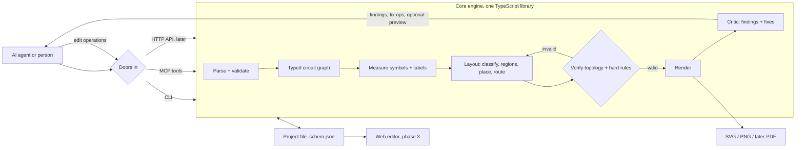
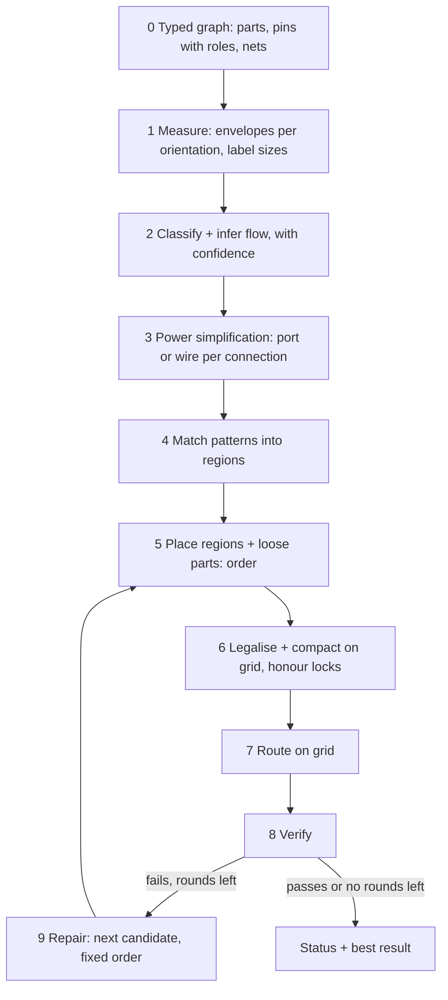

# Agent-first schematic engine: specification

| | |
|---|---|
| Status | Draft for review, **rev B** |
| Date | 2026-10-22 |
| Working name | `schem` (placeholder for the CLI and package names, final name to be decided) |
| Author | Project owner, drafted with Claude Code |
| Reviewer | GPT Astra (rev A review: `archive/SPEC-REVIEW-revA.md`) |
| Previous | `archive/SPEC-revA.md` |

Section 18 maps every rev A review finding (F01-F34) to what changed. Section numbers are kept from rev A so findings still point at the right place.

---

## 1. Summary

A tool that turns a description of a circuit (which parts exist and which pins connect) into a clean, publication-quality schematic drawing, with no human dragging and dropping. It is built first for AI coding agents (Claude Code, Codex, Cursor and similar), and second for people.

The agent never deals with coordinates. It writes a **netlist** (parts and connections), the engine **places parts, routes wires and renders** the drawing, an independent **verifier** proves the drawing has exactly the connections of the netlist, and a **critic** returns findings with ready-to-apply fixes so the agent can improve the drawing in small steps. A web editor (later phase) lets a person adjust the result by hand.

The visual target is the quality of [circuit-diagram.org](https://www.circuit-diagram.org/): thin even strokes, clean symbols, aligned parts, tidy labels, generous spacing.

## 2. Problem

- **Interactive editors** (circuit-diagram.org, Fritzing, KiCad, EasyEDA) produce good drawings but need a person to place every part and wire. That is slow when the hardware is already built and the person only needs a figure for a blog post, report or thesis.
- **Code-based drawing tools** (schemdraw in Python, CircuiTikZ in LaTeX) can be driven by an agent, but the agent has to choose every direction and position itself. An agent can render and look at the result, but every fix means re-planning coordinates by hand, and the tools give no structured feedback on what is wrong.
- **Automatic schematic generators exist.** SKiDL can generate SVG and KiCad schematics with automatic placement and routing; netlistsvg uses the ELK graph layout library and has an analog skin. **We have not yet measured how good their drawings are** on the circuits we care about. Phase 0 (section 15) runs the same circuits through both as baselines. The claim of this project is to be tested, not assumed:

> For hobby and common analog circuits, an engine with drafting conventions, a connectivity verifier and an agent edit loop produces drawings people rate as publishable more often, with fewer edit rounds, than the existing automatic tools.

If Phase 0 shows a baseline already meets that bar, the right move is to build on it instead.

## 3. Goals, non-goals and decisions

### Goals

1. An agent can produce a publishable schematic of a small-to-medium circuit (up to about 30 parts in v1) from a netlist alone.
2. **The drawing is electrically exact.** Every drawing is checked by rebuilding its connections from the geometry and comparing them with the netlist. A drawing that fails is never reported as valid.
3. The output looks hand-drafted by a careful engineer: conventional orientation, aligned parts, minimal crossings, no overlaps.
4. The agent can see the result (image) and read it (structured findings), and fix it with small, idempotent edit operations whose effect is predictable.
5. Results are **deterministic** (section 9.6).
6. Small edits cause small visual changes (section 9.5), so the agent's loop converges.
7. One project file holds the circuit and all intent; it is plain JSON, diff-friendly and safe to commit to git.
8. Outputs drop straight into blogs, Word documents, LaTeX and slides.

### Non-goals (for now)

- PCB layout, footprints, manufacturing bills of materials.
- Circuit simulation. (A SPICE export may come later.)
- Full electrical rule checking. Only basic checks (section 9.3).
- Multi-sheet or hierarchical schematics, buses, multi-unit parts (one quad op-amp drawn as four symbols). The file format **reserves** room for them (section 6.8); v1 rejects them with a clear error.
- Non-orthogonal drawing (45-degree parts and wires). v1 is orthogonal only.
- Very large designs. Above about 100 parts we warn and do our best.
- Copying circuit-diagram.org's code or symbols (section 14).

### Owner decisions (2026-10-22)

| ID | Question | Decision |
|---|---|---|
| D1 | Logical or physical drawing? | **Logical schematic that keeps real pin identity.** Board and chip pins keep their real names and numbers (an ESP32 board's GPIO4, three separate GND pins), so the drawing matches hardware that is already wired. It is not a wiring or breadboard diagram. |
| D2 | Which hard circuits must v1 draw well automatically? | **Hobby + common analog:** H-bridge, op-amp feedback circuits (inverting, non-inverting, summing), I2C buses with pull-ups, ICs with decoupling capacitors, bridge rectifier, transistor and MOSFET switches, plus the simple patterns. Differential pairs, current mirrors, Sallen-Key filters and multi-loop oscillators may come out with status `valid_low_confidence`. |
| D3 | May the engine replace wires with labels? | **Power and ground only.** Supply and ground nets may become power-port symbols automatically. Signal nets are drawn as wires unless the agent or user asks for a label. |
| D4 | What happens when an edit cannot be satisfied? | **Undo and explain.** The edit is rejected, the file and the last valid drawing stay unchanged, and the response lists the exact conflicting constraints. |
| D5 | Does "same input" include edit history? | **Two modes.** *Canonical* layout depends only on the circuit, intent, assets and engine version, so two electrically identical projects with identical intent give the identical drawing. *Incremental* layout (after an edit) also depends on the previous layout, which is stored in the file; it is deterministic given that file and the edit. `relayout canonical` always returns to the canonical drawing. (Decided by the author; owner may override.) |

## 4. Users and main scenarios

| User | Scenario |
|---|---|
| AI agent in a coding session | "Draw the schematic for the ESP32 + DHT22 + relay project in this repo" → reads firmware pin definitions, writes a netlist, renders, reads findings, applies suggested fixes, saves `docs/schematic.svg`. |
| Maker or student | Writes or pastes a short netlist, runs one command, gets an image for a report. |
| Technical writer | Asks an agent for a figure in a house style, at 300 DPI, for a Word document. |
| Person polishing a result (phase 3) | Opens the agent's file in the web editor, drags a part, wires follow, saves the same file. |

## 5. Architecture overview



### Packages (monorepo)

| Package | Responsibility |
|---|---|
| `core` | Data model, JSON schema, DSL parser, validation, quantities, edit operations, project file read/write, migrations. Pure functions. |
| `symbols` | Built-in symbol and module definitions (JSON), loader, transforms, measurement. |
| `text` | Bundled font, shaping and measurement. The same glyph positions are used for measuring and drawing. |
| `layout` | Classification, flow inference, pattern regions, placement, legalization, routing, label placement, incremental mode. |
| `verify` | **Independent** connectivity and hard-constraint checker. Works from geometry only and shares no routing code with `layout`. |
| `render` | SVG generation, themes, PNG (and later PDF) conversion. |
| `critic` | Metrics, findings, fix suggestions (dry-run validated), text description, alt text. |
| `cli` | `schem` command-line tool. |
| `mcp` | MCP server (phase 2). |
| `editor` | Web editor (phase 3). |

**Stack:** TypeScript on Node.js 22+ (tested on 24), also runnable in the browser for everything except PNG conversion and file access. pnpm workspaces with a committed lockfile and exact dependency versions. Candidate dependencies (confirmed or dropped in Phase 0): `elkjs` (placement ordering, only if candidate A wins, section 9.2), `@resvg/resvg-js` (SVG to PNG), `harfbuzzjs` or `fontkit` (text shaping), `zod` (schemas), `vitest` (tests).

## 6. Data model

The project file has four layers, kept strictly apart:

| Layer | Who writes it | Authoritative? |
|---|---|---|
| **Circuit**: parts, pins, nets, no-connect marks | agent or person | yes |
| **Intent**: hints, locks, presentation overrides, style | agent or person | yes |
| **Assets**: snapshot of every symbol and module definition used | engine | yes (pins the meaning of the file) |
| **Layout**: positions, routes, labels | engine | **no**, a cache. Deleting it loses no intent; regenerating it gives the canonical drawing. |

### 6.1 Coordinates and transforms

- **Electrical geometry is integer grid.** Pin anchors, wire vertices and junctions are integer grid points. Symbol artwork and measured bounds may be fractional.
- One grid unit (`G`) is 0.1 inch (2.54 mm) at physical scale 1, and 10 SVG user units.
- Each symbol has a **local origin**, an integer grid point. Every pin's `at` is integer in local coordinates, which keeps pins on grid in every orientation. The loader rejects a symbol that breaks this.
- A part's `x, y` is the sheet position of its local origin.
- Orientation = optional horizontal mirror about the local y axis (`x → -x`), then rotation about the origin by 0, 90, 180 or 270 degrees, clockwise on screen.
- **Text is always upright.** Labels are never mirrored or rotated with the symbol; their anchor side is chosen again after the transform.
- Origin is top-left, y grows downward (SVG convention).

### 6.2 Parts and pins

**Part**

| Field | Type | Notes |
|---|---|---|
| `id` | string | Reference designator, unique, the part's key: `R1`, `U2`. `^[A-Za-z][A-Za-z0-9_]*$`. Renaming uses the `renamePart` operation, which rewrites every reference in the file atomically. |
| `type` | string | Symbol or module id: `resistor`, `led`, `npn`, `opamp`, `ic`, `module:esp32-devkitc-v4`. |
| `props` | object | Raw values as written (section 6.7) plus type-specific fields. |
| `pins` | array | Only for `ic` and custom parts (section 7.3). |

**Pin** (defined by the symbol, or by `pins` for an `ic`)

| Field | Notes |
|---|---|
| `number` | The pin's identity, unique within the part: `"1"`, `"38"`, `"A3"`. |
| `name` | Display name. **May repeat** (three pins named `GND`). |
| `aliases` | Other accepted names (diode `anode`: `a`, `+`). Aliases must be unique within the part. |
| `role` | `power_in`, `power_out`, `ground`, `input`, `output`, `bidir`, `passive`, `nc`. Drives flow inference and checks. |
| `group` | Optional. Pins internally connected inside the part (a board's GND pins) share a group name. |
| `chain` | Optional `in` / `out` for two-pin parts (section 8). |

**Pin references**

- `U1.GPIO4`: by name or alias. Valid only when exactly one pin matches, or all matches are in the same `group`.
- `U1[38]`: by number. Always unambiguous.
- A reference to a `group` (e.g. `U1.GND` when all GND pins share a group) connects to the group. The drawing shows one representative pin unless other pins of the group are referenced by number. This keeps a 38-pin board readable while staying true to the hardware (D1).
- An ambiguous reference is an error that lists the candidates by number.

All references are **canonicalised** to `Part[number]` (or `Part{group}`) before any check, so aliases can never cause the same pin to appear twice.

### 6.3 Nets

```json
{ "id": "n3", "name": "SDA", "kind": "signal", "pins": ["U1[21]", "U2[3]", "R1[2]"] }
```

- **Identity.** Every net has an `id` that never changes once assigned. Names are optional, unique, and can change (`renameNet`). New nets get the next id from `meta.nextNetId`. Ids do not depend on membership, so adding a pin does not rename anything.
- **Kinds.** `signal`, `power`, `ground`. Names such as `GND`, `VCC`, `VDD`, `3V3`, `5V`, `VIN`, `VBAT`, `+12V` default to `power`/`ground`; an explicit `kind` wins.
- **Power domains.** Optional `domain` (`"analog"`, `"digital"`, `"chassis"` or any string). Ground nets in different domains are never merged and get distinguishable symbols.
- **Invariants** (checked on every load and edit; a violation is an error, not a warning):
  1. Each canonical pin is in at most one net.
  2. A pin marked no-connect is in no net.
  3. Net names are unique.
  4. Every net has at least one pin.
- **Merging.** `connect` between pins of two different nets merges them. The result keeps the named net's id and name. If both are named differently, the edit is rejected unless it says which to keep (`mergeNets` with `keep`). Merging a `power` net with a `ground` net, or two different power nets, is always rejected.
- **Splitting.** `disconnect` removes a pin from its net. A net left with zero pins is deleted. The engine never splits a net into two automatically.
- **No-connect.** Stored in the circuit as `nc: ["U1[12]"]`. Drawn as a small cross. Suppresses the unconnected-pin warning.

### 6.4 Intent: hints, locks and overrides

All intent is authoritative and lives outside the layout cache.

**Hints** are an **ordered** list; order is meaningful and is never re-sorted.

```json
{ "id": "h2", "type": "relative", "part": "D1", "rel": "right-of", "of": "R1", "priority": "normal" }
```

| Hint type | DSL example | Meaning |
|---|---|---|
| `relative` | `hint D1 right-of R1` | also `left-of`, `above`, `below`, `near` |
| `align` | `hint row R1 R2 R3` / `hint column C1 C2` | same centre y / x |
| `orient` | `hint R2 vertical` | `horizontal`, `vertical` |
| `flow` | `hint input J1` / `hint output SPK1` | inputs left, outputs right |
| `group` | `group "Power supply" U1 C1 C2` | keep together, optional titled dashed box |
| `decouples` | `hint C3 decouples U1.VCC` | place the capacitor at that IC pin |
| `pinSides` | `hint U1 pins-left IN1 IN2 pins-right OUT` | which side of a chip box each pin goes on, and its order |

**Priority:** `strict`, `high` or `normal` (default).

**Conflicts:**
- Relative hints form a graph. Any cycle (A right-of B, B right-of C, C right-of A) is detected, and the response names the smallest set of hints that conflict.
- `strict` against `strict` → the edit is rejected (D4).
- Otherwise the higher priority wins. With equal priority the one later in the list wins. A finding reports what was overridden.
- Hints beat templates. A template whose constraints contradict a `strict` or `high` hint is not used for that region.

**Locks:** `{ "part": "U1", "x": 20, "y": 10, "rot": 0, "flip": false }`. A locked part never moves, in any mode. Two locks that overlap, or a lock that blocks every route of a required connection, make the layout `infeasible` (D4).

**Overrides:** per-part label side, per-connection net style (`port` or `wire`, section 9.2 step 3), IC pin side and order, and (reserved, phase 3) wire waypoints per route branch.

### 6.5 Project file: `*.schem.json`

```json
{
  "schema": "schem/1.0",
  "meta": { "title": "LED indicator", "created": "2026-10-22", "nextNetId": 4, "nextHintId": 2 },
  "circuit": {
    "parts": [
      { "id": "B1", "type": "battery", "props": { "value": "9V" } },
      { "id": "R1", "type": "resistor", "props": { "value": "470" } },
      { "id": "D1", "type": "led", "props": { "color": "red" } }
    ],
    "nets": [
      { "id": "n1", "name": "PWR", "kind": "power", "pins": ["B1[+]", "R1[1]"] },
      { "id": "n2", "pins": ["R1[2]", "D1[A]"] },
      { "id": "n3", "name": "GND", "kind": "ground", "pins": ["B1[-]", "D1[K]"] }
    ],
    "nc": []
  },
  "intent": {
    "hints": [ { "id": "h1", "type": "relative", "part": "D1", "rel": "right-of", "of": "R1", "priority": "normal" } ],
    "locks": [],
    "overrides": {},
    "style": { "theme": "clean", "symbols": "ieee" }
  },
  "assets": {
    "library": "schem-symbols@0.1.0",
    "symbols": { "resistor": { "hash": "sha256:…" }, "led": { "hash": "sha256:…" }, "battery": { "hash": "sha256:…" } },
    "custom": {}
  },
  "layout": {
    "mode": "canonical",
    "basis": "sha256:…",
    "parent": null,
    "history": [],
    "parts": { "R1": { "x": 15, "y": 4, "rot": 0, "flip": false } },
    "routes": [ { "id": "n1/0", "net": "n1", "points": [[6,4],[6,10],[12,10]] } ],
    "junctions": [ { "id": "n1/j0", "at": [6,10] } ],
    "labels": { "R1.ref": { "x": 15, "y": 2, "anchor": "middle" } },
    "status": "valid"
  },
  "ext": {}
}
```

- **`layout.basis`** hashes everything the canonical layout depends on: canonical circuit, intent, the resolved symbol definitions, font bytes and shaping settings, templates, theme (it changes text and stroke sizes), layout options and engine version. A mismatch means the cache is stale.
- **`layout.parent`** (incremental mode only) is the basis plus layout hash of the drawing the edit started from. `layout.history` keeps the last 10 layout hashes so the critic can detect repeated states.
- **Route and junction ids** are stable: `netId/k`, numbered in a canonical order of the branch's end pins, so a phase 3 override can point at one branch.
- **Canonical serialisation:** UTF-8, LF line endings, 2-space indent, fixed key order, arrays in a defined order (parts and nets as written, `pins` canonical-sorted), numbers as integers wherever geometry is integer. `schem fmt` is idempotent.

### 6.6 Versioning and migration

- `schema` is `schem/MAJOR.MINOR`. A reader accepts any minor of its major and refuses a newer major with a clear error.
- Minor versions only add optional fields. A writer that meets unknown fields keeps them unchanged (inside `ext` or in place).
- Each major step ships a migration function, tested on fixtures. `schem migrate` writes a backup first.
- **Assets pin meaning.** The file records the library version and a hash of each built-in definition used; custom definitions are embedded in full. On load, a changed built-in definition (a module whose pins changed) is reported as a finding, never applied silently. `schem update-assets` adopts the new definitions explicitly.

### 6.7 Values and quantities

Raw values are always kept as written. Parsing depends on the property:

| Property | Unit | Examples that parse |
|---|---|---|
| resistor `value` | Ω | `470`, `4.7k`, `4k7`, `2R2`, `1M`, `4.7 kΩ`, `470ohm` |
| capacitor `value` | F | `100n`, `100nF`, `4.7u`, `4.7µF`, `4u7`, `10p` |
| inductor `value` | H | `10u`, `10uH`, `1m` |
| battery / voltage source `value` | V | `9V`, `3.3`, `3V3` |
| current source, fuse `value` | A | `500mA`, `2A` |
| crystal `value` | Hz | `16MHz`, `32.768k` |

Rules:
- SI prefixes `p n u µ μ m k M G`. **Case-sensitive:** `m` is milli, `M` is mega. `meg`/`MEG` is accepted as mega (SPICE habit).
- A bare number means the property's base unit. A wrong unit (`10uF` on a resistor) is an error.
- Decimal point only. `4,7k` is an error with the suggestion `4.7k`.
- Properties that are not quantities (`color`, `label`, `partNumber`) are strings and never parsed.
- An unparseable quantity is shown exactly as written, with a warning.
- Display format (`4.7 kΩ` or `4k7`) is a theme setting.

### 6.8 Reserved for later (rejected in v1 with error E900-E909)

| Feature | Reserved shape |
|---|---|
| Multi-unit parts (quad op-amp, relay coil and contacts drawn apart) | `parts[].units[]`, `pins[].unit`, shared power unit |
| Pin swapping | `pins[].swapGroup`: electrically equivalent pins. Distinct from visual reordering (`pinSides`), which v1 supports. |
| Buses | `buses[]` with id, member net ids in bit order, bus taps |
| Hierarchical sheets | `sheets[]`, instance paths, local/global label scope |
| Net classes, differential pairs | `nets[].class`, `pairs[]` |
| Wire waypoints | `intent.overrides.routes[branchId]` |

## 7. Symbol library

### 7.1 Symbol definition format (our own JSON)

```json
{
  "id": "resistor",
  "version": 1,
  "name": "Resistor",
  "aliases": ["res", "r"],
  "refPrefix": "R",
  "source": "original",
  "origin": [0, 0],
  "pins": [
    { "number": "1", "name": "1", "at": [0, 0], "dir": "left",  "role": "passive", "chain": "in" },
    { "number": "2", "name": "2", "at": [6, 0], "dir": "right", "role": "passive", "chain": "out" }
  ],
  "variants": {
    "ieee": { "graphics": [ { "path": "M0 0 H1.5 L1.75 -0.5 L2.25 0.5 ... H6" } ] },
    "iec":  { "graphics": [ { "path": "M0 0 H1.5 M4.5 0 H6" }, { "rect": [1.5, -0.5, 3, 1] } ] }
  },
  "body": { "x": 1.5, "y": -0.6, "w": 3, "h": 1.2 },
  "labels": { "ref": { "prefer": ["above", "below", "right", "left"] }, "value": { "follow": "ref" } },
  "props": { "value": { "quantity": "ohm" } }
}
```

- Graphics use a closed list of primitives: `path` (M, L, H, V, A, Z only), `line`, `rect`, `circle`, `arc`, `polygon`. No raw SVG, no text inside symbols except through `labels`.
- `body` is a box in local units (`x, y` = top-left corner, `w, h` = size).
- The **collision envelope** of a part is computed, not declared: the union of all artwork bounds, widened by half the theme stroke width, plus arrows and decorations. Labels get their own measured envelopes.
- `dir` is the side a wire leaves the pin.
- Stroke width, colours and fonts come from the theme, never the symbol.
- `source` records provenance: `"original"` for symbols drawn for this project.

### 7.2 v1 library (sized to D2)

- **Passive:** resistor, potentiometer, capacitor, polarised capacitor, inductor, crystal, fuse.
- **Diodes:** diode, Zener, Schottky, LED.
- **Transistors:** NPN, PNP, N-MOSFET, P-MOSFET.
- **Amplifiers:** op-amp (3-pin and 5-pin with supplies), comparator.
- **Sources:** battery, DC voltage source, AC source, current source.
- **Power ports:** ground, chassis ground, supply (arrow and bar).
- **Switches and loads:** SPST, push button (NO), relay (coil + contact as one symbol in v1), motor, lamp, buzzer.
- **Connectivity:** net label, header connector (N pins, generated), no-connect mark.
- **Generic:** `ic` box (section 7.3).

Later: logic gates, transformer, SPDT, photodiode, meters, speakers and more, added in phase 2 based on demand. IEEE/US and IEC variants where they differ; the choice applies to the whole sheet.

### 7.3 Generic ICs and modules

Chips and boards are drawn as a box generated from a pin list:

```
part U1 ic "ESP32-DevKitC" pins: 3V3 GND GPIO4 GPIO5 GPIO18 GPIO21 GPIO22 EN
```

- **Logical pin inventory vs visible pins.** All pins exist in the model; only connected, no-connect-marked or explicitly shown pins are drawn (`style.showUnusedPins: false` by default). The part's label states how many pins are hidden ("12 unused pins hidden").
- **Required supplies are never hidden.** A `power_in` or `ground` pin that is unconnected is always a warning, even when hidden.
- **Box shape is fixed before placement.** From flow inference (section 9.2 step 2) and hints, the engine computes a short, ordered list of pin-side assignments (power top, ground bottom, upstream pins left, downstream pins right, then variants). Placement uses the first; a repair round may try the next ones. The box never changes shape in the middle of a placement run.
- **Modules** are versioned definitions with real pin numbers, names, aliases, groups and their source: `module:esp32-devkitc-v4`, `module:arduino-uno-r3`, `module:raspberry-pi-pico`, sensor breakouts (DHT22, BME280, HC-SR04). Each records the datasheet or documentation URL and revision it was taken from. Aliases follow the board's own silk-screen and documentation exactly (on the ESP32-DevKitC V4, header label `D2` is GPIO9, not GPIO4). Different board revisions are different module ids.

## 8. Text DSL

A short, line-based language that agents and people write by hand. It compiles to the `circuit`, `intent` and `meta` parts of the JSON. Layout and assets exist only in JSON.

```text
circuit "LED indicator"
style theme=clean symbols=ieee

part B1 battery 9V
part R1 resistor 470
part D1 led color=red

net PWR = B1.+ R1.1
connect R1.2 D1.anode
net GND = D1.cathode B1.-

hint D1 right-of R1
```

### 8.1 Lexical rules

- UTF-8, optional BOM ignored. LF or CRLF. Final newline optional. Blank lines allowed anywhere.
- One statement per line. A line ending in `\` continues on the next line.
- **Comment:** `#` at the start of a line or after whitespace, to end of line. (`#` never appears inside identifiers or pin references.)
- **Keywords** are lowercase and case-sensitive: `circuit style part net connect chain nc hint group lock strict`.
- **Identifier** (part id): `[A-Za-z][A-Za-z0-9_]*`.
- **Net name:** `[A-Za-z0-9_+\-.]+` (allows `+12V`, `3V3`, `V-`). Appears only after the `net` keyword, so it can never be confused with a pin reference.
- **Pin reference:** `ID "." PINNAME` or `ID "[" PINNUMBER "]"`. `PINNAME` and `PINNUMBER` are `[A-Za-z0-9_+\-]+`.
- **String:** `"…"` with escapes `\"` and `\\`. Any Unicode inside. Used for titles, labels and part names with spaces.
- **Value:** the first bare token after the part type (`470`, `9V`, `4k7`); quote it if it contains spaces.
- **Option:** `key=value` with no spaces around `=`; value is a bare token or a string.

### 8.2 Grammar

```
file       = { line } ;
line       = [ statement ] [ comment ] EOL ;
statement  = circuit | style | part | net | connect | chain | nc | hint | group | lock ;
circuit    = "circuit" STRING ;
style      = "style" option { option } ;
part       = "part" ID TYPE [ VALUE ] { option } [ "pins:" pindecl { pindecl } ] ;
pindecl    = PINNAME | PINNUMBER ":" PINNAME ;
net        = "net" NETNAME [ "kind=" kind ] [ "domain=" token ] "=" pinref { pinref } ;
connect    = "connect" pinref pinref { pinref } ;
chain      = "chain" endpoint "->" endpoint { "->" endpoint } ;
endpoint   = pinref | ID ;
nc         = "nc" pinref { pinref } ;
hint       = "hint" [ "strict" ] hintbody [ "priority=" ( "high" | "normal" ) ] ;
hintbody   = ID rel ID
           | ( "row" | "column" ) ID ID { ID }
           | ID ( "vertical" | "horizontal" )
           | ( "input" | "output" ) ID
           | ID "decouples" pinref
           | ID ( "pins-left" | "pins-right" | "pins-top" | "pins-bottom" ) PINNAME { PINNAME } { side-group } ;
rel        = "right-of" | "left-of" | "above" | "below" | "near" ;
group      = "group" STRING ID { ID } ;
lock       = "lock" ID "at" INT "," INT [ "rotate" ( "0" | "90" | "180" | "270" ) ] [ "flip" ] ;
kind       = "signal" | "power" | "ground" ;
pinref     = ID "." PINNAME | ID "[" PINNUMBER "]" ;
```

### 8.3 Semantics

- **`net NAME = …`** creates a named net, or adds pins to it if it already exists (repeating `net GND = …` on several lines is allowed and extends the net).
- **`connect a b …`** puts the pins in one net: a new unnamed net, or the net one of them is already in. If they are in two different named nets, it is an error (use JSON `mergeNets`).
- **A pin in two different named nets** is an error naming both lines.
- **`chain`** joins endpoints left to right. A bare part id is allowed only for parts whose symbol defines `chain: in` and `chain: out` pins (resistor 1 → 2, diode and LED anode → cathode, polarised capacitor + → -, battery - → + inside the part, so `chain B1 -> R1` connects B1's + to R1's pin 1). A bare part at the start or end of a chain leaves its outer pin unconnected (warning). Chains merge into existing nets by the same rules as `connect`.
- **Round trip:** DSL → JSON → DSL keeps the meaning (circuit, intent, style, meta), not comments or formatting. JSON → DSL refuses files with embedded custom symbols or reserved features, with a message naming what cannot be expressed.

### 8.4 Errors

Every error has a code, line and column span, what is wrong, and a fix:

```
E104 9:14-9:18  unknown pin "R1.3". R1 (resistor) has pins 1, 2.
E106 12:9-12:16 "U1.GND" matches pins 14, 29, 38 that are not grouped. Use U1[14], U1[29] or U1[38].
E201 4:6-4:14   unknown part type "resister". Did you mean "resistor"?
E220 7:1-7:30   pin D1.anode is already in net PWR (line 5). A pin can be in one net only.
E310 3:16-3:20  "4,7k" is not a number. Did you mean "4.7k"?
W410            net n7 has one pin (U1.GPIO5). Connect it or mark it: nc U1.GPIO5
```

The test suite contains valid and invalid example files with the exact expected codes and spans.

## 9. Layout engine

This is the core of the project and its main risk. Rev B replaces "run ELK then fix up" with a pipeline where geometry is reserved before it is placed, and every step keeps ports, bodies and routes consistent.

### 9.1 What "looks good" means

Results are ranked **lexicographically**: a result that fails a group is never preferred over one that passes it, however good its later groups.

**Group 1: validity (all must hold, or the status is not `valid`)**
1. **Topology equivalence:** the connectivity rebuilt from the drawing equals the circuit exactly (section 9.7).
2. **No unintended contact:** no pin anchor, wire end or junction touches a wire or pin of another net; no wire passes through a pin anchor it does not connect to.
3. No overlap between part envelopes, label envelopes, or part and label.
4. No wire crosses a part envelope or a label envelope.
5. No collinear overlap of wires from different nets.
6. All electrical geometry on grid; all locks honoured exactly.

**Group 2: conventions (counted, weighted by rank)**
7. Positive supply at the top, ground at the bottom; ground symbols point down, supply symbols point up.
8. Signal flow left to right where the flow is known.
9. T junctions only, with a dot; never four-way (split into two T junctions one grid step apart).
10. Two-pin parts between a supply and ground drawn vertical.
11. Series parts on one signal path on one straight line where possible.
12. Repeated structures in equal-spaced rows or columns.
13. Decoupling capacitors next to the pin they serve.

**Group 3: readability**
14. No signal net shown as labels unless asked (D3).
15. Labels next to their part, on the preferred side.
16. Wires of one net traceable: a shared trunk with short taps rather than many parallel wires.

**Group 4: aesthetics (summed, weights tuned on the tuning set only)**
17. Crossings: each point where segments of two different nets cross counts once. Segments of the same net meeting at a junction are not crossings.
18. Bends: each change of direction along a route.
19. Total wire length.
20. Sheet area and distance from the target aspect ratio (default 4:3 landscape).

### 9.2 Pipeline



**Step 0: Typed graph.** A bipartite graph of parts and nets: each edge is one pin, carrying the pin's role and side. Nets stay whole; no net is ever split to suit the layout.

**Step 1: Measure.** For each part and each allowed orientation: collision envelope, pin anchors, and label sizes measured with the bundled font (section 12.2). Envelopes are known before any placement.

**Step 2: Classify and infer flow.**
- Sources: batteries, supplies, signal generators, connectors marked `input`, and pins with role `output` / `power_out`.
- Sinks: loads (LED, motor, lamp, buzzer, speaker), connectors marked `output`, pins with role `input` / `power_in`.
- Passive parts get a flow direction from their graph distance between sources and sinks (breadth-first, ties broken by part id).
- `bidir` nets (I2C, SPI MISO/MOSI share, GPIO) carry no direction. The part with the most such connections and a controller role (module or IC flagged `controller`) is placed upstream; peripherals downstream.
- **Feedback** edges (from a later rank back to an earlier one) are chosen by a fixed rule: an edge is feedback if it is the last edge to close a cycle in a depth-first walk in part-id order, unless a matched pattern says otherwise.
- Every inference carries a confidence. Low confidence anywhere in the final drawing gives status `valid_low_confidence` and a finding naming the uncertain part.

**Step 3: Power simplification (D3).** For every connection to a `power` or `ground` net, choose a power port or a wire:
- Default: port.
- **Wire** when the part is on a **power path**, meaning a series element between two different power nets (fuse, regulator in/out, supply switch, reverse-polarity diode, the transistor in a high-side switch). Ports go only at the outer ends of that path, so the current path stays visible.
- **Wire** when the connection is short and adjacent (the decoupling capacitor next to its IC pin can connect by a short wire to a single ground port).
- Per-connection overrides always win.
- Signal nets are always wires unless overridden.
- The full graph, including power connections, is kept for classification and pattern matching. Simplification only affects drawing.

**Step 4: Pattern regions.** Templates (section 9.4) are matched against the full graph. Rules:
- A part belongs to at most one region.
- Templates have a priority order. Overlapping matches are resolved by priority, then by larger region, then by the lowest part id. Losing matches are recorded as alternatives for the repair step.
- A template may declare child slots (the decoupling capacitors of an IC inside a larger region); otherwise regions do not nest.
- A region has **boundary terminals**: the pins where its nets leave it. The region is placed as one block with those terminals as its ports.

**Step 5: Place regions and loose parts.** Blocks (regions and remaining parts) get a column (flow rank) and a band (supply, signal, ground). The order of blocks within a column is chosen to reduce crossings. **Two candidate implementations are built in Phase 0 and the winner is kept:**
- **A: ELK-assisted.** ELK `layered` on the block graph (pinned version, explicit non-zero `randomSeed`, `portConstraints: FIXED_POS`). Each multi-pin net is passed as a star through a dummy net node, because elkjs rejects edges with several targets. **ELK output is used for ordering only.** Coordinates come from step 6.
- **B: own placement.** Rank assignment from step 2, ordering by a fixed number of barycentre sweeps, then step 6. Simpler to make exact, easier to apply locks and stability rules.

**Step 6: Legalise and compact.** Integer-only. Blocks move as rigid units with their ports and label envelopes. Locked parts are fixed obstacles placed first. Overlaps are removed by pushing blocks right and down in a fixed order; then the sheet is compacted left and up while keeping columns, bands, alignment hints and template constraints. Nothing is ever snapped independently of its ports.

**Step 7: Route.** Our own grid router, for both candidates:
- Obstacle map: part and label envelopes are blocked; existing wires of other nets can be crossed at a cost but never run along.
- Each net is routed as a tree: start from the pin nearest the net's flow source, add the remaining pins in a fixed order, each by A* search to the existing tree (cost = length + bend penalty + crossing penalty + penalty near other pins).
- Net order: template-internal nets first, then nets by fewest pins, then by net id.
- A fixed number of rip-up-and-reroute passes (default 3) re-route the nets involved in the most crossings.
- Junction dots where three branches meet; four-way meetings split.

**Step 8: Verify** (section 9.7). Topology and all validity rules.

**Step 9: Repair.** If verification fails, or Group 2 has severe breaks, try the next candidate in a fixed list: next pin-side assignment of an IC, next orientation of a part next to the failure, the alternative template match, spacing +1 G around the failure. Default budget: 8 repair rounds and a fixed node-expansion limit for routing. **Budgets are counts, never wall-clock time**, so a faster machine never produces a different drawing. A separate wall-clock timeout (default 30 s) only aborts with status `budget_exhausted`; it never selects a different result.

**Statuses**

| Status | Meaning | Export allowed? |
|---|---|---|
| `valid` | All validity rules pass | yes |
| `valid_low_confidence` | Valid, but some inference or template was a guess; findings explain | yes |
| `infeasible` | Constraints contradict (locks, strict hints); response lists the conflict set | no |
| `budget_exhausted` | No valid result within the budgets | no, unless `--draft` |
| `invalid_input` | Validation errors | no |

`--draft` exports carry a visible "DRAFT - NOT VERIFIED" stamp.

### 9.3 Basic electrical checks

Warnings, never blocking the render:
- pin not connected and not marked no-connect (required power pins always reported, even when hidden);
- net with a single pin;
- polarised part with both pins on the same net;
- power pin of an IC connected to a net of a different domain than its other power pins;
- unparseable value.

Errors (block): duplicate reference designator, unknown type, unknown or ambiguous pin, net invariant broken, power merged with ground (section 6.3).

### 9.4 Pattern templates

A template is data: a **matcher** (slots with part types and pin-to-net predicates) and **constraints** (relative positions, alignments, orientations, reserved corridors for wires), never fixed coordinates, so it adapts to label sizes. Templates are versioned and part of `layout.basis`.

v1 templates (D2), in priority order:

| Template | Matcher (summary) | Constraints (summary) |
|---|---|---|
| Op-amp inverting / summing | op-amp; resistor between OUT and IN-; one or more resistors into IN- | Op-amp centre; feedback resistor above, horizontal, spanning IN- column to OUT column; a corridor above the op-amp reserved for it; input resistors stacked left, aligned rows |
| Op-amp non-inverting | op-amp; resistor OUT → IN-; resistor IN- → ground | Feedback resistor above; ground resistor vertical below IN- |
| H-bridge | four switches (BJT or MOSFET) forming two legs between one supply and ground; load between the leg midpoints | Two vertical legs, high-side above low-side; load horizontal between midpoints; gate/base drives outward |
| Bridge rectifier | four diodes forming a full bridge | **Orthogonal convention:** two vertical diode legs side by side; AC inputs on the left at the leg midpoints; + output top, - output bottom. (The diamond drawing needs 45-degree geometry and is out of scope for v1.) |
| I2C bus with pull-ups | ≥2 parts sharing two `bidir` nets; a resistor from each to the same supply | SDA and SCL as two parallel horizontal trunks; the same SDA-over-SCL order on every chip; pull-ups vertical from the supply port above the trunks |
| Transistor / MOSFET low-side switch | transistor with load to supply on collector/drain, emitter/source to ground, resistor into base/gate | Load above, transistor below on one vertical line; drive resistor horizontal on the left; flyback diode (if any) parallel to the load |
| Decoupling capacitor (child slot) | capacitor between an IC power pin's net and ground; explicit `decouples` hint wins; if several ICs share the net and no hint, the nearest in flow order, low confidence | Vertical, next to the pin, short wire to the pin and to a ground port |
| Voltage divider | two resistors in series between a supply and ground with a tap | One column, vertical; tap to the right |
| RC / RL filter | series element on a signal path; shunt element to ground | Series horizontal; shunt vertical to ground |
| Pull-up / pull-down | resistor between a signal net and a supply or ground | Vertical from rail to the signal wire |
| LED + series resistor | resistor in series with an LED | In line, resistor first |

Low confidence in v1 (D2): differential pair, current mirror, Sallen-Key and other coupled feedback loops, common-emitter amplifier. These use the general pipeline and report `valid_low_confidence`.

### 9.5 Layout stability (incremental mode)

After an edit:
1. **Dirty set** = parts the operations touch, plus parts sharing a non-power net with them, plus the whole region of any of these.
2. **Frozen**: every other part keeps its position and orientation, and acts as an obstacle. Wires that cross the dirty boundary keep their outside portion; their crossing points become fixed terminals.
3. Steps 5-9 run inside the dirty set, with an added cost for moving any part from its previous position.
4. If no valid result: widen the dirty set by one net hop and retry, at most 3 times; then try the whole sheet with locks honoured and the displacement cost on.
5. If still no valid result, the edit is rejected (D4).

The response includes a **change report**: per part moved (displacement after removing any whole-sheet shift), rotated, flipped; route branches added, removed or changed; how far the dirty set had to widen.

### 9.6 Determinism

- Placement and routing use integer arithmetic only. If candidate A wins, ELK output (floating point) is converted to integer order only, with a defined tie rule.
- Every sort has a total order. String comparison by Unicode code point, never by locale (`localeCompare` is banned by lint rule).
- No iteration over unordered collections without sorting first.
- Single-threaded, or parallel only where results are merged in a fixed order.
- ELK (if used): exact pinned version, `randomSeed: 1`.
- Budgets are counts (section 9.2 step 9).
- SVG serialiser: fixed element and attribute order, numbers with at most 2 decimals and no `-0`, LF, no timestamps or random ids.
- PNG: resvg with pinned font bytes, `loadSystemFonts: false`, no time metadata.
- Engine, library, template, font and theme versions are all in `layout.basis`.
- Tested at three levels: layout JSON equal, PNG pixels equal, SVG and PNG bytes equal (section 13).

### 9.7 Topology verifier

A separate package (`verify`) with no code shared with the router:
1. Collect pin anchors, wire segments, junction dots, power ports and net labels from the final geometry.
2. Union-find: segments meeting at an endpoint join; a segment endpoint lying on another segment joins only if a junction dot is drawn there; crossings without a dot do not join; a pin joins the segment ending on its anchor; power ports and net labels with the same name join (virtual connection).
3. The resulting groups of pins must equal the circuit's nets exactly, after expanding pin groups (section 6.2). Hidden pins are excluded.
4. It also reports: a segment endpoint touching anything without a valid connection, a wire through a pin anchor, a junction dot with fewer than three branches, a pin with no wire and no port.

Any difference makes the result invalid, whatever the other metrics say.

## 10. Critic

### 10.1 Metrics

Returned after every render:

```json
{
  "status": "valid",
  "validity": { "topology": "ok", "contacts": 0, "overlaps": 0, "wireThroughBody": 0, "wireOverlap": 0, "offGrid": 0, "locks": "ok" },
  "conventions": { "breaks": 1 },
  "readability": { "signalLabels": 0, "farLabels": 0 },
  "aesthetics": { "crossings": 2, "bends": 14, "wireLength": 186, "sheet": [48, 32] },
  "confidence": "high",
  "repeated": false
}
```

Comparison between results is lexicographic (section 9.1); there is no single weighted score. `repeated: true` means this layout hash is already in `layout.history`, so the agent's last edits went in a circle.

### 10.2 Findings

Each finding has a stable id (derived from rule and entities), a severity, the parts and nets involved, a plain message, and either a fix or an honest "no local fix":

```json
{
  "id": "L201-U1-SDA-SCL",
  "severity": "warn",
  "message": "Nets SDA and SCL cross twice between U1 and U2.",
  "fix": {
    "ops": [ { "op": "setPinOrder", "part": "U1", "side": "right", "order": ["SCL", "SDA"] } ],
    "changesCircuit": false,
    "checked": true,
    "expect": { "aesthetics.crossings": -2 }
  }
}
```

- Fix operations are schema-valid and **dry-run before being suggested**: applied in memory, laid out and verified. Only fixes that pass are offered, with their measured effect.
- `changesCircuit: false` for visual fixes. Visual fixes never alter connectivity (`setPinOrder` reorders where pins are drawn on the box; it does not rewire).
- When no single fix works: `"fix": null, "message": "... no local fix found; consider relayout canonical"`.
- Severities: `error` (blocks validity), `warn` (conventions), `info` (aesthetics).

### 10.3 Agent stopping rule

The shipped agent instructions (section 11.6) tell the agent to stop when status is `valid` and there are no `warn` findings, or after 5 edit rounds, or when `repeated` is true, whichever comes first.

### 10.4 Text description and alt text

- **Text description** (for agents without vision, or to save tokens): sheet size, each part with grid position, orientation and neighbours, nets as wires or ports, crossings. Generated from verified geometry.
- **Alt text and net table** (for readers): generated from verified connectivity, not guessed function. Structural sentences ("B1, a 9 V battery, connects through R1, 470 Ω, to the anode of D1, a red LED; D1's cathode returns to B1"). Functional words ("drives", "filters") appear only when a template matched, and are marked as inferred. A component list and net table can be emitted alongside for accessible documents.
- SVG output carries `<title>`, `<desc>` and `data-part` / `data-net` attributes on groups, so meaning survives even when text is outlined.

## 11. Agent interfaces

### 11.1 Design rules

- **Files are the state.** Every command works on a project file path. No hidden server state.
- **Small responses by default.** Status, revision, counts, top findings (default 5) with a cursor for more. Detail levels: `brief`, `normal`, `full`.
- **Images only on request.** The preview size and crop are explicit, so response cost is predictable.
- **Every problem comes with a next step** (a checked fix, or a clear statement that none exists).
- **Revisions.** `revision` = hash of circuit + intent. Edits may carry `expectedRevision`; if the file changed meanwhile, the edit is refused with status `conflict`.

### 11.2 Security and resource limits

- **Path roots.** The CLI and MCP server only read and write inside configured roots (default: the project directory). Paths are resolved to their real location first, including symlinks and Windows junctions, and anything outside the roots is refused.
- **No silent overwrite.** Export to an existing file requires `overwrite: true`, except the project file itself.
- **Atomic saves.** Write to a temporary file in the same folder, then rename. On Windows, if the rename fails because another program (OneDrive, an editor, antivirus) holds the file, retry a fixed number of times with short waits, then fail with a clear message. The original file is never left half-written.
- **Untrusted content.** All text is XML-escaped. Custom symbols use only the primitive list in section 7.1. No raw SVG passthrough, no external references, no scripts in output.
- **Limits** (configurable): project file 2 MB, 500 parts, 512 pins per part, 200 characters per label, 5,000 path commands per custom symbol, PNG at most 8,000 px per side and 40 megapixels, routing node-expansion cap.
- **MCP over stdio:** protocol messages on stdout only; logs on stderr. MCP itself gives no file isolation; the root checks above are the isolation.
- **HTTP API (later):** binds to localhost only, requires a token, checks `Origin`.

### 11.3 Edit operations

Applied in order, as one transaction: all operations are validated, applied in memory, laid out and verified. **Only a valid result is saved**; otherwise nothing changes and the response explains why (D4). Operations are **setters**, so applying one twice gives the same result as applying it once.

**Visual operations (never change connectivity)**

| Operation | Fields |
|---|---|
| `place` | `part`, `rel` (`right-of`, `left-of`, `above`, `below`, `near`) + `of` |
| `setOrientation` | `part`, `rot` (0/90/180/270, absolute), `flip` (boolean, absolute) |
| `lock` / `unlock` | `part`, optional `at` (absolute grid position) |
| `align` | `axis` (`row`/`column`), `parts` |
| `setPinSides` / `setPinOrder` | `part`, sides and order of pins on an IC box |
| `setNetStyle` | `net`, optional `pin` (one connection), `style` (`port`/`wire`) |
| `setLabelSide` | `part`, `side` |
| `setSpacing` | `factor` (absolute, e.g. 1.2; default 1.0) |
| `addHint` / `replaceHint` / `removeHint` | hint object / `id` + new hint / `id` |
| `clearOverride` | override path |
| `relayout` | `mode`: `incremental` or `canonical` |

**Circuit operations**

| Operation | Fields |
|---|---|
| `addPart` / `removePart` | part object / `part` (its pins leave their nets) |
| `renamePart` | `from`, `to` (rewrites every reference) |
| `setProp` | `part`, `key`, `value` |
| `connect` | `pins`, optional `net` (name for a new net) |
| `disconnect` | `pin` |
| `renameNet` / `mergeNets` | `net`, `name` / `nets`, `keep` |
| `setNoConnect` | `pin`, `nc` (boolean) |

Each call may carry an `opId`. The last 50 op ids are kept in the sidecar history; a repeated `opId` is acknowledged and not applied again, so retries after a timeout are safe.

**Undo.** The previous 20 revisions are kept in a sidecar folder `.schem-history/` next to the project file (safe to delete, git-ignorable). `schem undo` / `schem_undo` restores the previous revision.

### 11.4 CLI (v1 door for agents and people)

```
schem init [name]                       starter project
schem render <file> -o out.svg|png      [--theme] [--scale N | --dpi N] [--text outline|font] [--draft]
schem check <file>                      status, metrics, findings; exit 1 if not valid
schem edit <file> --ops ops.json        apply operations (transaction); [--expect-revision R] [--dry-run]
schem preview <file> -o p.png           [--max 1024] [--focus R1,U2 | --finding ID]
schem query <file> part|net|region ID   positions, pins, connections
schem undo <file>
schem fmt <file> [--to dsl|json]
schem describe <file>                   alt text [--table]
schem components [query] [--limit 20]
schem migrate <file>
schem watch <file> -o out.svg           re-render on save; ignores its own writes
```

Human-readable output by default, `--json` for machines. Exit codes: 0 valid, 1 not valid or input errors, 2 usage error, 3 internal error, 4 conflict.

### 11.5 MCP tools (phase 2)

| Tool | Input | Output |
|---|---|---|
| `schem_create` | `path`, `source` (DSL or JSON), `detail?` | status, revision, metrics, top findings |
| `schem_edit` | `path`, `ops[]`, `expectedRevision?`, `dryRun?`, `detail?` | status, revision, change report, findings added and resolved |
| `schem_check` | `path`, `detail?`, `cursor?` | status, metrics, findings page |
| `schem_preview` | `path`, `maxSize?`, `focus?` (part ids or finding id) | PNG; if the whole sheet would make labels smaller than 9 px, returns an overview plus a note suggesting focused crops |
| `schem_query` | `path`, `part?` / `net?` / `region?`, `cursor?` | positions, pins, connections |
| `schem_render` | `path`, `format`, `out`, `theme?`, `scale?` or `dpi?`, `overwrite?` | output path and size |
| `schem_components` | `query?`, `limit?`, `cursor?` | symbol ids with pin names |
| `schem_component` | `type` | pins, roles, aliases, props |
| `schem_undo` | `path` | restored revision |

### 11.6 Agent instructions

A short file shipped with the package (a Claude Code skill, and `AGENTS.md` for Codex and others), under about 150 lines: list components → write netlist → create → read status and findings → apply checked fixes → preview once at the end → render. Includes the stopping rule (section 10.3) and the rule that agents must not change the circuit to make a drawing look better.

## 12. Rendering and themes

### 12.1 Default theme "clean"

- Black strokes on white, stroke width 0.2 G (2 px at 1x), round caps and joins.
- Junction dots radius 0.35 G.
- One sans-serif typeface (open-licensed, bundled), regular weight; reference designator and value the same size.
- Margins: 3 G around the drawing, measured from the outer edge of strokes and labels.
- Values with proper symbols (`4.7 kΩ`, `100 nF`), a non-breaking space between number and unit.

Other themes (phase 2): `textbook`, `dark`, `blueprint`, `mono-print`. A theme is JSON: colours, stroke width, font, label sizes, junction size, crossing style (plain or hop), value notation. **Themes are layout inputs**: a theme with bigger text or thicker strokes gives different envelopes, so it is part of `layout.basis`.

### 12.2 Text

- One font file, pinned by hash, licensed for embedding and redistribution (SIL Open Font License or similar). Its licence file ships with the package.
- Text is shaped once (kerning on, ligatures off) and the same glyph positions are used for measurement and drawing.
- v1 supports Latin, Greek (Ω, µ) and common technical symbols. A label with a character the font lacks is an error naming the character; there is no silent fallback.
- Right-to-left and complex scripts: not in v1.

### 12.3 Output formats and units

- **Physical size:** 1 G = 0.1 inch at print scale 1. A 48 × 32 G drawing is 4.8 × 3.2 inches (122 × 81 mm) at 100%.
- **SVG** (primary): self-contained, presentation as attributes (no CSS), `width`/`height` in millimetres plus `viewBox` in user units.
  - `--text outline` (default): text converted to paths, so it looks identical in every application; meaning kept in `<title>` and `aria-label`.
  - `--text font`: real `<text>` elements, selectable and searchable, with the font embedded as a subset. May shift slightly in applications that ignore embedded fonts.
- **PNG:** either `--scale N` (pixels per grid unit, for screens; default 10) or `--dpi N` (physical size × DPI, for print; 300 is typical). Giving both is an error. DPI is written into the file's metadata.
- **PDF** (phase 2): backend chosen in phase 2; requirements: vector output, outlined text, no creation timestamp, deterministic object ids.
- **Bounds** include stroke extents, labels and margins.
- **Test matrix** for SVG and PNG: Chrome, Firefox, Edge, Word (Microsoft 365, Windows), Google Docs (PNG), LaTeX (`\includegraphics` with PNG, and PDF from phase 2), Inkscape.

## 13. Testing and quality

1. **Corpus, split in two.**
   - *Tuning set* (about 30 circuits): developers may tune weights and templates on these.
   - *Held-out set* (about 15): never used for tuning; includes the owner's own hardware projects. Scored blind.
2. **Topology verifier on every test**, every corpus circuit, every edit test.
3. **Golden files** for the tuning set: layout JSON, SVG bytes and metrics. A change that alters them produces a side-by-side HTML report to review by eye before the new golden is accepted.
4. **Metamorphic tests** (output must be identical, canonical mode):
   - parts and nets listed in a different order;
   - pins written by alias instead of name, or by number;
   - DSL vs equivalent JSON;
   - save, reload, render;
   - a no-op edit;
   - setting an orientation to its current value.
5. **Edit-sequence tests:** add then remove a part gives the same topology and bounded drift; conflicting locks give `infeasible` with the correct conflict set; strict hint cycles are rejected; a retried `opId` is applied once.
6. **Generated circuits** built from combinations of the v1 patterns (not random graphs alone), up to 30 parts: must never crash, never break validity rules silently (they may return a non-valid status).
7. **Determinism:** run every corpus circuit on Windows x64 and Linux x64 in CI (macOS added later); layout JSON, SVG bytes and PNG pixels must match. PNG bytes are compared too and expected to match with the pinned resvg version.
8. **Agent evaluation:** give Claude Code and Codex a plain-language task with only the CLI (phase 1) or MCP tools (phase 2). Pass requires: the **final circuit equals the reference netlist** (compared as canonical pin partitions, so the agent cannot "fix" a drawing by changing the circuit), status `valid`, and a blind rating of 4 or more. Measure edit rounds and tokens.
9. **Packaging test:** install the packed npm tarball on a clean Windows machine with no build tools; render into a folder whose path has spaces, non-ASCII characters and lives under OneDrive; run `watch` and check it ignores its own writes.
10. **Performance**, recorded with part count, pin count, net count and label characters, cold and warm, p50 and p95, on a reference machine (owner's Windows laptop) and the CI runner:

| Size | Target (warm, p95) |
|---|---|
| 10 parts | < 300 ms |
| 30 parts, up to 150 pins | < 2 s |
| 100 parts | < 10 s, best effort |

## 14. Licensing and prior art

*This section records engineering decisions, not legal advice. Before any commercial release, the owner should have it reviewed.*

- **circuit-diagram.org:** its application and component repositories are published under GPL-2.0. We do not copy its code, symbol files or artwork. The licence of the hosted web editor was not checked and does not matter, because we copy nothing.
- **Our symbols** are drawn for this project (`source: "original"`). We follow common drafting conventions, but we do not copy artwork from standards publications (IEC, IEEE) or from other libraries. Being in a standard does not make a drawing free to copy.
- **Module pin data** (which pin is GPIO4) is factual data from manufacturer documentation, recorded with its source URL and revision.
- **Dependencies:**
  - elkjs (only if candidate A wins): EPL-2.0. Usable from MIT/Apache code; when we distribute it we must keep its notices and say where its source is. Our own code keeps our licence.
  - @resvg/resvg-js: MPL-2.0. File-level copyleft; we use it unmodified and keep its notices.
  - Bundled font: OFL or similar, licence file shipped.
  - A `THIRD_PARTY_NOTICES` file lists everything shipped, generated in CI.
- **Generated drawings belong to the user.** The licence and README state that we claim no rights in output.
- **Our licence:** to be decided by the owner (section 16). MIT or Apache-2.0 both work with the dependencies above.
- **Prior art studied for ideas, not code:** schemdraw, CircuiTikZ, netlistsvg, SKiDL, KiCad's netlist format.

## 15. Phases and acceptance criteria

### Phase 0: layout bake-off (about 2 weeks)

Goal: prove or disprove the main risk with hard cases and real edits, before anything else is built.

**Build (minimal, throwaway allowed):** JSON input only; the symbols the test cases need (about 15); measurement; topology verifier; grid router; placement candidates A and B; four templates (op-amp inverting/summing, I2C pull-ups, decoupling, H-bridge); incremental mode; the visual operations `place`, `setOrientation`, `lock`, `setPinSides`; SVG output.

**Cases (12), chosen before work starts:**

| # | Case | Set |
|---|---|---|
| 1 | LED + resistor + battery (sanity check) | tuning |
| 2 | Voltage divider feeding an op-amp buffer | tuning |
| 3 | Inverting summing amplifier, 3 inputs | tuning |
| 4 | H-bridge, 4 MOSFETs, motor, gate resistors | tuning |
| 5 | ESP32 + 2 I2C sensors + pull-ups | tuning |
| 6 | ESP32 + relay via NPN driver + flyback diode | tuning |
| 7 | Two ICs, each with 2 decoupling capacitors | tuning |
| 8 | Differential pair with current mirror load (low confidence allowed) | tuning |
| 9 | 555 astable with LED output | **held out** |
| 10 | Bridge rectifier + smoothing capacitor + 7805 regulator | **held out** |
| 11 | Owner's real hardware project, about 30 parts, with real labels | **held out** |
| 12 | Owner's second real project, or an Arduino + sensors + display build | **held out** |

**Baselines:** the same cases through SKiDL's schematic generator, netlistsvg with its analog skin, and schemdraw code written by Claude Code with preview images (best of 3 attempts).

**Pass gates (for the winning candidate):**
1. Topology correct on 12 of 12. (Hard gate.)
2. All validity rules pass on 12 of 12, or (for case 8 only) `valid_low_confidence`.
3. Blind owner rating of 4 or more ("would publish, or one small edit away") on at least 9 of 12, **including at least 3 of the 4 held-out cases**. "One small edit" means one edit call with at most 3 visual operations from the list above and no absolute coordinates; the edit must be made by an agent following the findings, not by hand.
4. Stability, on cases 3, 5, 7 and 11, for each of: change a value (wider label), add a part, remove a part, change pin sides. Locked parts move 0. Untouched parts move at most 2 G on average. Routes change only on touched nets plus at most one more.
5. Rated better than or equal to the best baseline on at least 8 of 12, blind.
6. Case 11 lays out in under 2 seconds.

"Blind" means the owner rates shuffled images with no indication of which tool or candidate made them.

**Decision:** keep candidate A or B, or, if neither passes, stop and rethink the layout approach (for example constraint-based placement of small regions) before Phase 1.

### Phase 1: engine + CLI

Data model (all of section 6), DSL, validation with the documented errors, v1 symbol and module library (section 7.2-7.3), the winning layout pipeline with all v1 templates (section 9.4), verifier, critic with checked fixes, all edit operations, incremental mode and undo, CLI, SVG and PNG, theme `clean`.

**Accept when:** all validity rules hold on every corpus circuit; at least 75% of the held-out set rated 4+ blind with no edits, and 90% within 3 agent edit rounds via the CLI; determinism tests pass on Windows and Linux; the packaging test passes.

### Phase 2: agent loop and polish

MCP server, agent instructions, focused previews, query paging, PDF, more themes, more symbols, better handling of the low-confidence families.

**Accept when:** in the agent evaluation, Claude Code and Codex reach status `valid` and a rating of 4+ on at least 90% of held-out tasks within 3 edit rounds, with the final circuit equal to the reference.

### Phase 3: web editor

Browser app on the same core. Open a project, drag parts (wires reroute live, drag sets a lock), edit values, set hints and overrides, export. Saves the same file format.

### Phase 4: from real hardware

More modules; drafting a netlist from Arduino / ESP-IDF / MicroPython pin definitions; KiCad netlist import; experimental: drafting a netlist from a photo of a breadboard, done by the agent's own vision with the engine validating.

## 16. Open questions for the owner

1. Final project name.
2. Licence: MIT or Apache-2.0?
3. Default symbol style: IEEE/US (zigzag resistor) or IEC (box resistor)? Proposed: IEEE, IEC one setting away.
4. Web editor (phase 3): hosted site, local app started by the CLI, or both?
5. Which two of your own hardware projects go into the held-out set (cases 11 and 12)?
6. Is an HTTP API wanted at all, or are CLI + MCP enough?

## 17. Notes for the reviewer (rev B)

Please check section 18 first: does each change actually resolve the finding? Then look hardest at:

1. **Section 9.2.** The new pipeline (measure first, regions, ordering, integer legalisation, own grid router, independent verifier, counted repair). Is anything still underspecified enough that two developers would build different things?
2. **Section 9.7.** Is the verifier's union-find rule set complete? What drawing would it wrongly accept or reject?
3. **Section 15, Phase 0.** Are the cases and gates hard enough, and fair to the baselines?
4. **Sections 6.2-6.4.** Pin groups, net identity, merge rules, hint conflicts. Any remaining way for one pin to end up in two nets, or for an edit to change meaning silently?
5. **Section 11.3.** Are the setter operations enough for an agent to converge without needing absolute coordinates?
6. **Where rev B over-corrected:** anything added that a v1 does not need and that slows the first release.

Mark each comment **blocker**, **should fix** or **suggestion**, with a section number.

## 18. Changes from rev A

| Finding | Verdict | Where | What changed |
|---|---|---|---|
| F01 | Partly accepted | 6.2, 6.8 | Pins now have number (identity), name (may repeat), aliases, role, group; references canonicalised; ambiguous references are errors. Multi-unit parts and pin swapping reserved, rejected in v1. **Not accepted:** hidden persistent part ids. Agents write files by hand, so the reference designator stays the key, and `renamePart` rewrites all references atomically. |
| F02 | Accepted | 6.3, 11.3 | Persistent net ids independent of names and membership; invariants; merge and split rules; power-ground merges always rejected; no-connect stored in circuit and exclusive with nets. |
| F03 | Accepted | 6, 6.4, 6.5, 9.5 | Locks and overrides moved to authoritative intent; layout is a pure cache; canonical and incremental modes (D5); `basis` hashes symbols, fonts, templates, theme and versions; `parent` records incremental history. |
| F04 | Accepted | 9.1, 9.7, 9.2 statuses | Independent topology verifier is the first validity rule; unintended contact added; explicit statuses; non-valid results cannot be exported without `--draft`. |
| F05 | Accepted | 9.2 steps 0, 2, 5 | Typed bipartite graph; source/sink inference with confidence; deterministic feedback rule; nets passed to ELK as stars through dummy nodes (elkjs rejects multi-target edges). Worked I2C mapping in template table; summing amp in template table. |
| F06 | Accepted | 9.2 steps 1, 4, 6, 9 | Envelopes and labels measured before placement; templates are constraints applied during placement, not after; blocks move with ports; counted repair loop. |
| F07 | Accepted | 9.2 step 9, 9.6 | Counted budgets; wall-clock only aborts; explicit ELK seed; total orders; code-point comparison; serialiser rules; three-level determinism tests. |
| F08 | Accepted | 9.5, 9.2 step 6 | Locks are fixed obstacles in our own legalisation; ELK used for ordering only; dirty set, frozen boundary, displacement cost and widening rules defined. |
| F09 | Accepted | 15 Phase 0 | 12 named hard cases including 4 held out; topology gate 12/12; blind rating; stability gate; edits must be agent-made, bounded and coordinate-free; baselines. |
| F10 | Accepted | 2 | Prior-art claims corrected (SKiDL draws schematics; netlistsvg has an analog skin); claim restated as a hypothesis tested against baselines in Phase 0. |
| F11 | Accepted | 6.1, 7.1 | Integer electrical geometry, fractional artwork; local origin; transform order; upright text; `body` encoding defined; loader validation. |
| F12 | Accepted (reserve only) | 6.8 | Buses, sheets, scopes, net classes, pairs and route waypoints reserved; stable route branch ids. |
| F13 | Accepted | 6.4 | Hint ids, priority, ordered list never sorted, cycle detection with minimal conflict set, strict conflicts reject, hints beat templates. |
| F14 | Accepted | 6.5, 6.6 | Major/minor rules, unknown-field preservation, migrations with backup, embedded custom symbols, hashed built-ins, explicit `update-assets`, idempotent `fmt`. |
| F15 | Accepted | 7.3 | Logical vs visible pins; required supplies always reported; hidden-pin count shown; box shape fixed before placement from a bounded candidate list; versioned modules with sources; D2/GPIO wording fixed. |
| F16 | Accepted | 8.1, 8.2 | Full lexical rules; named nets syntactically distinct (`net NAME = …`, `connect …`); `nc`, `strict`, priority, pin numbers `U1[38]`; blank lines, CRLF, EOF, continuation. |
| F17 | Accepted | 8.3 | Round trip defined as semantic, DSL subset documented, JSON → DSL refuses what it cannot express; chain in/out pins per symbol; repeated net lines extend; conflicting memberships are errors. |
| F18 | Accepted | 6.7 | Per-property quantity schema; case rules; RKM; decimal comma rejected; strings never parsed. |
| F19 | Accepted | 9.4, D2 | H-bridge and summing amp templates added; differential pair, current mirror, Sallen-Key explicitly low confidence; all in Phase 0 cases. |
| F20 | Accepted | 9.2 step 3, 6.3 | Simplification only affects drawing, full graph kept; power-path rule; per-connection overrides; power domains; `decouples` relation. |
| F21 | Accepted | 9.2 step 4, 9.4 | Matcher, priority, ownership, child slots, boundary terminals, versioning; bridge drawn in an orthogonal convention; templates written as constraints. |
| F22 | Accepted | 9.1, 10.1 | Lexicographic ranking; crossing and bend counting rules; change report replaces scalar change score; repeated-state detection; stopping rule. |
| F23 | Accepted | 10.2 | Fixes are schema-valid ops, dry-run checked, with expected effect and `changesCircuit`; SDA/SCL example now uses visual `setPinOrder`; "no local fix" stated honestly. |
| F24 | Accepted | 11.2 | Roots with real-path resolution incl. junctions; no silent overwrite; atomic saves with OneDrive handling; primitive allowlist; escaping; limits; stdio rules; HTTP later localhost + token. |
| F25 | Accepted | 11.1, 11.5 | Revisions, statuses, top findings with cursor, detail levels, query tool, explicit previews with focus crops and minimum label size. |
| F26 | Accepted, scaled | 11.3 | Absolute setters; transactions; `expectedRevision`; `opId` retry safety; undo via sidecar history; rename/merge/nc/hint operations. Multi-agent concurrency beyond the revision check: not in scope. |
| F27 | Accepted | 12.2, 12.3 | Pinned font bytes, one shaping pass for measure and draw, outlined text by default with semantic text kept, missing glyphs are errors, app test matrix. |
| F28 | Accepted, PDF later | 12.3 | Physical units defined; `--scale` vs `--dpi` exclusive; DPI metadata; themes are layout inputs; bounds include strokes; PDF requirements set, backend chosen in phase 2. |
| F29 | Accepted | 13 | Tuning vs held-out split; topology on every test; metamorphic and edit-sequence tests; pattern-based generated circuits; perf recorded with pins/nets; agent eval requires netlist equivalence. |
| F30 | Accepted | 14 | Dependency obligations listed (EPL, MPL, OFL), notices file, symbol provenance, no copying from standards artwork, output rights, legal-review note. |
| F31 | Accepted | 15 | Edits, incremental mode and verifier pulled into Phase 0; Phase 1 symbol list cut to what D2 needs; extra themes, symbols, PDF and MCP moved to Phase 2. |
| F32 | Accepted | 11.2, 13 item 9 | Clean-Windows packaging test, OneDrive paths, watch self-write suppression, stdout/stderr rule. |
| F33 | Accepted | 9.2 step 5, 15 | Two concrete placement candidates compared in Phase 0; constraint-based placement named as the fallback; learned placement deferred. |
| F34 | Accepted | 10.4, 12.2 | Alt text from verified connectivity, inferred function marked; net table; semantic attributes in SVG; script support stated. |
