# Report: claude/power-path-redo

Branch `claude/power-path-redo`, made from `main` at `54d9ad4` in its own worktree (`../schem-power-path`). Nothing was pushed, merged or rebased. I did not touch the main checkout or `neon/bench-15`.

## Summary

| | Milestone | Commit | Done |
| --- | --- | --- | --- |
| M1 | Crystal: a two-pin part across two pins of one chip stands beside them | `2249ca9` | yes |
| M2 | PR #7 restored and integrated with the general layout | `69070e2`, `7dd7dc9` | yes |
| M3 | Before and after for every bench circuit with a series supply path | this report | yes (two circuits qualify) |

- All 11 of PR #7's tests pass, unchanged.
- The bench total went from 908.1 to 906.2. `regulator` went from 38.9 to 37.0 and looks better. The other 17 circuits are byte for byte the same drawings.
- All 8 phase0 cases and all 31 phase0 drawings (validation and edits) are byte for byte the same as on `main`.
- The random edit sweep gives the same result as on `main`: 131 of 137 edits stable, line for line the same output.

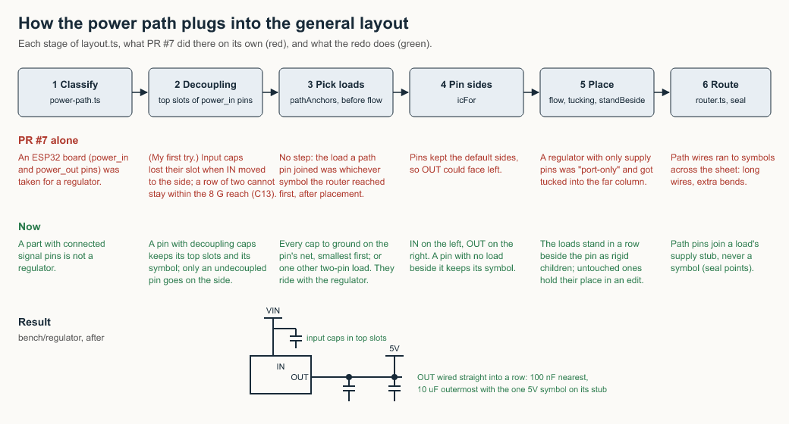

## Why PR #7 clashed, and how it is fixed

PR #7's classifier (`src/layout/power-path.ts`) is sound. It finds parts in series on a supply (fuse, switch, regulator, inductor, high-side transistor), turns a supply net with no loads into a plain wire, and takes the supply symbol off path pins. The trouble came after classification: the layout had no idea where a path pin's wire should go.

I first restored the two files as they were and hooked them in directly. That gave `regulator` 75.0 (was 38.9) and `sensor-node` 163.2 (was 92.1). I found four causes.

1. **Supply symbols: the target was picked too late.** A path pin lost its symbol, and the router joined it to whichever symbol on the net it reached first, after everything was placed. On `regulator`, the output wire ran across the sheet to a 5V symbol in another column.
   - Fix: pick the loads before placement (`pathAnchors` in `power-path.ts`). For a regulator pin, these are every capacitor from the pin's net to a ground symbol, smallest first. With no capacitor, it is one other two-pin part to ground.
   - Those loads go with the regulator the way stack children do (`stackRoot`). They are then placed in a row beside the pin as rigid children (`standBeside` in `layout.ts`, shared with the M1 bridge code).
   - Only the outermost load keeps the supply symbol. It sits on a 2 G stub, and the pin's straight wire joins the stub.
   - The router's new `seal` option stops a path wire from ever landing on a symbol itself, only on a stub.
2. **Flow: a board was taken for a regulator.** The classifier read any part with a `power_in` and a `power_out` pin as a regulator. On `sensor-node` that included the ESP32 board, so its 3V3 and 5V pins were wired as a series path through the chip.
   - Fix: a part with any connected signal pin is not a regulator.
3. **Stacks and tucking.** A regulator with only supply pins counts as "port-only", so the general layout tucks it into the shortest column. With its path pins wired, that dragged long wires across the sheet.
   - I first exempted path parts from tucking, but that dropped `sensor-node`'s regulator board to the bottom of the sheet, so I reverted it.
   - With the loads now riding as rigid children, the regulator and its row move as one block and tucking is harmless.
   - A regulator pin that ends up with no load beside it gets its supply symbol back, so nothing is wired across the sheet. That is why `sensor-node` is unchanged: its regulator's input is on a switched net and its output has no two-pin load to ground.
4. **Pin sides.** Left to the default sides, `regulator`'s OUT pin faced left (see the before image).
   - Fix: a regulator box takes IN on the left and OUT on the right (`icFor`, the `pathSides` map).
   - The exception: an input pin that has decoupling capacitors keeps its top slots and its symbol, as on any chip. I tried a row of input capacitors on the left first. Two labelled capacitors side by side cannot both stay within the 8 G decoupling reach (convention C13): C1 ended up 9 to 10 G from IN whatever the label placement. That cost 6 points and looked no better, so the existing decoupling rule wins.

Edits:
- An untouched load in the row starts from where it stood and moves out only as far as a changed neighbour needs. Before this fix, it left the row and moved 9 G.
- A capacitor's place in the row comes from its leading value, so "100 nF X7R 50 V" sorts as 100 nF.
- `src/edit/edit.ts` uses the same classifier to know which nets are drawn as wires.

The hooks are narrow. The new logic is in `power-path.ts` (`pathAnchors`, the regulator test) and in `bridges.ts` (M1). `layout.ts` has the glue:
- the path nets, after the port nets;
- `pathSides`, next to decoupling;
- the anchors, next to the bridges;
- one extra branch in `icFor`;
- the port stub length;
- the path request in step 7.

`router.ts` gains the `seal` option.

## The crystal rule (M1)

**Rule** (`src/layout/bridges.ts`): a built-in two-pin part whose two pins are on two different wired nets, where exactly one box (an IC or module) has exactly one pin on each of those nets, is a *bridge*. The layout then does three things:

- **pin sides:** the chip's two pins sit next to each other on one side;
- **flow:** the part goes with the chip, like a stack child;
- **placement:** the part stands up beside the two pins, its top pin level with the upper pin's wire and its bottom pin wired from below.

A part that a template, stack, decoupling slot, lock or hint already holds is left alone. There are no names, ids or values in the rule. A resistor across two pins of a chip gets the same treatment, and a test covers that.

| Before | After |
| --- | --- |
| 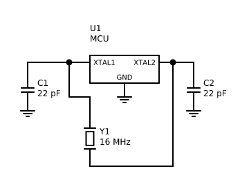 | 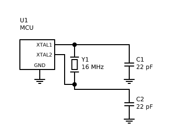 |

Before, the crystal hung below the chip and its XTAL2 wire looped round. Now XTAL1 and XTAL2 sit together on the right, and Y1 stands between their wires.

M1 changed no bench or phase0 drawing (bench 908.1, unchanged): no bench circuit has a two-pin part across two pins of one chip (none of the 18 layouts notes a bridge; the bench `mcu` has no crystal). The rule shows on the symbol test circuit above and in `tests/bridges.test.ts`.

## Before and after for the bench circuits with a series supply path (M3)

Only two of the 18 bench circuits contain a series supply path (`out/tools/classify.ts` over `bench/circuits`): `regulator` and `sensor-node`.

**regulator: 38.9 to 37.0**

| Before (`main`) | After |
| --- | --- |
| 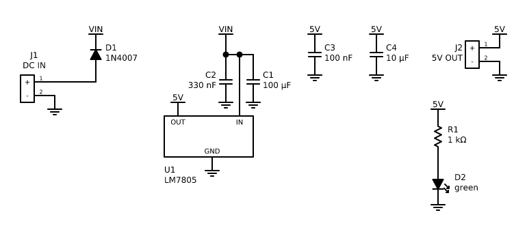 | 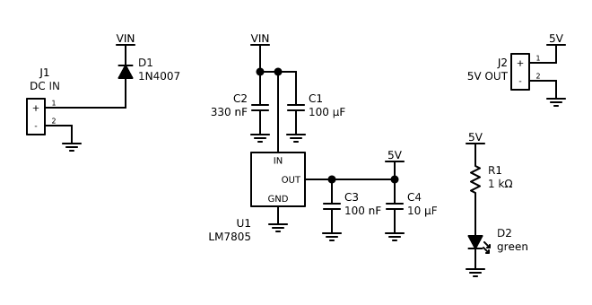 |

- **Before:** U1 faced backwards (OUT on the left, IN on the right), and the output capacitors C3 and C4 floated in their own columns with their own 5V symbols.
- **After:** IN is on top with its decoupling capacitors as before. OUT is on the right, wired straight into C3 (100 nF, nearest) and C4 (10 uF, with the 5V symbol).
- **Score:** wire 35 to 47 G and bends 5 to 5, but the sheet is smaller, so the total drops 1.9.

**sensor-node: 92.1 to 92.1, the same drawing**

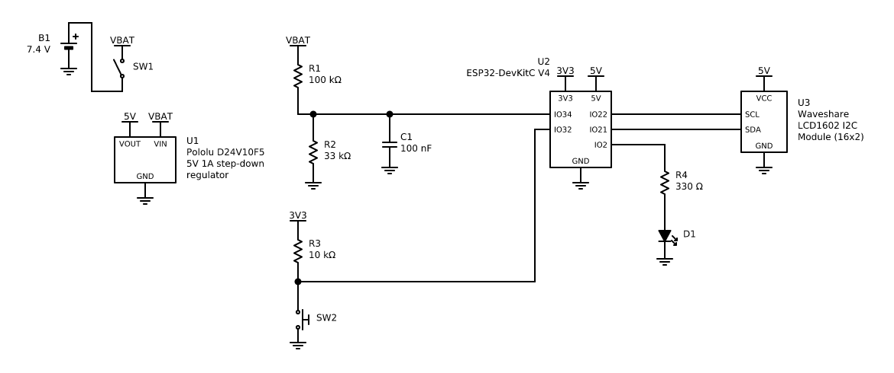

The classifier still notes "U1 joins VBAT to 5V". But U1's input comes through switch SW1 on a wired net, and its 5V output feeds only board pins, with no two-pin load to stand beside it. So both pins keep their symbols and the drawing is exactly as before.

### Other drawings that changed (not on the bench)

These come from `out/tools/extra.ts`, which draws the symbol test circuits and PR #7's four test circuits.

PR #7's regulator test circuit: OUT now goes to the right with C2 beside it, instead of a wire up and across to a 5V symbol.

| PR #7 hooked in as it was | After |
| --- | --- |
| 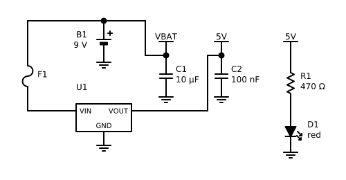 | 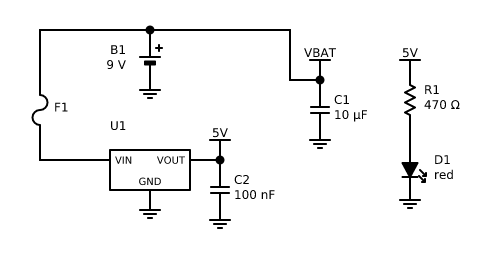 |

An input with a load but no decoupling capacitor goes on the left, its load beside it (new test circuit):

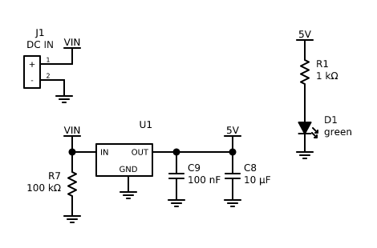

The NMOS motor driver: the fuse now feeds the 12V rail by wire, which is what PR #7 intends. The drawing is the same as PR #7's own. The crossing over the PWM line was already there before; the cost is a longer wire over the top.

| Before (M1) | After |
| --- | --- |
| 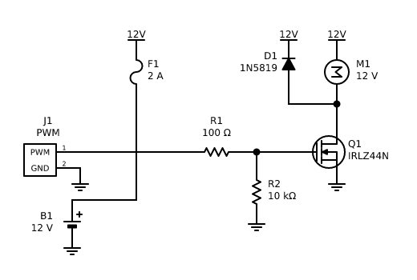 | 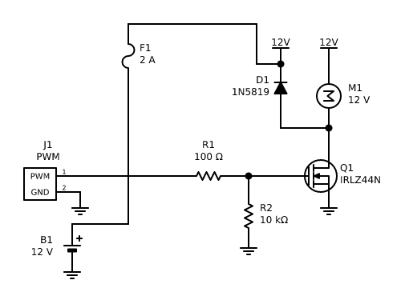 |

## All 18 bench scores (lower is better)

| Circuit | Before (`main`) | After | Change |
| --- | ---: | ---: | ---: |
| ce-amp | 39.9 | 39.9 | 0 |
| current-sink | 28.7 | 28.7 | 0 |
| darlington | 36.3 | 36.3 | 0 |
| debounce | 25.9 | 25.9 | 0 |
| differentiator | 63.0 | 63.0 | 0 |
| follower | 31.0 | 31.0 | 0 |
| highside | 28.4 | 28.4 | 0 |
| inamp | 75.3 | 75.3 | 0 |
| levelshift | 67.9 | 67.9 | 0 |
| mcu | 72.0 | 72.0 | 0 |
| mixer-ce | 56.4 | 56.4 | 0 |
| multivibrator | 63.3 | 63.3 | 0 |
| ne555 | 41.3 | 41.3 | 0 |
| pushpull | 61.3 | 61.3 | 0 |
| regulator | 38.9 | 37.0 | -1.9 |
| schmitt | 32.6 | 32.6 | 0 |
| sensor-node | 92.1 | 92.1 | 0 |
| shift | 53.8 | 53.8 | 0 |
| **Total** | **908.1** | **906.2** | **-1.9** |

I compared every bench SVG byte for byte with `main`: only `regulator.svg` differs.

## The four checks on the final code commit (`7dd7dc9`)

This report's own commit adds only files under `docs/`.

`npm run typecheck`, exit 0:

```
> schem-cli@0.0.1 typecheck
> tsc --noEmit && tsc --noEmit -p web
```

`npm test`, exit 0:

```
 Test Files  32 passed (32)
      Tests  664 passed (664)
```

`npm run phase0`, exit 0:

```
case                           status                             verifier  overlaps conv read ms
case01-led                     valid                              valid     0        0    0    68
case02-divider-buffer          valid                              valid     0        0    0    23
case03-summing                 valid                              valid     0        0    0    6
case04-hbridge                 valid                              valid     0        0    0    100
case05-i2c                     valid                              valid     0        0    0    8
case06-esp32-relay             valid                              valid     0        0    0    10
case07-two-ic-decoupling       valid                              valid     0        0    0    10
case08-diffpair                valid                              valid     0        0    0    6
```

All 12 edit scripts give the same results as on `main`: 11 saved and passing gate 4, and `case03-pin-sides` rejected as expected. Gates 1 to 6 report "incomplete" exactly as on `main`, because the runner does not collect those results.

`npm run bench`, exit 0:

```
circuit           status                   score     was  cross  bends  wire  conv  limit  back  upstr
ce-amp            valid                     39.9    39.9      0      3    66     0      0     0      0
current-sink      valid                     28.7    28.7      0      2    49     0      0     0      0
darlington        valid                     36.3    36.3      0      5    59     0      0     0      0
debounce          valid                     25.9    25.9      0      1    49     0      0     0      0
differentiator    valid                       63      63      0      7    87     0      1     0      0
follower          valid                       31      31      0      2    45     0      0     0      0
highside          valid                     28.4    28.4      0      2    37     0      0     0      0
inamp             valid                     75.3    75.3      0     10   191     0      0     0      0
levelshift        valid                     67.9    67.9      0     12   147     0      0     0      0
mcu               valid                       72      72      0     10   140     0      0     0      0
mixer-ce          valid                     56.4    56.4      0      8    93     0      0     0      0
multivibrator     valid                     63.3    63.3      2      2    74     0      0     1      0
ne555             valid                     41.3    41.3      0      5    78     0      0     0      0
pushpull          valid                     61.3    61.3      0      7   139     0      0     0      0
regulator         valid                       37    38.9      0      5    47     0      0     0      0 better
schmitt           valid                     32.6    32.6      0      3    58     0      0     0      0
sensor-node       valid                     92.1    92.1      0      8   152     0      0     0      0
shift             valid                     53.8    53.8      0      4   122     0      0     0      0
18 circuits, 18 valid. Total score 906.2 (baseline 908.1). Images: out/bench/index.html
```

I opened and looked at every changed PNG:
- bench: `regulator`;
- extra drawings: `pp-fuse`, `pp-nosym`, `pp-pmos`, `pp-regulator`, `sym-mcu-crystal`, `sym-nmos-motor-driver`.

## Tests added

All of these are new and none were weakened. PR #7's `tests/power-path.test.ts` is unchanged.

- `tests/bridges.test.ts` (5 tests):
  - finding a bridge;
  - ignoring a pin on a supply symbol;
  - ignoring a part across two chips;
  - the crystal standing between its pins with no hint;
  - the same for a resistor.
- `tests/power-path-layout.test.ts` (7 tests):
  - OUT on the right with its capacitors in a row, smallest nearest, one symbol;
  - an input with a load going to the left;
  - an input with no load keeping its symbol;
  - decoupled input capacitors keeping their top slots;
  - three `pathAnchors` unit tests (order, leading value, a non-capacitor load).

One of my own new tests was wrong at first. It expected an input with no load at all to go on the left, but the rule (on purpose) gives such a pin its symbol back. I fixed the test, not the code, and added a separate test for the load case.

## What I skipped, and open questions

- **PR #7's other drawings are as PR #7 made them.** The fuse, switch and high-side PMOS test circuits (`pp-fuse`, `pp-nosym`, `pp-pmos`) still route their path wires wherever the router finds room, and `pp-pmos` loops round its transistor. None of them is on the bench, and PR #7's tests pass on them. Placing fuses and switches with the same "stand beside" idea is the obvious next step. I did not do it, to keep this change small.
- **Input capacitors and the decoupling reach.** A row of two input capacitors on the left would match the output side. But convention C13 (at most 8 G from the pin) cannot be met by two labelled capacitors side by side. Is 8 G right for a regulator's input bulk capacitor, or should the row count as one group? I did not touch the conventions.
- **One hand edit moves more than on `main`.** On `regulator`, I added a part, then lengthened C3's value to "100 nF X7R 50 V". The longer label pushes C4 and the column to its right 6 G. That averages 2.4 G over the untouched parts, above the 2 G limit; `main` gives 1.2 G. The random sweep in `tests/edits.test.ts` is unaffected (131 of 137 on both).
- **sensor-node shows no power path.** Its regulator board keeps symbols on both sides, because neither pin has a two-pin load to stand beside it. Drawing VBAT, through SW1, into the regulator as one wired line would need the switch to be placed by the same rule.
- I did not run anything under the reserved test set, `npm run gates -- --test` or `npm run phase0 -- --test`, and did not update the bench baseline.
