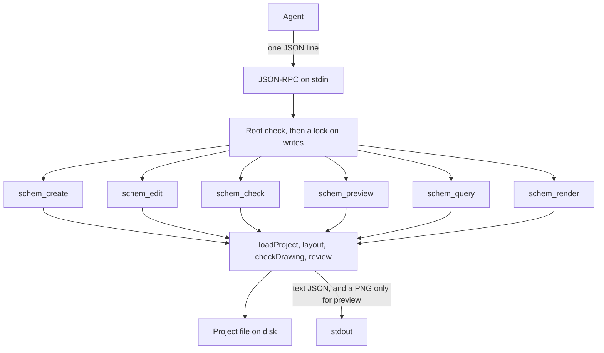

# MCP server

Branch: `grok/mcp-server`, created from `main` at `2474558`. Not merged.

## What this is

A stdio door so an agent can create a project, edit it, check it, preview it, query it and render it. The drawing is still done by the engine that `schem draw` and `schem edit` already use. Nothing under `src/layout/` was changed, and no package was added.



The agent never sends coordinates. A reply carries `revision` (circuit and intent) and `layoutToken` (that revision plus the drawing). `detail` is `brief` (counts only), `normal` (the first findings, the default) or `full` (those, plus metrics, and on an edit the change report). `cursor` is a decimal offset such as `5`. Findings are five to a page. A checked fix is searched for the first five findings only. Later pages still list the finding, and the text says no fix was searched.

## How to run it

```text
npm run mcp
npm run mcp -- --root <folder> [--root <folder>]
```

The default root is the current folder. Repeat `--root` to allow more than one. Protocol lines are JSON-RPC 2.0, one object per line, on stdout only. The startup line goes to stderr. Known protocol versions are `2024-11-05`, `2025-03-26` and `2025-06-18`. Any other version is answered with `2025-06-18`.

`schem_create` takes `path` and `source`. `source` may be JSON text or the object. The file is created only if it does not exist.

`schem_edit` takes `path` and `ops`. Optional: `expectedRevision`, `expectedLayout`, `dryRun`, `strict`, `detail`. `strict` refuses an edit that moves untouched parts past the limit. The default matches the command line: the edit is saved and the reply lists the moves. A dry run writes nothing and reports `fileRevision`, which is the revision still on disk.

`schem_check` reads status, tokens and a page of findings.

`schem_preview` returns a PNG. `maxSize` is the longer side in pixels (default 1024, at most 8000). If fitting the whole sheet would make part labels shorter than 9 px, the image is still the overview and the text says to ask again with `focus` set to part ids.

`schem_query` returns positions, pins and connections for one `part` or one `net`. With neither, it returns a page of parts and nets.

`schem_render` writes `svg` or `png` to `out`. For a PNG, pass `scale` (pixels per grid unit, default 10) or `dpi`, not both. `overwrite` must be true to replace a file. 1 grid unit is 0.1 inch, so dpi 300 is 30 pixels per grid unit.

A tool that fails puts `isError: true` on the result and a JSON object in the text block. A revision or layout mismatch is `status: "conflict"` and writes nothing. A preview adds a second content block, `type: "image"`, `mimeType: "image/png"`.

## File safety

These checks are the guardrail in SPEC 11.2. They are not a sandbox.

- A path is realpath'd, so a symlink or a Windows junction is followed, and the result must sit inside a root. A sibling folder such as `root-other` does not count.
- A new file is checked through its parent folder and created with exclusive-create.
- A replace writes a temporary file in the same folder, checks the folder again, and renames over the target. The rename is retried when Windows reports the file is busy, the same way `src/cli.ts` does. If the named path is itself a symlink or junction, the server refuses.
- Writes take `<file>.lock`, created exclusively and removed when the write finishes. A lock older than 60 seconds is stale and may be taken over.
- Before an edit is saved, the previous file is copied to `.schem-history/`, last 20, the same as `schem edit`. There is still no restore command.
- Limits: project file 2 MB, 500 parts, 512 pins on a part, 200 characters on a label, 5000 path commands on a custom symbol, PNG at most 8000 px a side and 40 megapixels.

## Left out

`schem_undo` is not a tool. The history folder is written, and restoring it needs a command the engine does not have yet. `schem_components` and `schem_component` are not tools either. The text DSL, describe, alt text and the other SPEC 11.4 commands are not part of this server. README was not changed.

`scale` and `dpi` are reported in the JSON for a PNG. The PNG bytes do not carry a DPI chunk, because `toPng` does not write one and the renderer was not changed.

## Files

- `src/mcp/protocol.ts`: one JSON-RPC line in, one line out.
- `src/mcp/roots.ts`: roots, realpath, symlink and junction refusal.
- `src/mcp/store.ts`: lock, history copy, exclusive create, atomic replace.
- `src/mcp/sheet.ts`: calls layout, the checker, findings, SVG and PNG, and shapes the small JSON reply.
- `src/mcp/tools.ts`: the six tools.
- `src/mcp/server.ts` and `src/mcp/main.ts`: initialize, tools/list, tools/call, ping, and the stdin loop.
- `tests/mcp.test.ts`: in-process tools, plus one spawned process for stdout.
- `package.json`: script `mcp`.

## Commands

`npm run typecheck` finished with exit 0 (`tsc --noEmit` and `tsc --noEmit -p web`).

`npm test`: 507 passed, 21 files, exit 0.

`npm run phase0`: all 8 validation cases printed `valid`. The verifier column was `valid` for each. case08-diffpair printed 1 convention and 0 readability breaches. The edit scripts printed as they do for this engine (three of them differ from the frozen affected-parts table and still pass gate 4 under the recomputed rule). The runner printed gates 1 to 6 as incomplete, with its own reasons: validation subset only, no blind ratings, no warm p95.

I did not run `npm run phase0 -- --test` or `npm run gates -- --test`.

## Pictures

I looked at two PNGs written under `out/` during an earlier run of the preview (that folder is gitignored, so they are not in the commit).

`out/mcp-led.png` is the LED example after R1 was set to 1k: battery on the left (B1, 9 V), resistor on top (R1, 1 kΩ), red LED on the right (D1), and a closed loop. Labels are readable. It looks like a normal schematic.

`out/mcp-led-r1.png` is the same sheet with `focus` set to R1 and `maxSize` 256. It shows the resistor, the R1 and 1 kΩ labels, and the wire through the part. The battery and the LED are outside the crop.

## Open questions

- README does not mention `npm run mcp`. I left it alone.
- On this machine, creating a file symlink returned `EPERM`, so the test records that and does not exercise the file-symlink refusal. A directory junction that points outside the root was refused, both for reading and for creating.
- A later change could add `schem_components` from the symbol list the engine already has, and `schem_undo` once restore exists as a real command.
