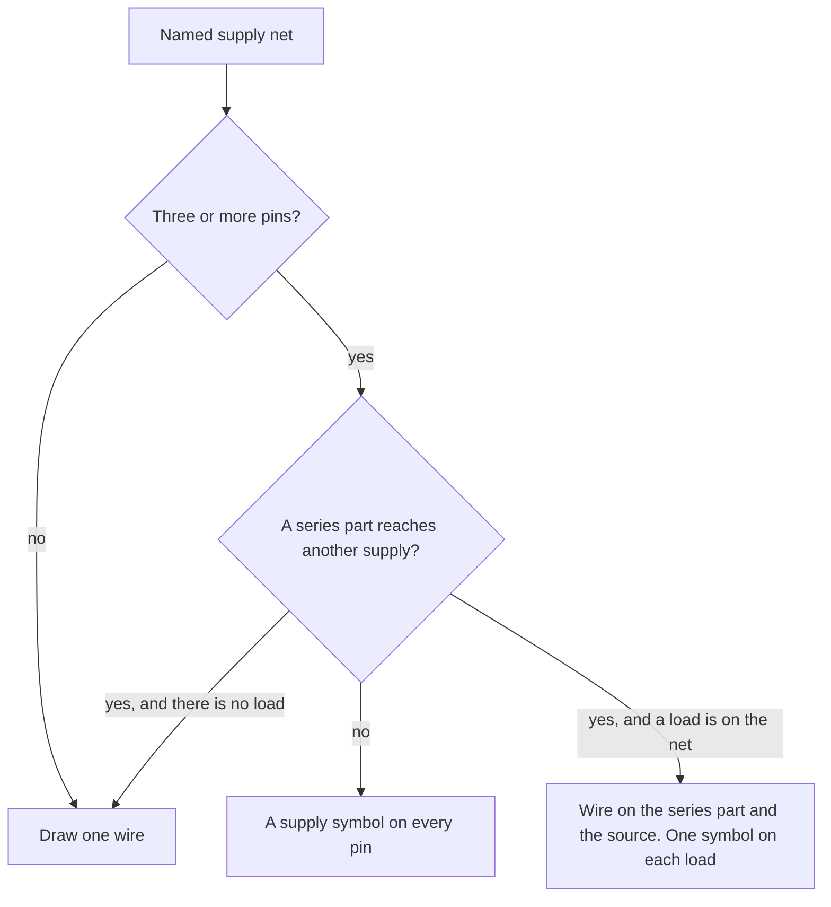

# Series power path

A fuse, switch, diode, inductor, regulator, or high-side transistor that sits between two supply nets is now drawn in the wire. Supply symbols stay on the loads. A supply net that has only the series part and a source is drawn entirely as a wire, even when it has three or more pins.

Before this change, a named supply or ground net with three or more pins became a symbol on every pin. A fuse on that net showed a symbol on each lead, so the current path disappeared.

The series parts are:

- fuse, spst switch, pushbutton
- diode or inductor, only when both pins are already on supply nets
- a part with exactly one power input pin and one power output pin, such as a regulator module
- a high-side transistor: the supply pin and the switched pin, not the gate or base

A diode with one pin on a signal net is left alone. A flyback diode across a relay coil is the usual case. Ground nets are left alone. A board with several power outputs, such as the Arduino Uno, is not treated as one regulator, because the code does not guess which pin is the regulated output.

The router can meet the wire in the middle of a supply stub. It does not land on the supply symbol itself. A symbol still has exactly one wire.

## Files

- `src/layout/power-path.ts`: finds the series parts and the pins that stay wires
- `src/layout/layout.ts`: uses that result when it chooses symbols, flow, and routing
- `src/layout/router.ts`: a supply symbol's anchor can be sealed so a wire does not join it
- `src/edit/edit.ts`: a supply net with no load counts as a wire when an edit asks which parts moved
- `tests/power-path.test.ts`: classification and four drawings

No new package. `src/layout` is changed because this is the power-path rule in SPEC section 9.2. The owner asked for one of the remaining hard items to be built.

## What the pictures show

I rendered four circuits and looked at the PNGs. All four came back `valid`, and the verifier agreed.

- Fuse, capacitor, resistor, LED: the battery and the fuse are wired together. One VBAT symbol sits on the capacitor. The wire from the fuse to the resistor takes a long jog under the capacitor.
- Battery, fuse, and switch on one net, with no capacitor: there is no VBAT symbol. The three parts meet at one dot. The fuse feeds the LED. The switch feeds a resistor to ground. This sheet looks like a normal schematic.
- High-side P-channel MOSFET: the source is on VBAT with the battery and the capacitor. The drain feeds VCC. One of the VCC loads sits off to the side with its own VCC symbol. The gate resistor goes to ground.
- Regulator module: the fuse feeds VIN. VOUT is a wire into the 5V symbols on the output capacitor and the LED. VIN and VOUT are both on the top of the box, because both nets are supplies, so the two wires loop above the box. They do not join.

## Commands

- `npm run typecheck`: exit 0 (`tsc` and `tsc -p web`)
- `npm test`: 503 passed, 21 files, exit 0
- `npm run phase0`: exit 0. All 8 validation cases printed status `valid` and verifier `valid`. case08-diffpair printed 1 convention breach and 0 readability breaches. That circuit has no series supply part. Gates 1 to 6 printed incomplete, which is the runner's usual report for the validation subset.

I did not run `npm run phase0 -- --test` or `npm run gates -- --test`. I did not open the held-out cases.

## Skipped

- SPEC step 7b, which turns two nearby supply symbols into one wire after routing, is not in this change.
- The inductor symbol is not on main. The classifier accepts the type. A drawing of an inductor waits until that symbol is merged.
- README was not changed. The symbol count is unchanged.

## Open questions

- A regulator box puts both supply pins on top. A later change could prefer the output on another side. I did not add that, because it would move pins on other modules.
- The long jog under the capacitor is the general router, not a special power-path route. I did not change how columns are spaced.
